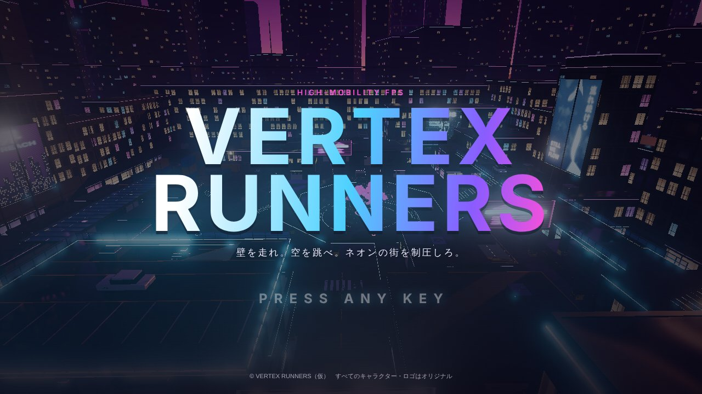
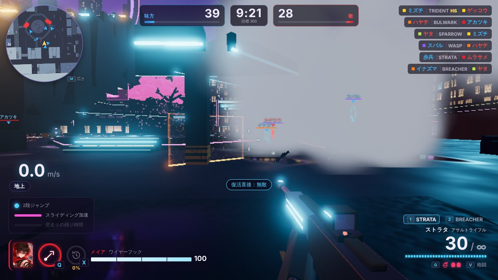
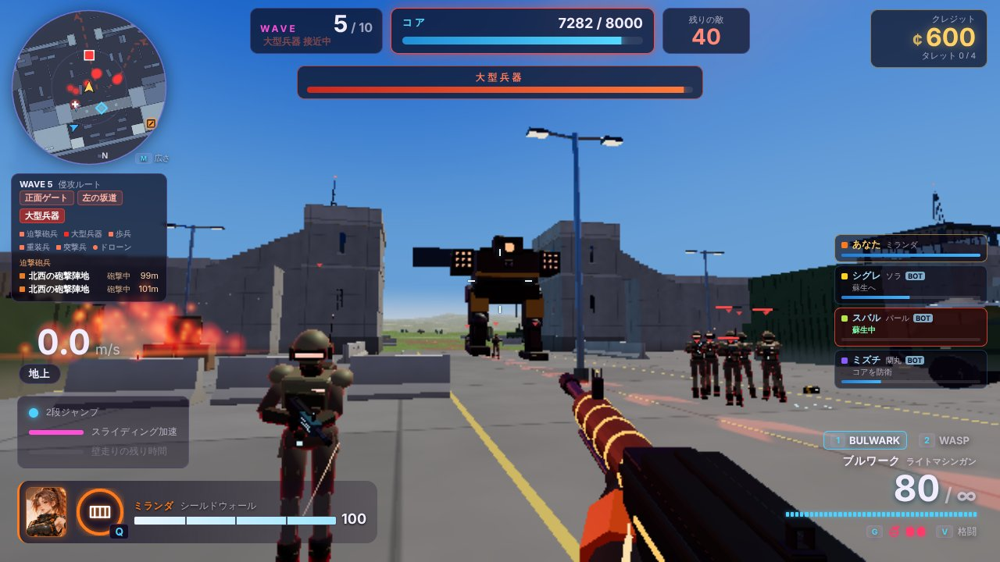

# VERTEX RUNNERS

壁走りと2段ジャンプで駆け回る、ブラウザで遊べる高機動 FPS（TypeScript・three.js）。

**▶ ブラウザで遊ぶ：https://tyaso0909.github.io/vertex-runners/**　（パソコンの Chrome または Edge。キーボードとマウスで遊ぶ）



| 消耗戦 | タワーディフェンス |
|---|---|
|  |  |

## 特徴

- **動き**：壁走り・壁ジャンプ・2段ジャンプ・スライディングが途切れずにつながる。勢いを保ったまま街を駆け抜ける
- **3つのモード**
  - **タイムアタック**：ネオン都市のコースで、的を壊しながらゴールを目指す。記録とゴースト付き
  - **消耗戦**：6対6のチーム戦（味方も敵もボット）。パイロットと歩兵を倒して、先に 300 点
  - **タワーディフェンス**：プレイヤー＋味方のボット3体で、軍事要塞のコアを 10 ウェーブの敵から守る協力戦。敵は降下ポッドで降りてくる。タレット・設置物を買って置き、迫撃砲兵や大型兵器と戦う
- **6人のキャラクター**：それぞれアビリティ（ワイヤーフック・クローク・シールド・ソナー・オーバードライブ・フェイズシフト）とパッシブを持つ
- **武器**：12 種類の武器と、サイト・アタッチメントのカスタマイズ。グレネード 6 種類。ロードアウトを 5 つまで保存
- **3D モデルは Blender の Python スクリプトで作った**（`assets-src/`）。6人のキャラクターの全身は、テクスチャ付きのモデル（Tripo で作成）にスクリプトで骨・重み・動きを付けたもの。ゲームの仕組み（`shared/`）は描画（`client/`）から分けてあり、ボットも人間と同じ入力で動く。自動テスト 251 項目

仕様は `game-spec.md`、作ったときの記録は `docs/` にある。

## 自分のパソコンで動かす

必要なもの：[Node.js](https://nodejs.org/) 20.19 以上（22 をおすすめ）、Chrome または Edge の最新版。

```bash
npm install      # 初回だけ
npm run dev      # 開発サーバーを起動 → 表示された http://localhost:5173 をブラウザで開く
```

ほかのコマンド：

| コマンド | 内容 |
|---|---|
| `npm test` | 移動・射撃・グレネード・格闘・アビリティ・マップ・タイムアタック・消耗戦・タワーディフェンス・ボット・ロードアウト・武器のカスタマイズ・購入メニューのアイテム・ブースト・グレネードの種類・追加の武器・降下ポッド・迫撃砲兵・キャラクターのモデルの自動テスト（251項目） |
| `npm run models` | Blender で武器・サイトとアタッチメント・小物・タレット・敵・キャラクター（全身は取り込んだモデルに骨と動きを付ける `build_imported.py`）・歩兵・遠く用の軽いモデル（LOD）・マップのモデルを作り直す（Python 3.11 と `pip install bpy` が必要） |
| `npm run map` | マップ（ネオン都市）の見た目だけを作り直す |
| `npm run map:fortress` | マップ（軍事要塞）の見た目だけを作り直す |
| `npm run typecheck` | 型チェック |
| `npm run build` | 配布用にビルド（`dist/`） |
| `npm run build:single` | ダブルクリックで開ける1ファイル版を作る（`dist-single/index.html`） |
| `npm run build:artifact` | claude.ai の公開ページ用に作る（`dist-artifact/`。3D モデルはページの横に置く文字のファイルになる。公開ページでは埋め込んだデータを読めないため） |

## 操作

| 入力 | 動作 |
|---|---|
| W A S D | 移動 |
| マウス | 視点 |
| Shift | ダッシュ（前進中） |
| Space | ジャンプ／空中で2段ジャンプ／壁走り中は壁ジャンプ |
| C / Ctrl | しゃがみ／ダッシュ中はスライディング |
| 左クリック | 射撃 |
| 右クリック | エイム（押している間） |
| R | リロード |
| 1 / 2 / ホイール | 武器の持ち替え |
| G | グレネード（押している間は構えて軌道を表示、離すと投げる。種類はロードアウトで選ぶ。サッチェルは、置いてあるときにもう一度押すと起爆） |
| V | 格闘（少し離れた的には踏み込む） |
| Q | アビリティ（キャラクターごとの能力） |
| X | ブースト（消耗戦。ゲージが満タンのとき） |
| Tab | スコアボード（消耗戦・タワーディフェンス。押している間） |
| E | 調べる・蘇生（長押し）・タレットや設置物を置く／自分のタレット・設置物を見て長押しで売る（タワーディフェンス） |
| B | 購入メニュー（タワーディフェンス。マウスで選んで買う。置く場所を選んでいる間は R・ホイールで向きを回す） |
| F | 準備完了（タワーディフェンスの準備時間中） |
| M | ミニマップの広さの切り替え（消耗戦・タワーディフェンス） |
| T | スタート地点に戻る（タイムアタックでは直前のチェックポイントへ） |
| H | 操作説明の表示切替 |
| Esc | 一時停止（再開・設定・メニューへ戻る。練習では装備の変更・調整パネルも） |

ウィンドウのまま遊ぶときは、しゃがみに **C キー** を使ってください（Ctrl+W でタブが閉じるのを防ぐため）。「全画面で出撃」なら Ctrl でも安全です。

### 画面の流れ
タイトル（PRESS ANY KEY）→ メインメニュー（**消耗戦**／**タイムアタック**／**タワーディフェンス**／**ロードアウト**／**練習**／**設定**）→ ロードアウトの選択（その場でキャラクター・武器も変えられる）（消耗戦ではボットの難易度、タワーディフェンスでは敵の難易度 易・普・難も）→ ゲーム → リザルト（もう一度／メインメニュー）。設定はマウス感度・視野角（FOV 70〜110）・音量・画質・キー操作の一覧。

### ロードアウト
メインメニューの **ロードアウト** で、試合に持っていく「キャラクター＋メイン武器＋サブ武器＋武器のカスタマイズ＋グレネード＋ブースト」の組み合わせを **5 つ**まで名前を付けて保存できる。押した枠が「使用中」になり、消耗戦・タワーディフェンス・タイムアタックはそのロードアウトで出撃する（試合の前の画面から「ロードアウトを編集」でも開ける）。画面はタイタンフォール 2 にならい、中身を板で並べ（キャラクター／武器［サイト］［アタッチメント ×2］／グレネード／ブースト）、板を押すと選ぶ画面になる。選ぶ物にカーソルを合わせると、3D の武器と性能の変化（増える所は緑、減る所は赤）が出る。

**武器のカスタマイズ**：武器ごとにサイト 1 つ（アイアン・レッドドット・ホロ・2倍・3倍・スレット・狙撃用スコープ・可変スコープ）と、アタッチメント 2 つまで（拡張マガジン・クイックリロード・サプレッサー・コンペンセイター・クイックストック・レーザーサイト・ガンランナー・ロングバレル）。付けた物は一人称の武器にもモデルで付き、光学サイトをのぞくと照準がレンズの中に出る。スレットスコープは見えている敵を赤く浮かび上がらせ、可変スコープはのぞいている間にホイールで倍率を変える。ボット（パイロット）もランダムにサイト・アタッチメントを付け、三人称の武器にも見える。武器は 12 丁（武器種ごとに 2 丁。アサルトライフル：ストラタ・トライデント［3点射］、サブマシンガン：ワスプ・ニードル、ライトマシンガン：ブルワーク・サイクロン［回転式］、ショットガン：ブリーチャー・テンペスト［全自動］、スナイパーライフル：ゼニス・ファルコン［半自動］、ハンドガン：スパロー・ガベル［リボルバー］）。どれにも固有の名前と一言の説明があり、ロードアウトのカードと HUD（持ち替えたとき）に出る。数値は `config/attachments.json`、形と確認は `shared/weaponCustom.ts`・`shared/loadout.ts`（オンラインではサーバーが同じ確認をする想定）。

**グレネードの種類**（タイタンフォール 2 のオードナンスを参考に 6 種から 1 つ）：フラグ（跳ねて 3 秒で爆発）／アーク（放電。受けた敵は 3 秒動きが鈍り、狙いが乱れる）／ファイアスター（刺さった所が 5 秒燃える。敵に刺されば敵ごと燃える）／グラビティスター（刺さると周りの敵を引き寄せて浮かせ、爆発）／スモーク（煙の幕を 12 秒。ボットも煙越しには見えない）／サッチェル（張り付き、もう一度 G で起爆）。HUD の G の横に種類のアイコンと数。数値は `config/grenades.json`、仕組みは `shared/grenades.ts`・`shared/simulation.ts`、見た目は `client/weapons/grenadeView.ts`。

### 消耗戦（フェーズ6）
プレイヤー＋味方のボット5体 vs 敵のボット6体（ネオン都市）。先に **300 点**、または **10 分**たって点の多いチームの勝ち。
- 得点：敵のパイロット **5**、敵の歩兵 **1**、アシスト（倒された敵パイロットに直前5秒以内にダメージを与えていた）**1**
- 倒されると **5 秒**後に、敵から離れた出現地点で復活。復活直後の **2 秒**は無敵
- 両チームの**歩兵**（各チーム最大12体）が、4人の分隊でマップの中央付近に湧き続ける。地上だけを歩き、近くの敵を撃つ（命中は低い）
- ボットはプレイヤーと同じ入力コマンドで動く。巡回 → 敵を見つける → 交戦（横へ動きながら撃つ・2段ジャンプ・壁走り・遮蔽物に隠れてリロード・グレネード）→ 体力が減ると退避。キャラクターごとのアビリティも使う
- ボットの狙いは、**速く動く相手・遠い相手ほどずれる**。立ち止まらず走り続けるほど撃たれにくい
- 画面：上に両チームのスコアと残り時間、左上にミニマップ（範囲の中の味方と、銃を撃った敵の位置を少しの間。M で広さを切り替え）、右上にキルログ、真ん中に得点の知らせ、**Tab** でスコアボード。味方（歩兵も）は**青い輪郭**、敵は赤の縁取り。名札も味方は青、敵は赤
- **ブースト**（タイタンフォール 2 のブーストを参考にした、いわゆるキルストリーク）：得点がゲージにたまり、満タンで **X** で使う。ロードアウトで 1 つ選ぶ。倒されてもゲージは減らず、倒されずに続けて倒すとたまり方が増える（最大 2 倍）。ボットも使う
  - **マップハック**（30 点）：15 秒間、敵の位置を 1.5 秒ごとにチームのミニマップへ映す
  - **ホロパイロット**（25 点）：自分そっくりの立体映像 5 体が前へ走り出す。敵のボットは本物と思って撃つ
  - **フェイズリワインド**（25 点）：5 秒前にいた場所へ、通った道をさかのぼって戻る。戻る間は弾が当たらない
  - **ハードカバー**（30 点）：目の前に大きな盾（幅 6m）を 20 秒立てる
  - **ティック**（35 点）：クモ型の地雷 2 つを投げる。敵へ這っていって爆発する（壁は回り込む）
  - **ダイスロール**（20 点）：ほかの 5 つのどれかが出る
  - 数値は `config/boosts.json`、仕組みは `shared/boosts.ts`
- 詳しくは `docs/PHASE6_REPORT.md`（ブーストは `docs/PHASE7_REPORT.md`）

### タワーディフェンス（フェーズ7）
プレイヤー＋味方のボット3体で、**軍事要塞**の中央の**コア**（体力 8000）を、10 ウェーブの敵から守る協力戦。第5・第10ウェーブには**大型兵器**（二本足の歩行兵器）が来る。
- 敵の兵士は**降下ポッド**で降りてくる。要塞の外の草原・岩場だけでなく、**防壁の上・格納庫の屋上・要塞の中**（コアから離れた中庭・資材置き場・荷役場）にも降りる。準備時間中は次のウェーブの降下予定地点（点線の輪と光の柱・左上の「降下ポッド」の欄）、降りてくる直前は地面の赤い輪・空へ伸びる光の柱・ミニマップ・画面の上の知らせ（防壁の上・要塞の中のとき）でわかる。着地の衝撃に巻き込まれると吹き飛ばされる
- **迫撃砲兵**（3 ウェーブ目から）：降りると少し高い所（外の前哨陣地の屋上・砲撃陣地、中のテラス・防壁の上など）へ上って迫撃砲を据え、そこからコアを砲撃し続ける。砲弾の落ちる所には赤い輪が出る。据えた迫撃砲兵は頭の上の「迫撃砲」の札（壁越し）・画面の上の欄・ミニマップでわかるので、壁走りと2段ジャンプで駆け上がって倒す。近づくと砲撃をやめて拳銃で撃ち返してくる
- 要塞のまわりは広い草原・岩場（264m × 208m）。前哨陣地（中に弾薬補給所）・コンテナ置き場・崩れた壁・見張り台がある
- 各ウェーブの前に **30 秒の準備時間**。左上の図と地面の赤い矢印の帯で、次のウェーブの**侵入ルート**（正面ゲート・左の坂道・右の搬入口）がわかる。全員が準備完了（**F**）なら飛ばす
- 敵を倒すと**クレジット**（倒した人に入る。タレットが倒したら置いた人）。ウェーブを守りきると全員にボーナス
- **B** で購入メニュー（ARMORY）が開き、マウスで選んで買う。分類は タレット／設置物／強化／装備。置く物のカードを押すと、見ている地面に影が出る（置けないときは赤く、理由を表示）→ 左クリックか **E** で置く（**R**・ホイールで向きを回す、右クリックでメニューへ戻る）。置くとメニューに戻る。自分のタレット・設置物を見て **E 長押し**で売る（半額が戻る）。準備時間中はすべて、ウェーブ中はアーマーだけ買える
  - タレット（1人 4 基まで。自分が置いたタレットは輪郭が青く光る）：機銃タレット 300（連射・ドローンにも当たる）／ロケットタレット 600（範囲ダメージ・地上だけ）／減速フィールド 400（範囲の敵の動きを半分に）／修理ステーション 500（近くのタレット・バリケードとコアを直す）
  - 設置物（それぞれ1人 2 つまで）：**ダミーバルーン** 150（パイロットの形にふくらむ囮。敵が撃ち、近くの突撃兵は囮で自爆する）／**ワイヤートラップ** 250（イオンのトリップワイヤーのように、置くと3つの機雷が左右に広がってレーザーでつながり、横切った地上の敵の所で続けて爆発する。1回きり）／**バリケード** 200（道をふさぐ装甲の壁。敵は足を止めて壊そうとし、突撃兵はぶつかって自爆する。味方の弾は通り、乗り越えられる）／**ジャンプパッド** 120（乗ると約 6m 跳ね上がる）
  - 強化：自分のタレットをレベル 3 まで（威力・体力・射程・範囲が上がり、装甲板や灯りが付く）
  - 装備：**アーマー** 200（買うとすぐ体力の上に装甲 +50。そのラウンドだけ）
- 敵：**歩兵**（近くのプレイヤー・タレットを撃つ）、**突撃兵**（足が速く、コアで自爆）、**重装兵**（正面の盾で弾を止める。盾の上の頭と背中が弱点。タレットを狙う）、**迫撃砲兵**（高い所に陣取ってコアを砲撃する）、**ドローン**（壁を飛び越えてコアを撃つ）、**大型兵器**（背中の炉心と正面のセンサーが弱点。ロケットでタレット → コアを狙う）
- 倒されると**ダウン**。10 秒以内に味方が近くで **E を 3 秒**押し続けると蘇生（体力 50%）。間に合わなければ、ダウンから 15 秒で要塞の中に復活
- 味方のボットは、将来のオンラインで**人間が足りない枠を埋める参加者**。指示は受けず、ずっと遊撃する：敵がいちばん押し込んでいる所・誰も守っていないルートへ行き、コアへ走る突撃兵を止め、砲撃している迫撃砲兵を倒しに行き、ダウンした味方を蘇生し、コアが攻撃されるとコアを守る。買い物も人間と同じ決まりで、準備時間に自分のクレジットで、次に敵が来るルートのタレットが足りない所に置き、余ったクレジットでワイヤートラップ・タレットの強化・ダミーバルーン・アーマーを買う。ミランダはコアの前でシールド、ソラはウェーブの始めにソナー。チームの表示では **BOT** の印が付く
- 画面：上にウェーブ・準備時間・コアの体力・残りの敵、大型兵器の体力、左上にミニマップ（侵入ルートの赤い線も）とその下に侵入ルート・敵の種類、右上にクレジット、右に味方4人（体力・ダウンの残り時間）。味方の名札（名前・キャラクター・体力）は壁越しにも見え、ダウンした味方は赤い印と残り時間。コアの位置は画面の中なら ◇、外ならミニマップの縁に出る
- 難易度（易・普・難）で敵の体力・攻撃・数が変わる。記録（守りきったウェーブ・最速クリア）は難易度ごとに保存
- 詳しくは `docs/PHASE7_REPORT.md`

### 移動のコツ
- **壁走り**：ダッシュ中にジャンプして、壁に沿うように飛び込む。正面からぶつかると壁走りにならない（よじ登りになる）。
- **壁ジャンプ**：壁走り中に Space。壁と反対側の斜め前へ跳び、2段ジャンプも回復する。
- **スライディング**：ダッシュ中に C。着地の瞬間に C を押しっぱなしにしておくと、そのままスライディングに入る。下り坂では加速し続ける。
- **勢いを保つ**：着地した直後（0.12秒以内）にジャンプすると減速しない。スライディング中のジャンプも勢いを保つ。
- **よじ登り**：縁に向かって W を押しながらジャンプ。足元から 1.5m までの縁に登れる。

### 射撃場
スタート地点のすぐ後ろ（南）にある。4〜80m の的、横に動く的、弾薬補給所がある。予備弾は無限（リロードは必要）。グレネードは2つまで持て、6秒で1つ回復する。装備（メイン・サブ）は Esc の一時停止画面で変えられる。

### タイムアタック（フェーズ5）
メインメニューで **タイムアタック** を選ぶ。ネオン都市の西の駅の屋上から東のホテルの屋上まで、20体のターゲットを壊しながら走るコース「ネオン・ラン」。
- カウントダウンのあとに計測が始まる。チェックポイント 7 か所＋ゴール。次のチェックポイントは光る矢印と光の柱で示す
- 壊し損ねたターゲット1体ごとに +5 秒。コースから落ちると直前のチェックポイントへ戻る（タイマーは止まらない）
- **R 長押し**でスタートからやり直し、**T** で直前のチェックポイントへ
- ベスト記録とゴーストはキャラクターごとにブラウザに保存。リザルトに区間タイムとベストとの差
- 詳しくは `docs/PHASE5_REPORT.md`

### 練習のステージ・画質
メインメニューの **練習** で、敵のいないステージを選んで自由に走る（Esc の一時停止画面で、キャラクター・装備・数値の調整ができる）。画質は「設定」の「自動・高・中・低」（自動は、重いと試合の途中では解像度だけを下げ、それでも重ければ次の試合から画質を1つ下げる）。使うシェーダーは試合の読み込みのときにまとめて作り、試合中に作らない（作る瞬間に画面が止まるため）。遠くのキャラクター・武器は面を減らしたモデルで描き、遠い・画面の外のキャラクターは動きの計算を間引く。

- **ネオン都市**：夕暮れのビル街（東西・南北で形が違う）。地面（道路）があり、落ちて死ぬ場所はない。足場は 0・5・10・15m の4段で、階段・坂・橋・壁走りで上り下りする。西のチームは駅、東のチームはホテルから出る。中に入れる建物が13棟（駅・ホテル・ゲームセンター・パチンコ店・オフィス・カフェ（2階建て）、立体駐車場（4層）、ラーメン屋・銭湯・コンビニ・商店街の店）。中央に円形広場と桜、北に高架道路。壁走りで渡る場所が4か所（西・東の大通りの看板、北の通りの看板、コンテナ置き場）。
- **テスト部屋**：移動の練習用の箱の部屋、射撃場、アビリティ訓練場。

### キャラクター
試合の前の画面で6人から選ぶ（練習では Esc の一時停止画面でも変えられる）。Q でアビリティ、パッシブは常に効いている。

| キャラクター | アビリティ（Q） | パッシブ |
|---|---|---|
| メイア | ワイヤーフック（壁・足場へ引き寄せられる。的に当てると引き寄せる） | 壁走りの時間 +30% |
| パール | 光学迷彩（5秒間ほぼ透明） | 足音が小さい |
| ミランダ | シールドウォール（敵の弾を止める壁を8秒） | 体力の回復が早い |
| ソラ | パルスソナー（周囲40mの敵を壁越しに表示） | 倒した敵が弾薬を落とす |
| アレックス | オーバードライブ（6秒間、移動速度+30%・回復2倍） | 移動速度 +10% |
| 蘭丸 | フェイズシフト（準備0.5秒のあと3秒間無敵） | 狙われると画面の縁が紫に光る |

**アビリティ訓練場**はスタート地点の西の端。ダメージ床、ソナーで探す壁の向こうの的、ワイヤーで登る高い塔と浮いた足場、撃ってくるタレットがある。

## フォルダ構成

```
client/        描画・入力・UI（three.js を使うのはここだけ）
  game.ts        ゲーム本体。ロジックを 60回/秒 で進め、画面は毎フレーム描く
  input.ts       キーボード・マウス → 入力コマンド
  fpsCamera.ts   一人称カメラ（補間・壁走りの傾き・着地の沈み込み・視野角）
  hud.ts         HUD（移動）
  weaponHud.ts   HUD（照準・弾数・ヒットマーカー・ダメージの数字・スコープ）
  audio.ts       効果音（Web Audio で合成）
  assets.ts      3D モデルの読み込み
  vitalsHud.ts   HUD（体力・アビリティ・被弾方向・画面の縁の光）
  assets/        Blender で書き出したモデル（.glb）とキャラクターの顔の絵（portraits/）
  characters/    三人称のキャラクター表示（アニメーション・武器を持たせる）
  abilities/     アビリティの見た目（ワイヤー・シールド・ソナー・弾薬パック）
  ui/            キャラクター選択・ロードアウト画面（武器の 3D 表示・性能の棒）・ミニマップ
  loadouts.ts    ロードアウト 5 枠の保存（ブラウザ）
  timeAttack/    タイムアタックの進行・コースの見た目・ゴースト・画面表示・記録の保存
  attrition/     消耗戦の進行（ほかの参加者の表示・射撃の演出・3D の音・スコア・キルログ・スコアボード・リザルト）
  td/            タワーディフェンスの進行（タレット・コア・ドローン・大型兵器・ロケット・設置物の表示、降下ポッド・降下予定地点の表示（dropViews.ts）、迫撃砲兵の迫撃砲・砲弾の表示（mortarViews.ts）、購入メニュー（buyMenu.ts）と設置、蘇生、画面表示、リザルト）
  characters/actorModel.ts  試合用の軽いキャラクター表示（部品を1つにまとめ、消える演出・迷彩・チームの縁取りを入れる）
  main.ts        画面の流れ（タイトル・メニュー・試合の前・設定・一時停止・リザルト）
  quality.ts     画質（自動・高・中・低）
  weapons/       一人称の武器表示（サイト・アタッチメントの取り付け・照準）、射撃の演出、グレネードの見た目と爆発
  tuning.ts      調整パネル
  scene/         ステージの見た目（空・遠景のビル・マップの質感と看板・的とタレット・経路の表示・画面全体の効果）
shared/        ゲームロジック（描画に依存しない。将来サーバーでも動かす）
  simulation.ts  固定刻みでゲームを進める
  movement.ts    移動アクション
  weapons.ts     射撃（連射・ばらつき・リロード・持ち替え・ダメージ）
  grenades.ts    グレネード（飛び方・跳ね返り・爆風・軌道の予測）
  abilities.ts   キャラクターのアビリティとパッシブ
  targets.ts     射撃の的・訓練用タレット（当たり判定）
  collision.ts   当たり判定（カプセル vs 回転できる箱）
  input.ts       入力コマンドの形
  level.ts       ステージデータの形と組み立て道具
  levels/        ステージ（ネオン都市・軍事要塞・テスト部屋）
  courses/       タイムアタックのコース（チェックポイント・ターゲット・コース用の足場）
  timeAttack.ts  タイムアタックの進行（カウントダウン・チェックポイント・落下・ペナルティ・ゴースト）
  nav.ts         ボット用の経路（地形から自動で作る。経路探し）
  hitbox.ts      参加者の当たり判定（体のカプセルと頭の球）
  loadout.ts     ロードアウトの形と確認（正しい組み合わせか）
  weaponCustom.ts 武器のカスタマイズ（サイト・アタッチメントを武器の数値に当てはめる・確認）
  attrition.ts   消耗戦の進行（チーム・得点・復活・出現地点・歩兵の分隊・勝敗）
  boosts.ts      消耗戦のブースト（ゲージ・マップハック・ホロパイロット・フェイズリワインド・ハードカバー・ティック・ダイスロール）
  td/            タワーディフェンスの進行（ウェーブ・降下ポッド・迫撃砲兵の砲撃・敵の頭・ドローンと大型兵器の動き・ロケット・タレットと強化・設置物（devices.ts）・アーマー・クレジット・味方ボット）
  bots/          ボット（見る・狙う・撃つ／経路に沿った移動・跳ぶ・壁走り／パイロットと歩兵の判断）
config/        調整用パラメータ（JSON）。各項目の意味は config/README.md
assets-src/    3D モデルの元データ（Blender のスクリプト。maps/ はマップ、characters/models/ はキャラクターの全身の元のモデルと骨の位置）。portraits/ はキャラクターのイラストと、顔の絵を切り抜くスクリプト
scripts/       マップの配置を Blender 用に書き出すスクリプト
tests/         自動テスト
docs/          フェーズごとの実装報告
```

### オンライン化に向けた設計
- プレイヤーもボットも、同じ `InputCommand`（移動・視点・ジャンプ・しゃがみ・ダッシュ・射撃・アビリティ）でしか動かない。ボットの頭（`shared/bots/`）は、見えたもの（ゲームの状態）から入力コマンドを作るだけ。
- ゲームの状態更新は `shared/` にまとめ、描画（`client/`）とは分離している。
- ロジックは固定 60Hz で進む。画面はその間を補間して描くので、モニターのリフレッシュレートに左右されない。
- タワーディフェンスのプレイヤーの操作（タレット・設置物を置く・売る・強化・アーマー・準備完了）は `TdMatch` のメソッド（`tryPlace`・`trySell`・`tryUpgrade`・`buyArmor`・`setReady`）を呼ぶだけで、将来はサーバーへの要求に置き換えられる。味方ボットは人間が足りない枠の穴埋めで、同じメソッドで置き、クレジット・タレットの上限・蘇生・準備完了の決まりは人間と同じ（指示は受けない）。参加人数ごとの敵の量の倍率は `config/td.json` の `PLAYER_SCALE`。

## 数値の調整

`config/movement.json`（移動）、`config/weapons.json`（武器）、`config/characters.json`（キャラクター）、`config/camera.json`（視点・操作）、`config/timeattack.json`（タイムアタック）、`config/attrition.json`（消耗戦）、`config/boosts.json`（消耗戦のブースト）、`config/grenades.json`（グレネードの種類）、`config/bots.json`（ボットの難易度・歩兵）の数値を書き換えて保存するだけで変わります。開発サーバー中は自動で読み直されます。

ゲーム中に Esc で一時停止すると、右側の調整パネルでその場で数値を変えられます。良い値が見つかったら「movement.json をコピー」を押し、`config/movement.json` に貼り付けて保存してください。

## GitHub Pages への公開

`main` ブランチに push すると、GitHub Actions（`.github/workflows/deploy.yml`）が型チェック・自動テスト・ビルドをして、GitHub Pages に公開する。
最初の 1 回だけ、リポジトリの **Settings → Pages → Build and deployment → Source** を **GitHub Actions** にしておく。
プルリクエストでは、型チェックと自動テストだけをする（`.github/workflows/test.yml`）。

## ライセンス

MIT ライセンス（`LICENSE` を参照）。

