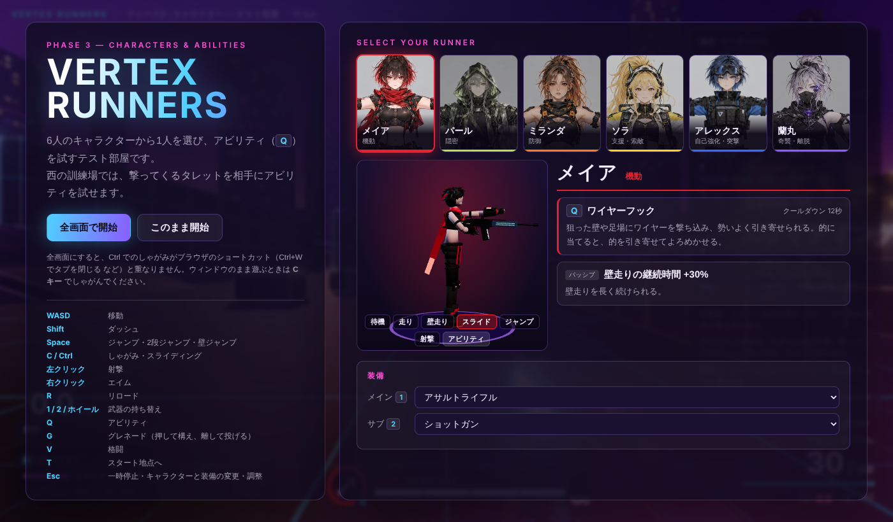
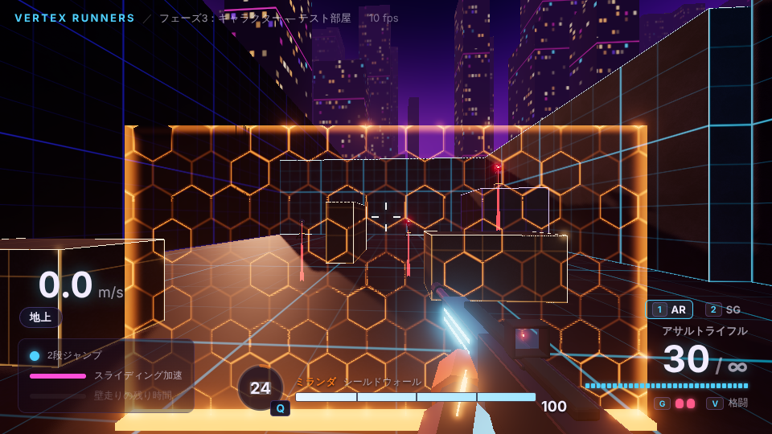
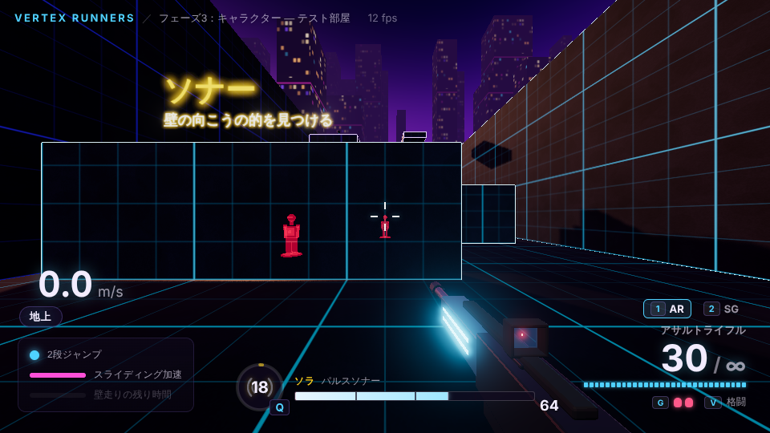
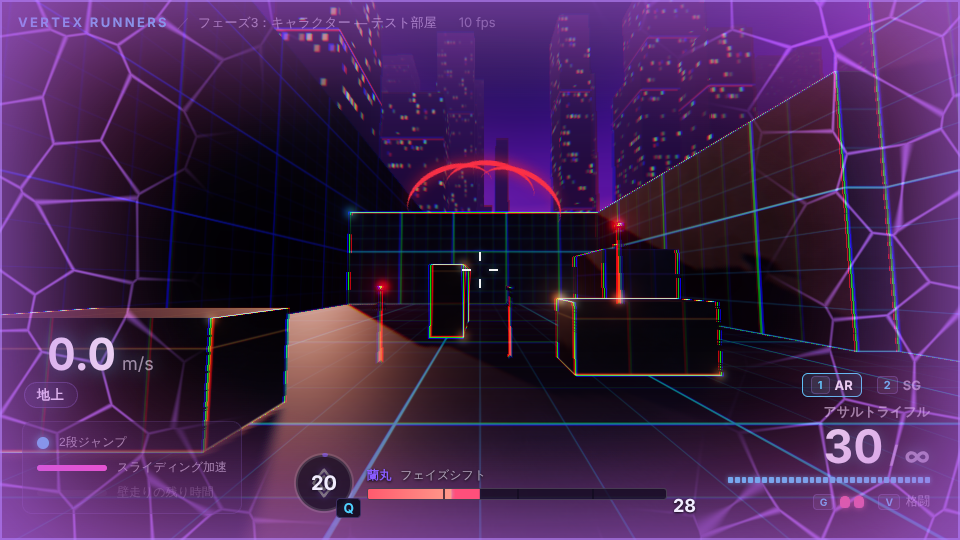
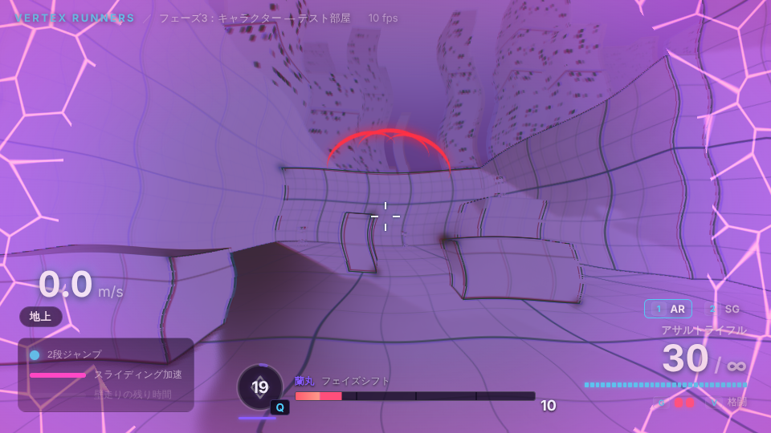
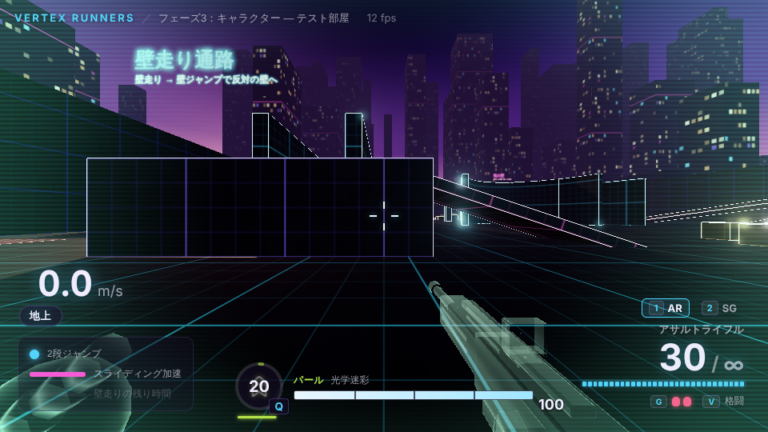
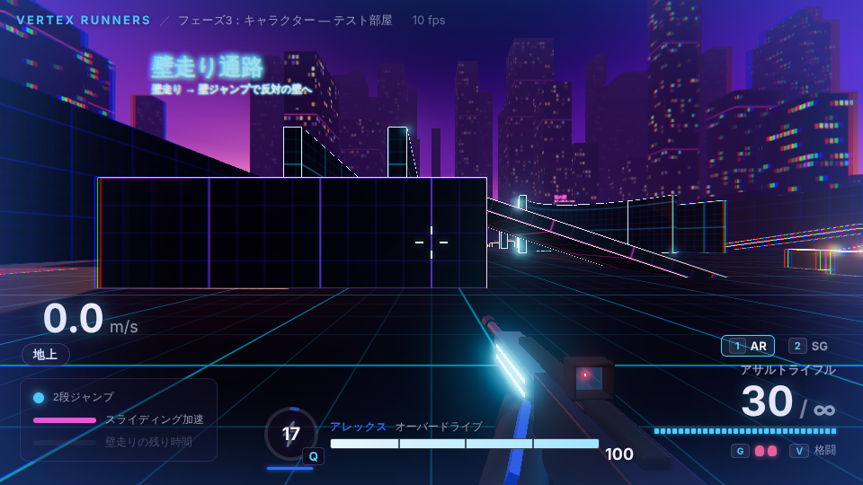
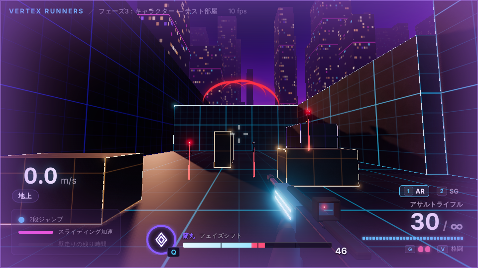
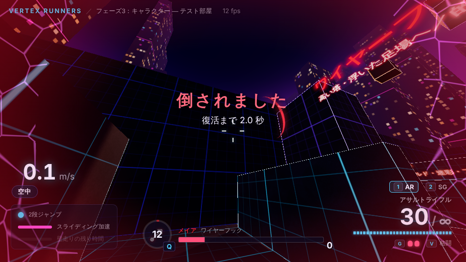
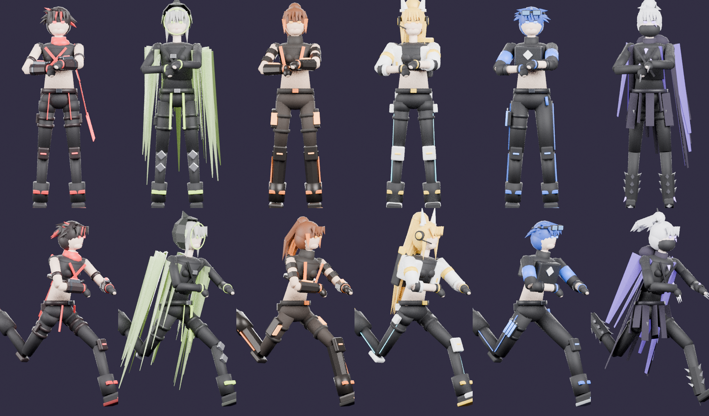

# フェーズ3 実装報告：キャラクター

## 実装したもの

| 仕様の項目 | 状態 | 主なファイル |
|---|---|---|
| 6キャラクターのアビリティ（Q）とパッシブ | 済 | `shared/abilities.ts`, `shared/simulation.ts`, `shared/movement.ts` |
| キャラクター定義データ | 済 | `config/characters.json`（各項目の意味は `config/README.md`） |
| キャラクター選択画面（開始画面・一時停止画面） | 済 | `client/ui/characterSelect.ts` |
| 6キャラクターの 3D モデル（Blender） | 済 | `assets-src/characters/build_characters.py` → `client/assets/characters/<id>.glb` |
| アニメーション（待機・走り・壁走り・スライディング・ジャンプ・射撃・アビリティ） | 済 | 同上（モデルに入っている）、`client/characters/characterView.ts` |
| 一人称用の腕モデル（キャラクターごと） | 済 | 同上 `fp_<id>.glb`、`client/weapons/viewmodel.ts` |
| 能力の確認用に「動く的」と「撃ってくるタレット」 | 済 | `shared/levels/testRoom.ts`（アビリティ訓練場） |
| HUD：体力・キャラクターの顔・アビリティのクールダウン・被弾方向の赤い弧（仕様 7.3） | 済 | `client/vitalsHud.ts` |

## 6人の能力

| キャラクター | アビリティ（Q） | クールダウン | パッシブ |
|---|---|---|---|
| メイア（赤） | **ワイヤーフック**：狙った壁・足場（38m 以内）にワイヤーを撃ち込み、引き寄せられる。ジャンプで途中で離せる。的に当てると、的を自分の方へ 4m 引き寄せて 1.2 秒よろめかせる。外れたら 1 秒で再使用できる | 12秒 | 壁走りできる時間 +30% |
| パール（黄緑） | **光学迷彩**：5 秒間ほぼ透明。撃つ・殴る・投げると解ける。タレットは 7m より近くないと狙えず、狙っても大きく外す | 20秒 | 足音が 35% の大きさ |
| ミランダ（オレンジ） | **シールドウォール**：目の前に幅 4.2m・高さ 2.4m の壁を 8 秒出す。敵の弾だけを止め、自分の弾は通る。当たると波紋が広がる | 25秒 | 回復が 3 秒後に始まり、2 倍の速さ |
| ソラ（黄） | **パルスソナー**：周囲 40m の敵を 3 秒間、壁越しに赤く表示する。波が広がる速さ（60m/秒）に合わせて、遠い敵ほど少し遅れて見つかる | 18秒 | 倒した敵が弾薬パックを落とす（拾うと両方の武器の弾倉が満タン） |
| アレックス（青） | **オーバードライブ**：注射（0.4 秒）のあと 6 秒間、移動速度 +30%・回復 2 倍。効果中は被弾直後でも回復し続ける | 18秒 | 移動速度 +10% |
| 蘭丸（紫） | **フェイズシフト**：0.5 秒の準備のあと 3 秒間、一切のダメージを受けず移動速度 +30%。準備中から終わるまで撃つ・投げる・殴る・エイムはできない | 20秒 | タレットなどに狙われると画面の縁が紫に光り、警告音が鳴る |

体力は全員 100。ダメージを受けて 5 秒たつと 1 秒に 12 ずつ回復する。倒されると 2 秒後にスタート地点で復活する。

## アビリティ訓練場（テスト部屋の西の端）

スタート地点から西へ進み、壁走り通路の南を抜けた先。入口から北へ順に並んでいる。

1. **ダメージ床**（1 秒に 15 ダメージ）：ミランダの回復・アレックスのオーバードライブ・蘭丸の無敵を確かめる
2. **ソナー**：3 枚の壁の向こうに的（1つは動く）。ソラで壁越しに見つけ、倒すと弾薬パックが落ちる
3. **ワイヤーフック**：高さ 12m の塔（上に的）と、宙に浮いた高さ 13m の足場。どちらも普通には登れない
4. **タレット**：低い仕切り壁の北に 3 台（1台は台の上）。狙いを定める 0.8 秒の間は赤いレーザーが出て、そのあと撃ってくる。遮蔽物の箱もある。撃って壊せる（体力 150、6 秒で直る）

タレットの弾はほかの場所へ飛ばないよう、訓練場は壁で仕切ってある。

## 演出

| 能力 | 見た目と音 |
|---|---|
| ワイヤーフック | 左手を前へ突き出し、手元から刺さった点まで赤いワイヤーが伸びる。離すと巻き戻る。撃ち出す音・刺さる音 |
| 光学迷彩 | 一人称の腕と武器が、縁だけ光る半透明に変わる。画面の縁が青緑にゆらぐ |
| シールドウォール | 六角形の模様が明滅するオレンジの壁が下から組み上がる。弾が当たると波紋が広がり、消える前に点滅する |
| パルスソナー | 左手でヘッドセットに触れる。光の球と地面を走る輪が広がり、見つけた的が壁越しに赤く光る |
| オーバードライブ | 注射器を太ももに刺す動き。画面の縁が青く脈打ち、縁の色がずれる。心臓の鼓動の音 |
| フェイズシフト | 準備中は画面の縁から紫のひび割れが広がり、入ると色が反転した紫の世界になって像が揺らぐ。武器を下げて手をかざす |

ほかに追加したもの：足音（パールは小さい）、着地の音、被弾の音と画面の揺れ、被弾方向の赤い弧、体力が少ないと画面の縁が赤く脈打つ、倒されたときの表示と復活までの残り時間、アビリティが使えるようになった合図（アイコンが光り、音が鳴る）、使えないときに押した音。

| | |
|---|---|
|  |  |
| シールドウォールがタレットの弾を止めている | ソナーで壁の向こうの的が赤く見える |
|  |  |
| フェイズシフトの準備（紫のひび割れ） | フェイズシフト中 |
|  |  |
| 光学迷彩（腕と武器が半透明） | オーバードライブ（画面の縁が青く脈打つ） |
|  |  |
| 蘭丸のパッシブ（タレットのレーザーと紫の縁） | 倒されたとき |

## 3Dモデル（Blender）

- `assets-src/characters/build_characters.py` が、参考画像（`images/characters/`）と仕様 7.2.2 の外見の説明をもとに、6人の体・服・髪・装備を基本図形の組み合わせ（ローポリ）で作る。テーマカラーの発光部分（目・ライン・結晶）にはブルームがかかる。
  - メイア：黒髪に赤いメッシュ、赤いスカーフ（背中へ流れる）、両腕の機械式ガントレット、赤いハーネス
  - パール：結晶片のフード付きマント（半透明の尖った破片）、銀髪、黄緑のライン、すねの菱形の装甲
  - ミランダ：茶色から毛先がオレンジのポニーテール、腕と脚の重厚な装甲、腰と太ももの多数のポーチ
  - ソラ：腰まで届く金色のポニーテール、アンテナの耳が付いたヘッドセット、白と黄色のジャケット、背中の索敵ユニット（光るレンズ）
  - アレックス：青い髪、額のゴーグル、プレートキャリア、右太ももの青い注射器3本
  - 蘭丸：銀髪のポニーテール、黒いフェイスマスク、紫に光る結晶、裂けたマント、とげのあるブーツ、爪の付いたグローブ
- **骨格は6人共通**（腰・背骨・胸・首・頭・肩・上腕・前腕・手・太もも・すね・足）。部品を骨に固定する方式（スキニングなし）で、どの動きでも服や装備が崩れない。
- **アニメーション**は同じスクリプトで作る。腕は IK（手の位置から腕の角度を求める仕組み）で、右手がグリップ・左手が銃身の下に来る構えにしてある。射撃の反動、アビリティの「左手を突き出す」動き、スライディングで一番低い所が地面すれすれになるよう腰を下げる、なども計算で決めている。
- 三人称のモデルは、選択画面で回して（ドラッグ）見られ、7種類の動きを切り替えられる。武器は両手の位置から毎フレーム置き直すので、どの動きでも手から離れない。ゲーム中に三人称のモデルが出るのはフェーズ4以降（ボット）。
- **一人称の腕**（`fp_<id>.glb`）はキャラクターごとに袖・手袋・飾り（メイアのガントレット、ミランダの装甲、蘭丸の爪など）が違う。武器モデルに追加した握る位置（`GripR`・`GripL`）に付けている。ショットガンは左手が先台と一緒に動く。グレネードやアビリティを使うときは左手が銃から離れる。
- 小物：訓練用タレット（土台＋回る頭＋2本の銃身）、弾薬パック、アレックスの注射器（`assets-src/props/build_props.py`）。
- 選択画面とHUDの顔写真は、参考画像の正面から切り出した（`client/assets/portraits/`）。
- 作り直し：`npm run models`（Python 3.11 と `pip install bpy`）。`python assets-src/characters/build_characters.py meia --preview` で確認用の画像（正面・横・背面・走り・スライディング）が `assets-src/characters/preview/` にできる。

## 受け入れ条件の確認

> 6つの能力が機能する（テスト部屋に動く的を置いて確認）

自動テストを 24 項目追加し、合計 **84 項目すべて合格**（`npm test`）。
- 共通：クールダウン中は使えずクールダウン後に使える、体力は5秒後から回復し0で倒れて復活する、ダメージ床でダメージを受ける
- メイア：壁へ引き寄せられ近づくと離れる（2段ジャンプも回復）、ジャンプで途中で離せて勢いが残る、的を引き寄せてよろめかせる、壁走りの時間が30%長い
- パール：5秒間透明になり撃つと解ける、透明の間はタレットが近づかないと気づかない、足音が小さい
- ミランダ：シールドがタレットの弾を防ぎ8秒で消える、自分の弾は通り抜ける、回復が3秒で始まり2倍の速さ
- ソラ：40m 以内の的を壁越しに表示（波が届いてから3秒）、倒した的が弾薬を落とし拾うと弾倉が満タン
- アレックス：注射のあと6秒間速くなる、注射の間は撃てない、効果中は被弾直後でも2倍の速さで回復する
- 蘭丸：準備のあと3秒間ダメージを受けず速く動ける、その間は撃てずタレットにも狙われない、狙われると分かる
- タレット：見えている相手を狙い、狙いを定める時間のあとに撃つ、壁に隠れていると撃たれない、撃って壊せる

ブラウザでも、6人それぞれで訓練場のタレット・的を相手にアビリティを使い、上の画面のとおり動くことを確認した。
ただしこれまでと同じく作業環境に GPU がないため（10fps 前後）、**60fps での手触り（ワイヤーの引き寄せの速さ、オーバードライブの速さなど）は未確認**。Esc の調整パネルに「キャラクター」を追加したので、実機で調整してほしい。

## 仕様に書かれていなかったため補った点

1. **プレイヤーの体力・回復・死亡・復活を先に入れた**（仕様ではフェーズ6）。アビリティ（シールド・回復・無敵）を確かめるには、ダメージを受ける仕組みが必要なため。テスト部屋で倒されると、2 秒後にスタート地点で復活する。
2. **訓練用タレット**：仕様の「動く的」に加え、撃ってくる相手がいないとシールド・迷彩・フェイズシフト・蘭丸のパッシブが確かめられないため、撃ってくるタレットを作った。フェーズ7の TD のタレット（味方が置くもの）とは別物。
3. **ダメージ床**：回復系の能力を確かめるために置いた。
4. **ワイヤーフックの細かい動き**：刺さった点へ加速しながら引き寄せられ、1.6m まで近づくか 1.6 秒たつと離す。着地・壁にぶつかる・ジャンプでも離す。離した時の勢いは残る（そのまま壁走りや2段ジャンプにつなげられる）。
5. **自分のグレネードの爆風**：プレイヤーに体力ができたので、自分にも 60% のダメージで当たるようにした（`SELF_GRENADE_DAMAGE_MUL`）。
6. **蘭丸のパッシブ**は、今は「タレットに狙われている」ときに出る。フェーズ6でボットの照準にも使う。
7. **ボットがアビリティを使う場面**は `characters.json` の `BOT` に書いておいた（使うのはフェーズ6）。
8. **HUD の配置**：仕様 7.3 どおり、体力・キャラクターの顔・アビリティを左下にまとめた。フェーズ1から出している移動の確認用の表示（速さ・2段ジャンプなど）はその上へ移した。
9. **前回選んだキャラクターを覚える**（ブラウザに保存。次に開いたときも同じキャラクター）。

## 次のフェーズへの申し送り
- 三人称のモデルとアニメーション（`CharacterView`）はできているので、フェーズ4以降でボット・他のプレイヤーに使える。
- 迷彩・フェイズシフトの「他人から見た見た目」（半透明・ゆらぎ）は、他のプレイヤーやボットが出るフェーズ6で作る。
- ソラのパッシブ「タレットの修理 +50%」と、蘭丸の「蘇生ができない」は、TD（フェーズ7）で使う。
