# フェーズ4 実装報告：ネオン都市マップ

## 実装したもの

| 仕様の項目 | 状態 | 主なファイル |
|---|---|---|
| 6.1 のマップ制作（配置・当たり判定） | 済 | `shared/levels/neonCity.ts` |
| 建物・小物を Blender で作成 | 済 | `assets-src/maps/build_map.py` → `client/assets/maps/neon_city.glb` |
| ライティング・ブルーム・濡れた床・ネオン・看板 | 済 | `client/scene/mapView.ts` |
| ボット用経路データ（地点と接続、壁走りで渡れる区間を含む） | 済 | `shared/nav.ts`（自動で作る）＋ `neonCity.ts` の `navLinks`（壁走りの区間） |
| マップの選択（ネオン都市／テスト部屋） | 済 | `client/main.ts`、`client/game.ts`（`setLevel`） |

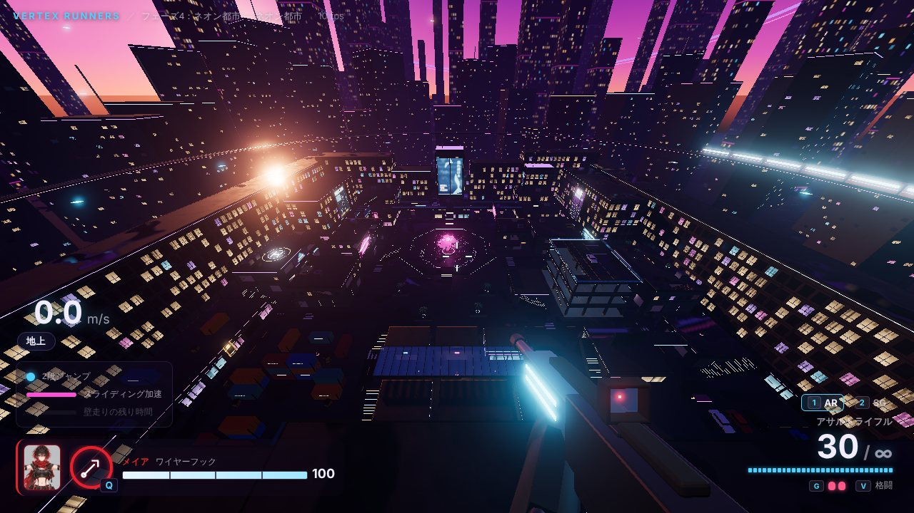

## マップの構成（作り直し 2回目：東西・南北で形の違う街）

ご依頼に合わせて2回作り直した。
1. 1回目：屋上だけの浮いたマップ → **地面のあるビル街**（落ちて死ぬ場所をなくし、中に入れる建物を作った）。
2. 2回目：左右対称だった配置を、**東西・南北で形の違う街**に作り直した。あわせて**全体を軽くした**（下の「動作を軽くした」）。

- 見た目（夕暮れの紫の空・ネオン・濡れた道路・桜・大画面）はそのまま。
- 地面（道路と歩道）がマップ全体にあり、**落ちて死ぬ場所はない**。
- 建物の高さを **0・5・10・15m の4段**にそろえ、階段・坂・橋・壁走りで上り下りする。
- 西がチーム0（**駅**から出る）、東がチーム1（**ホテル**から出る）。出現の建物も、まわりの街並みも東西で違う。

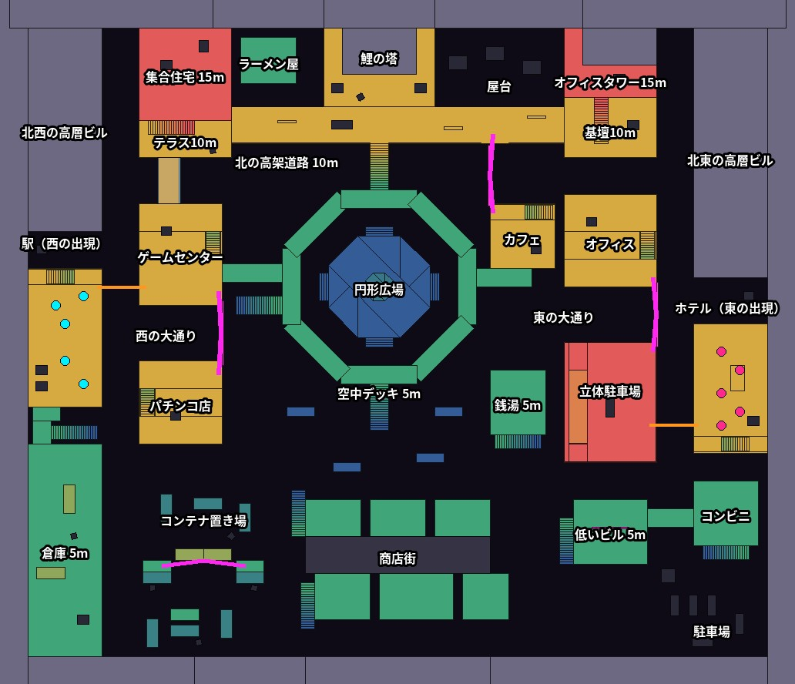

色は足場の高さ（青 0m・緑 5m・黄 10m・赤 15m・灰色は上がれない高い建物）。白は中に入れる建物の壁、桃の線が**壁走りで渡る道**、橙の線が**2段ジャンプで跳び移る道**、水色・桃色の丸が出現地点。

| 場所 | 西側 | 中央 | 東側 |
|---|---|---|---|
| 北 | 北西の高層ビル、集合住宅（15m）とテラス（10m）、ラーメン屋 | **北の高架道路（10m）**、鯉の塔、屋台 | オフィスタワー（15m）と基壇（10m）、北東の高層ビル |
| 真ん中 | **駅（出現）**、ゲームセンター、西の大通り、パチンコ店 | **円形広場と桜**、まわりの空中デッキ（5m） | カフェ、オフィス、東の大通り、**ホテル（出現）**、立体駐車場、銭湯 |
| 南 | 倉庫（5m）、**コンテナ置き場** | 南の広場、**商店街**（ガラスの屋根） | 低いビル（5m）、コンビニ、地上の駐車場 |

### 中に入れる建物（13棟）

| 建物 | 中のようす | 上り方 |
|---|---|---|
| 駅（西の出現・2階建て） | 出現地点・弾薬補給所・出発の大画面・カウンター | 中の階段で2階・屋上（ヘリポート）。2階のバルコニーから倉庫の屋上へ |
| ホテル（東の出現・2階建て） | 出現地点・弾薬補給所・ロビーのカウンター・大画面 | 中の階段で2階・屋上（植木の屋上庭園） |
| ゲームセンター（2階建て） | ゲーム機の列・カウンター・鯉の画面 | 中の階段で2階・屋上。2階から空中デッキへ橋、屋上から集合住宅のテラスへスカイブリッジ |
| パチンコ店（2階建て） | パチンコ台の列 | 中の階段で2階・屋上 |
| オフィス（2階建て） | 机・棚 | 中の階段で2階・屋上 |
| カフェ（2階建て） | カウンター・テーブル | 中の階段で2階・屋上。2階から空中デッキへ橋 |
| 立体駐車場（4層） | 車・駐車枠・柱 | 車路（坂）で 0→5→10→15m |
| ラーメン屋・銭湯・コンビニ・商店街の店（4軒） | カウンター・棚・ゲーム機など | 銭湯・コンビニ・商店街は外の階段で屋上へ |

### 壁走りを活かす場所

道路の幅は 8〜12m で、両側の建物の壁はどこでも壁走りできる。そのうえで、**壁走りしないと渡りにくい場所**を4か所作った（場所ごとに形が違う）。どれも、実際の移動の計算で渡れることを自動テストで確かめている（両向き）。

1. **西の大通りの看板**：ゲームセンターの屋上（10m）⇄ パチンコ店の屋上（10m）。12m の大通りの上を、ホログラム看板の面で壁走りする。
2. **東の大通りの看板**：オフィスの屋上（10m）⇄ 立体駐車場の3階（10m）。
3. **北の通りの看板**：カフェの屋上（10m）⇄ 北の高架道路（10m）。13m。
4. **コンテナ置き場**：2段に積んだコンテナの山（5.2m）から、3段に積んだコンテナの壁の横を壁走りして、14m 先の山へ。
5. このほか**2段ジャンプの跳び移り**が2か所：駅の屋上 → ゲームセンターの屋上、ホテルの屋上 → 駐車場の3階（どちらも 8m）。

西のチームは「駅の屋上 → ゲームセンター → 看板 → パチンコ店」、東のチームは「ホテルの屋上 → 駐車場の3階 → 看板 → オフィス → カフェ → 看板 → 高架道路」と、それぞれ違う屋上の道がある。中央では高架道路が東西の高い所をつなぎ、空中デッキから階段で上がれる。

| | |
|---|---|
| 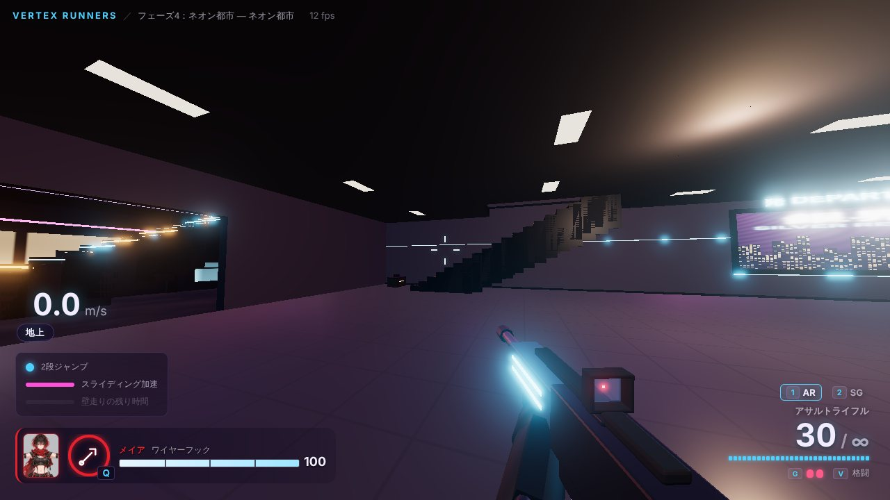 | 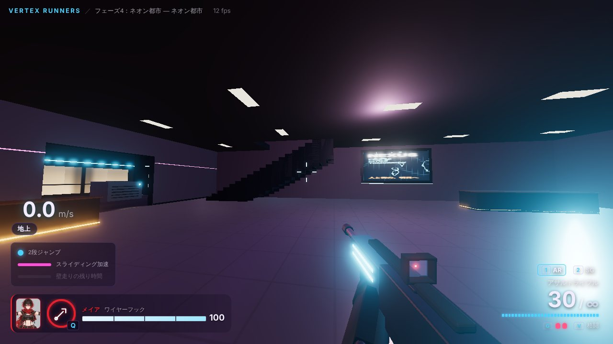 |
| 駅（西の出現）の1階 | ホテル（東の出現）のロビー |
| 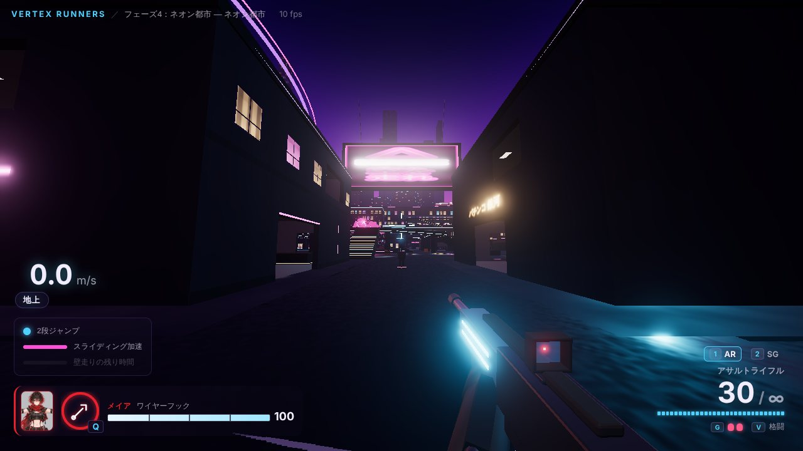 | 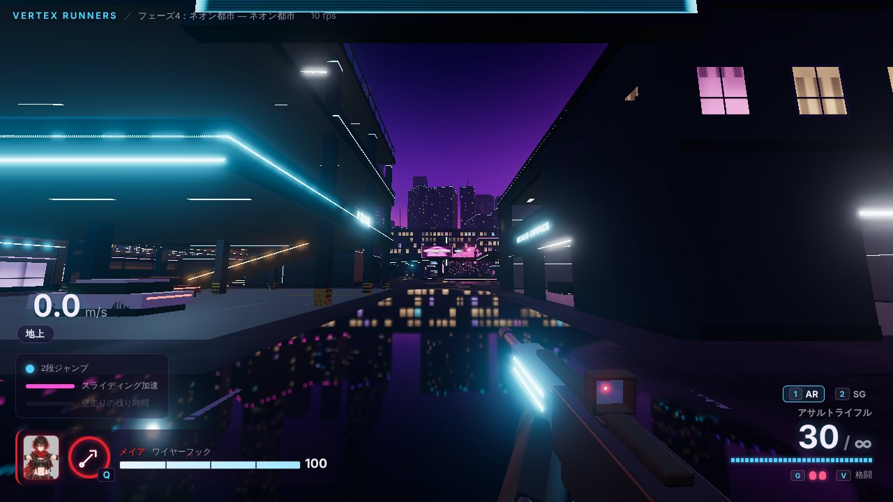 |
| 西の大通り（奥に看板） | 東の大通り（濡れた道路にネオンが映る） |
| 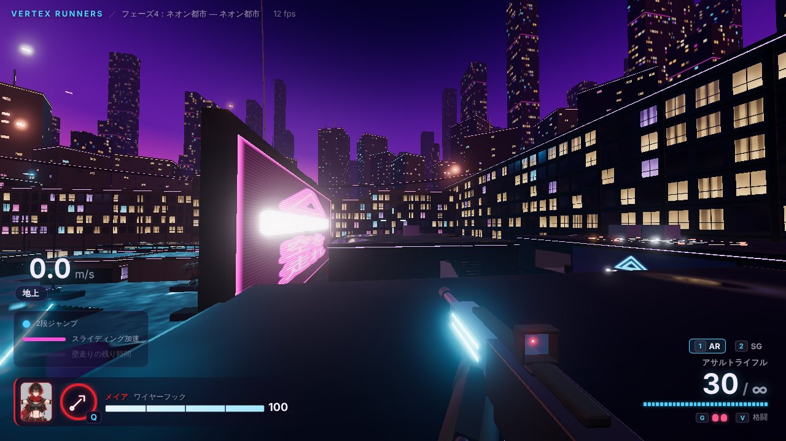 | 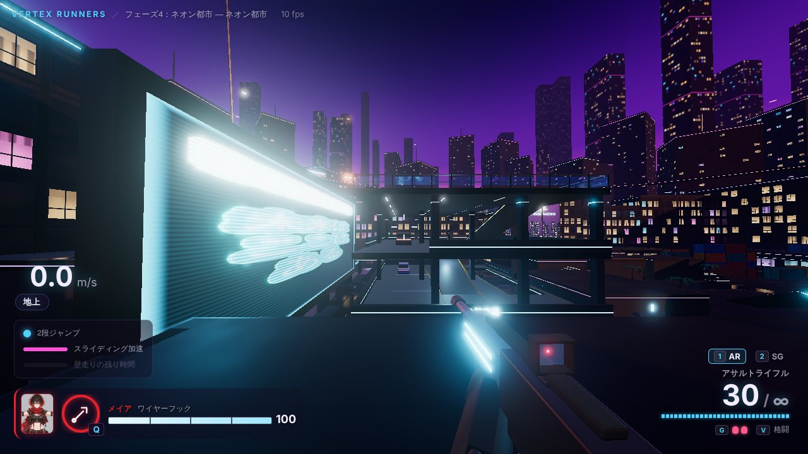 |
| ゲームセンターの屋上から、西の大通りの看板とパチンコ店 | オフィスの屋上から、東の大通りの看板と駐車場 |
| 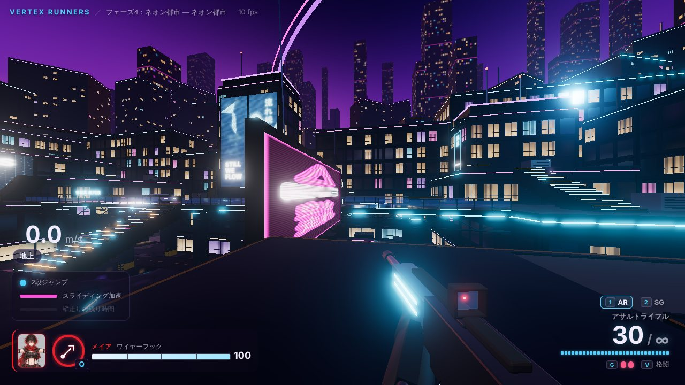 | 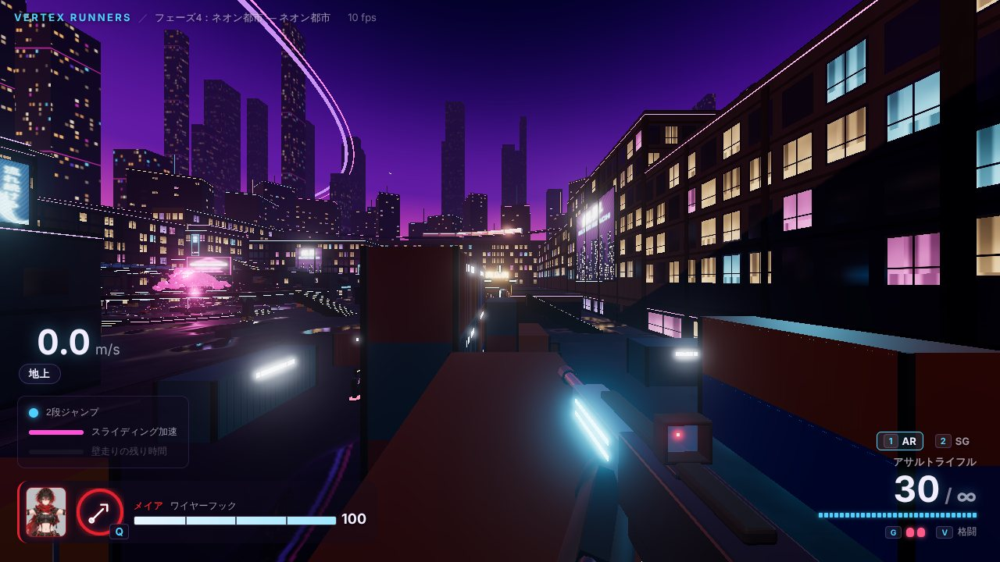 |
| カフェの屋上から、北の通りの看板と高架道路 | コンテナの山の上（左の壁を壁走りして向こうの山へ） |
| 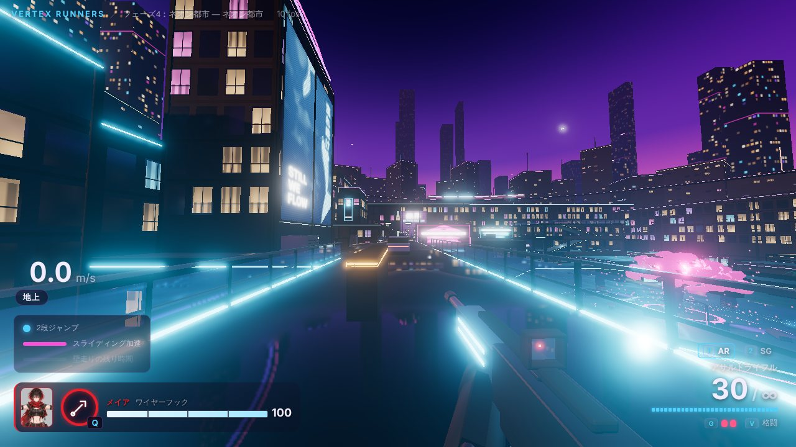 | 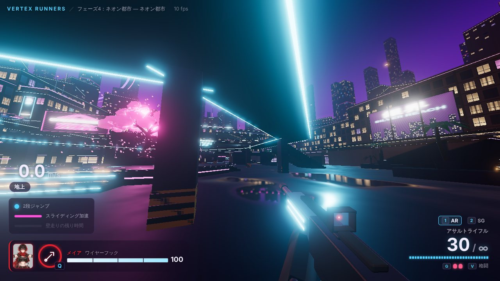 |
| 北の高架道路 | 円形広場と空中デッキ |
| 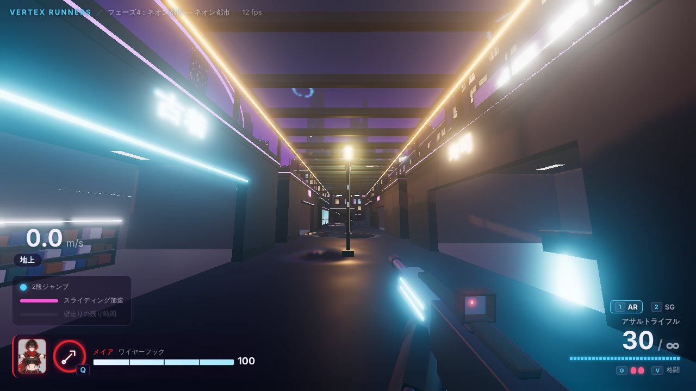 | 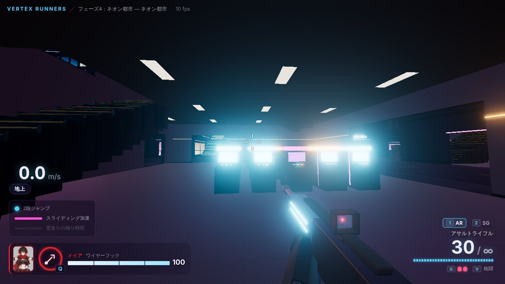 |
| 商店街（ガラスの屋根） | パチンコ店の中 |
| 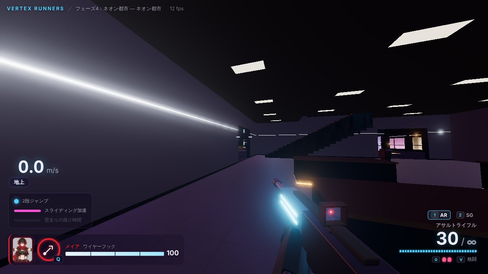 | 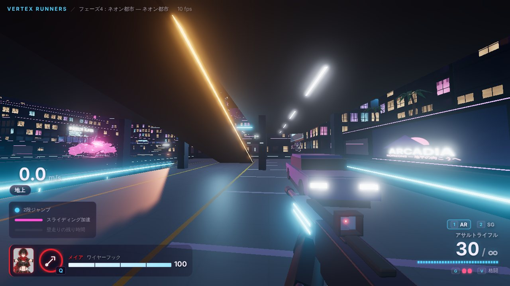 |
| オフィスの中 | 立体駐車場の2階 |

## 動作を軽くした

| 何をしたか | 効果 |
|---|---|
| 描画の解像度を、画面の画素数までにした（高精細の画面で2倍の解像度で描いていたのをやめた） | 高精細の画面では、描く画素が約 1/4 |
| キャンバスのなめらか処理（MSAA）をやめた（後処理を通すので効いていなかった） | 無駄な処理がなくなる。画質「高」では後処理側で MSAA を使う |
| 影：解像度 4096 → 2048、毎フレーム → 4フレームに1回描き直す（太陽は動かないため）。遠くのビル（マップの外）は影の計算から外した | 影の処理が 1/8 以下 |
| マップの点光源を 19個 → 5個（照明は光る天井・窓・ネオンで見せる） | 1画素あたりの光の計算が約 1/4 |
| 光のにじみ（ブルーム）を計算する解像度を 1/2 → 約 1/3 | |
| 床・壁の模様の計算（雑音）を4回 → 3回の重ね合わせにした | |
| 桜の花のかたまりの面を減らした（2.3万 → 0.8万）、空を飛ぶ車 28台をまとめて1回で描く | |
| 爆発のたびに点光源を足していたのをやめ、1つを使い回す（光の数が変わると全部の質感を作り直すので、爆発の瞬間に画面が止まっていた） | グレネードの爆発で止まらない |
| 一時停止中（メニューの後ろ）は描く回数を 1/3 にした | メニュー中の負荷 |
| 当たり判定：地形の箱を 8m のマスに分けて、近くの箱だけを調べる（これまでは毎回 1,000 個すべてを調べていた） | 光線の判定が約 19倍、1回の更新が約 2.6倍速い（フェーズ6でボットが増えても重くなりにくい） |

さらに、開始画面・一時停止画面に**画質の選択（自動・高・中・低）**を足した。
- **自動**（はじめはこれ）：「中」で始め、遊んでいる間のフレームレートが 45 を下回ると「低」に下げる。一瞬止まっただけでは下げない。
- **高**：解像度 1.5倍まで・MSAA・影を2フレームごと。**中**：上の軽くした設定。**低**：解像度 0.75倍・影なし・ブルームなし・点光源なし。
- 選んだ画質は覚えておく。

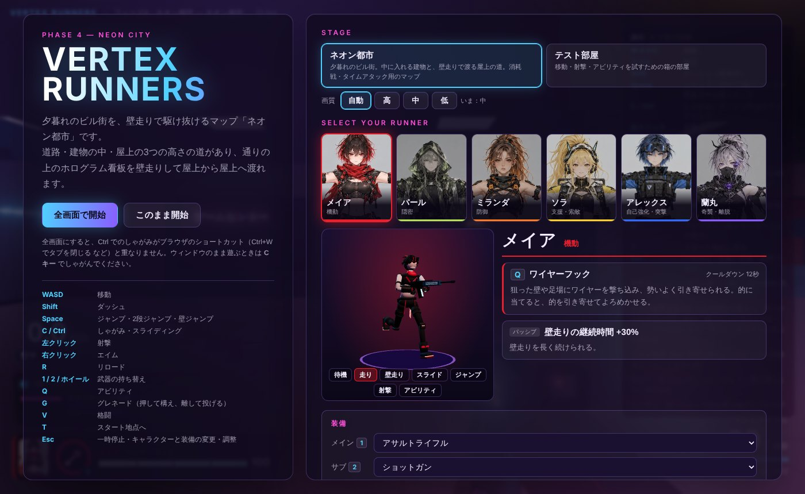

## Blender でのマップ作り

- `npm run map` で作り直す。① `scripts/export-map.ts` が当たり判定の配置（箱・飾り・出現地点・経路）を `assets-src/maps/neon_city_layout.json` に書き出し、② `assets-src/maps/build_map.py` がそれを読んで見た目を作る。
- **当たり判定と見た目が同じデータから作られる**ので、ずれない（足場の上面・壁の面は箱の面とそろえ、飾りは 0.2m 以内しか出っ張らせない）。坂は見た目を階段にしている。
- 箱の種類（ビル・橋・ガラス・手すり・階段・コンテナ・空調・木箱・植え込み・売店・看板など）ごとに、外壁の階の帯・柱・窓、橋の下のトラス、ガラスの枠、手すりの支柱、階段の光る段鼻、コンテナの波板などを作る。
- 作り直しで足したもの：
  - **地面と道路**：アスファルト（水たまりで光が映る）・歩道・縁石・中央の点線・横断歩道。
  - **中に入れる建物**：外壁の外側はコンクリート、内側は内装の壁（光の帯）。扉の上のネオン、各階の床（磨いたタイル）と天井の照明パネル、階段の穴の縁の黄色の線、屋上の軒とネオン。地面から建つビルの1階は店先（明るい窓・ひさしのネオン・シャッター）。
  - **立体駐車場**：床・なめらかな車路（矢印）・柱（黄色と黒の帯）・腰壁・駐車枠・天井の照明。
  - **家具と車**：ゲーム機（光る画面）、商品の棚、カウンター、駐車している車。
- 外周の高架レールは、マップを囲むビルの上に見える高さ（38m）に上げた。
- マップの外の遠いビル・高架・地面は、名前に `Bg_` を付けた別のメッシュにした（ゲーム側で影の計算から外す）。
- 書き出した後、`gltfpack` で頂点を量子化して圧縮し、7.7MB → 1.2MB にした（ゲーム側は three.js の MeshoptDecoder で読む）。
- マテリアルは名前（Floor・Concrete・Window・Glass・Neon* など）で区別し、ゲーム側で専用の質感に置き換える（濡れた床の水たまり、窓の中の模様と明かり、ネオンのブルームなど）。

## ボット用の経路（`shared/nav.ts`）

- 地形の箱から、2.5m 間隔で立てる場所に**点**（約4,600個）を置き、次の**つながり**（約32,000本）を自動で作る。壁や階段のすぐ横・コンテナの上のような狭い所は、点を少しずらして置く（建物の中でもつながるように）。
  - 歩く：隣の点へ、床が続いていて体がぶつからないとき（階段・坂を含む）
  - 飛び降り：縁から下の足場へ（最大 12.5m 下。屋根や床で上がふさがっている所へは下りない）
  - 跳び移り：同じくらいの高さの、隙間の向こうへ（6.5m まで）
  - よじ登り：1.5m までの段差、2段ジャンプが要る 2.8m まで（コンテナの上など）
  - 壁走り・長い跳び移り：ステージのデータに書いた区間（壁走りは壁の位置も持つ）
- `findPath(グラフ, 始点, 終点)`（A*）で点の列が返る。フェーズ6のボットはこれで移動先を決め、つながりの種類を見て走る・跳ぶ・壁走りする。
- Esc の調整パネルの「画面・確認用」→「ボット用の経路を表示」で、画面に表示できる。

## 受け入れ条件の確認

> 参考画像の雰囲気が出ており、壁走りで建物間を移動できる

- 雰囲気：上の画面のとおり（夕暮れの紫の空、窓明かりのビル街、ネオンと大画面、濡れた道路の映り込み、光る桜、高架道路）。
- 壁走り：自動テストで、実際の移動の計算（助走 → 縁でジャンプ → 壁に寄って壁走り → 着地）で、4か所をどちらの向きにも渡れることを確認（8区間）。8m の跳び移り2か所も、2段ジャンプで渡れることを確認。

自動テストは合計 **107 項目すべて合格**（`npm test`）。ネオン都市まわりのテストは次のとおり。
- 形：**東西・南北で鏡写しになっていない**こと（同じ形の箱が反対側にあるのが 1 割未満）、大きさ、足場が 0・5・10・15m の4段、両チームの出現地点が両端の建物の中（屋根の下）にあること
- **落ちる場所がない**：地面がマップ全体を覆い、マップの中のどこでも真下に床があること。マップの外へは出られないこと
- **中に入れる建物**：13棟があり、東西の大通りから中・2階・屋上へ、階段と坂だけで（跳び移り・壁走りなしで）行けること
- 経路：主な場所（48か所）が、どちらの出現地点からも行き来できること。孤立した点が 3% 未満。経路探しが動くこと
- 壁走りの8区間・跳び移り2か所を、移動の計算で実際に渡れること
- 当たり判定の絞り込みが、すべての箱を調べたときと同じ結果になること（光線・カプセル 各3,000回）
- 画質の自動調整：遅いときだけ下げ、一瞬止まっただけでは下げないこと

ブラウザでも、上の画面、ステージの切り替え、画質の切り替え（自動で下がることも）を確認した。ただし作業環境に GPU がない（ソフトウェアで描くので 10fps 前後で、軽くした効果はこの環境では測れない）ため、**実機でのフレームレートは未確認**。まだ重い場合は、画質を「低」にして変わるか教えてほしい（どこが重いのかの手がかりになる）。

## 仕様に書かれていなかったため補った点

1. **配置は東西・南北で形を変えた**（ご依頼）。両チームの条件は、出現の建物から屋上の道・壁走りの場所・中央までの距離がおおよそ同じになるようにした。
2. **大きさ**は仕様の「約150m × 150m」に対し、歩ける範囲が東西 160m・南北 136m。出現の建物を両端に置くため東西を少し長くした。
3. **高低差**は足場で 15m（仕様は約30m）。まわりのビル（20〜34m）と塔（24〜36m）は壁・飾りで、上には行けない。足場の高さを 5m ごとの4段にそろえ、階段（1段 25cm）・坂でつないだ。
4. **マップの外**：まわりをビルで囲み、さらに見えない壁で、屋上から外へ跳び出せないようにした。地面があるので落ちて死ぬことはない。
5. **練習用の的**を大通り・高架道路・カフェ・駐車場・オフィス・商店街などに 12 体置いた（消耗戦のボットはフェーズ6）。駅とホテルの中に弾薬補給所。
6. **ステージの選択**を開始画面・一時停止画面に追加。最初はネオン都市、前回選んだものを覚える。テスト部屋（アビリティ訓練場など）にも切り替えられる。
7. **出現地点**は各チーム5か所をデータに入れた。今はプレイヤー1人なので、チーム0の最初の地点から始まる。

## 次のフェーズへの申し送り
- タイムアタック（フェーズ5）のコースは、このマップの上に置く想定。屋上の道（ホテル → 駐車場 → 看板 → オフィス → カフェ → 看板 → 高架道路 → 広場、など）やコンテナ置き場の壁走りをコースに組み込める。
- ボット（フェーズ6）は `buildNavGraph(level, movementConfig)` と `findPath` を使う。出現地点は `level.spawns`。
