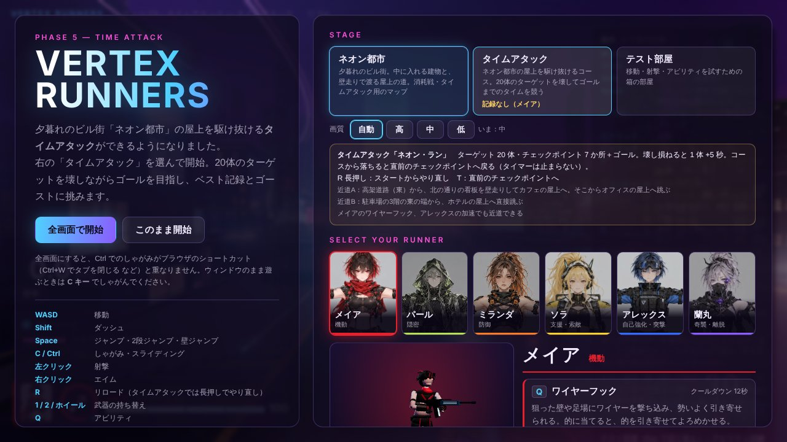
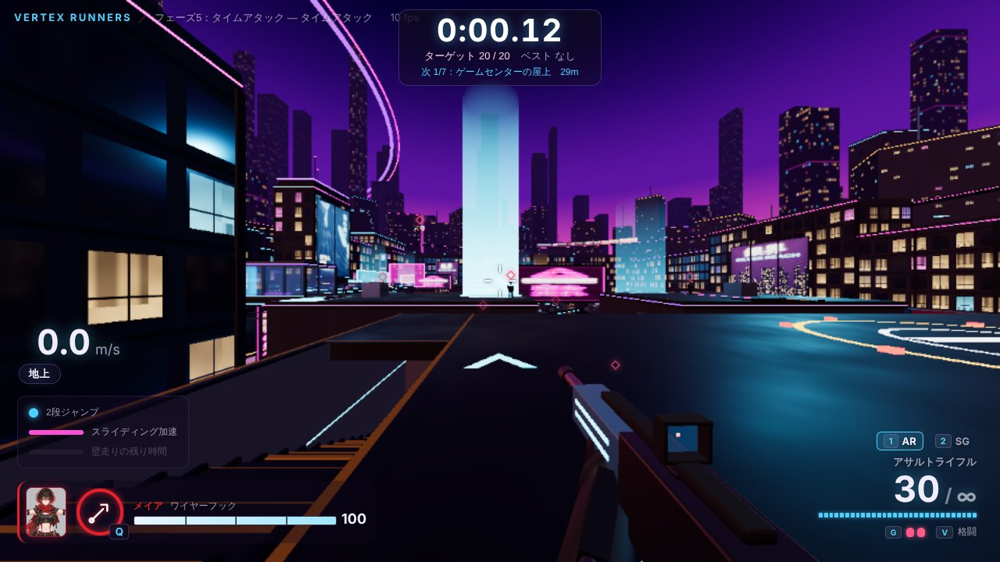
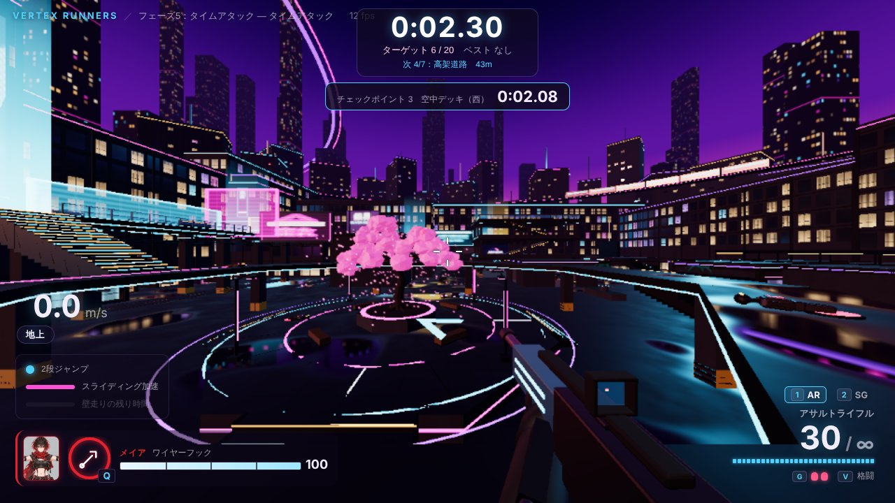
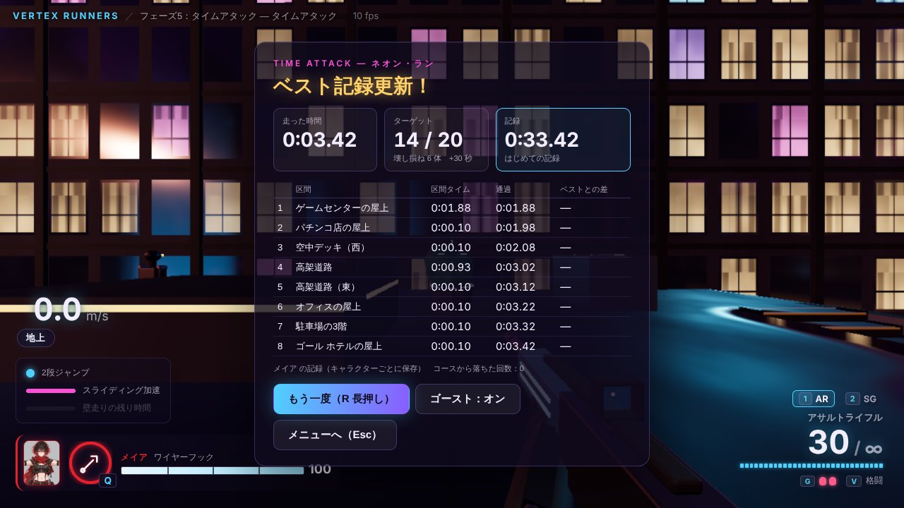
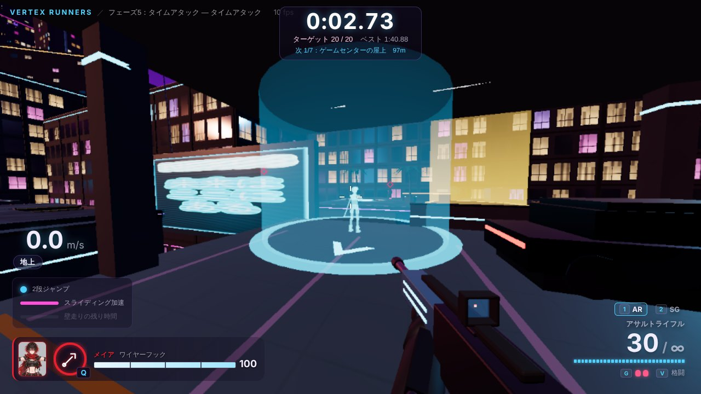
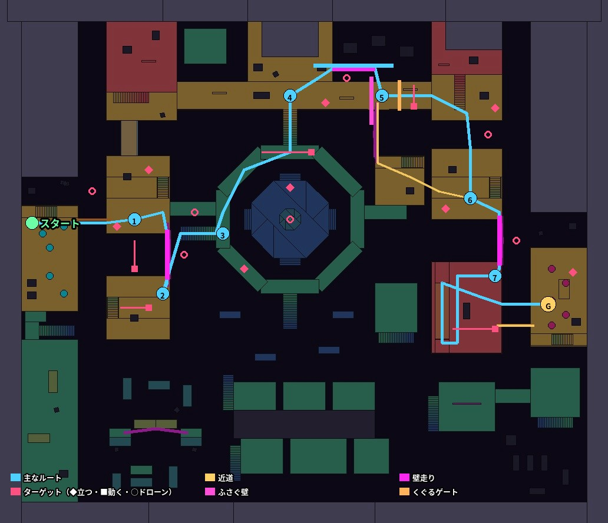
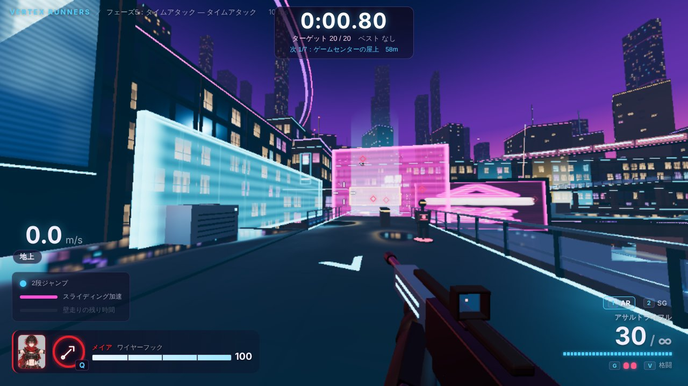
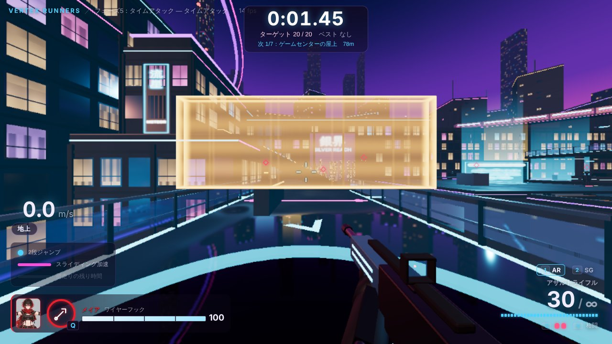
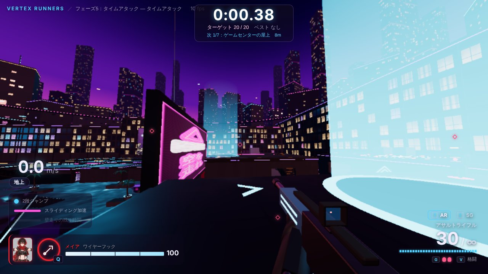

# フェーズ5 実装報告：タイムアタック

あわせて、ご依頼の**ジャンプ力の向上**も行った（下の「ジャンプ力」）。

## 実装したもの

| 仕様 5.2 の項目 | 状態 | 主なファイル |
|---|---|---|
| ネオン都市の中の専用コース（屋上・外壁・空中回廊） | 済 | `shared/courses/neonCourse.ts` |
| ターゲット 20 体（立っている的・レールの上を動く的・浮いているドローン） | 済 | 同上、`shared/targets.ts`（ドローンと「復活しない」的）、`assets-src/props/build_props.py`（ドローンのモデル） |
| 壊し損ねたターゲット1体ごとに +5 秒 | 済 | `shared/timeAttack.ts` |
| コースから落ちると直前のチェックポイントへ戻る（タイマーは止まらない） | 済 | 同上 |
| ベストタイムをブラウザに保存（キャラクター別）。リザルトに記録・区間タイム | 済 | `client/timeAttack/records.ts`、`client/timeAttack/taHud.ts` |
| ゴースト（ベスト記録の走りを半透明の影で再生。オン／オフ） | 済 | `client/timeAttack/ghostView.ts` |
| 「壁走り → 2段ジャンプ → スライディング」を必ず使う区間、上級者向けの近道 2 か所 | 済 | `shared/courses/neonCourse.ts` |
| アビリティも使える | 済 | （ふだんどおり使える） |
| 次のチェックポイントを光る矢印とマーカーで示す | 済 | `client/timeAttack/courseView.ts` |
| R キー長押しでスタートからやり直し | 済 | `client/timeAttack/controller.ts` |
| HUD：経過タイム、残りターゲット数、ベスト記録との差（仕様 7.3） | 済 | `client/timeAttack/taHud.ts` |

ゲームの進み（カウントダウン・チェックポイント・落下・ペナルティ・ゴール・ゴーストの記録）は `shared/timeAttack.ts` にあり、描画から切り離して、固定 60Hz のシミュレーションと一緒に進む（将来サーバーに移せる）。数値は `config/timeattack.json` にまとめた。

## 遊び方

1. 開始画面（または Esc の一時停止画面）の「ステージ」で **タイムアタック** を選び、開始する。カードには、いま選んでいるキャラクターのベスト記録が出る。
2. 駅の屋上から、3・2・1・GO のカウントダウンで始まる（カウントダウンの間は動けない。見回すことはできる）。
3. 画面の上にタイム・残りのターゲット・ベストとの差、その下に次のチェックポイントまでの距離。目の前に浮かぶ**光る矢印**が次のチェックポイントの方を指し、チェックポイントには**光の柱**が立つ。ターゲットには赤いひし形の目印が付く。
4. チェックポイントを通ると、区間タイムとベストとの差（速いと緑、遅いと赤）が出る。
5. ホテルの屋上のゴールに入るとリザルト。**R 長押し**（0.7 秒）でいつでもスタートからやり直し。**T** で直前のチェックポイントへ戻る（タイマーは止まらない）。

| | |
|---|---|
|  |  |
| スタート直後（矢印と光の柱、ターゲットの目印） | チェックポイントを通ったときの区間タイム |
|  |  |
| リザルト（記録・ペナルティ・区間タイム・ベストとの差） | ゴースト（ベスト記録の走りを青い影で再生） |

## コース「ネオン・ラン」

西の駅の屋上から、東のホテルの屋上まで。チェックポイント 7 か所＋ゴール。道のりは約 330m で、ターゲットを撃ちながら走って 1 分前後。

| 区間 | 内容 |
|---|---|
| スタート → 1 ゲームセンターの屋上 | 8m の隙間を **2段ジャンプ** で跳ぶ |
| 1 → 2 パチンコ店の屋上 | 西の大通りのホログラム看板を **壁走り**（12m） |
| 2 → 3 空中デッキ（西） | 大通りへ飛び降り、階段を駆け上がる（動く的とドローン） |
| 3 → 4 高架道路 | 円形広場のまわりの空中デッキを回り、北の階段で高架道路へ |
| 4 → 5 高架道路（東） | **道をふさぐ壁**を、北側のパネルの **壁走り → 壁ジャンプ・2段ジャンプ** でよける |
| 5 → 6 オフィスの屋上 | 低いゲートを **スライディング** でくぐり、オフィスの基壇から 8m の隙間を跳ぶ |
| 6 → 7 駐車場の3階 | 東の大通りの看板を **壁走り** |
| 7 → ゴール ホテルの屋上 | 車路で駐車場の屋上へ駆け上がり、ホテルの屋上へ跳び降りる |

**壁走り → 2段ジャンプ → スライディング**は、区間 4〜6 で必ず使う（壁は高さ 8m で越えられず、横を抜けるには壁走りが要る。壁の向こうへ戻るのに壁ジャンプ・2段ジャンプ、そのすぐ先のゲートは床から 1.15m より上がふさがっていて、しゃがむかスライディングでしか通れない）。

**近道（上級者向け）**
- **A（5 → 6）**：高架道路から北の通りの看板を壁走りしてカフェの屋上へ降り、オフィスの屋上へ跳ぶ。ゲートと高架道路の東を通らない。
- **B（7 → ゴール）**：駐車場の3階の東の端から、ホテルの屋上へ直接跳ぶ。車路と屋上を通らない。
- どちらも、通らない所のターゲットを遠くから撃たないと、壊し損ねで 5 秒ずつ足される。メイアのワイヤーフック、アレックスの加速でも近道できる。

**ターゲット 20 体**：立っている的 8・レールの上を往復する的 5・浮いているドローン 7。倒しても復活しない。体力は的 60・ドローン 40（`config/timeattack.json`）。

| | |
|---|---|
|  |  |
| 高架道路の壁（桃）と、北側の壁走りのパネル（水色） | スライディングでくぐるゲート（橙） |

ゲームセンターの屋上から、壁走りする看板・ドローン・パチンコ店の屋上の動く的を見る。

### ドローン（Blender）
`assets-src/props/build_props.py` に `build_drone` を足した（`python assets-src/props/build_props.py drone`）。八角形の機体、正面の光る目（核）、4つのプロペラ（ゲームで回る）、光る輪。当たり判定は機体 0.9×0.32×0.9m と、核（頭）半径 0.24m。壊すと回りながら小さくなって消える。

## ジャンプ力

`config/movement.json` の **JUMP_VELOCITY と DOUBLE_JUMP_VELOCITY を 6.0 → 6.8** にした。

| | 前 | 今 |
|---|---|---|
| 1段のジャンプの高さ | 1.00m | 1.28m |
| 2段ジャンプの合計 | 約 2.0m | 約 2.6m |
| 走りながらの 2段ジャンプで跳べる距離（同じ高さ） | 約 8m | 約 10m |

もっと上げたい・戻したいときは、Esc の調整パネル（「ジャンプ」）で試してから、`config/movement.json` の値を書き換えればよい。マップの 8m の隙間・壁走りの区間・ボット用の経路は、この値で自動テストが通ることを確かめている。

## 受け入れ条件の確認

> 5.2 の仕様どおり最後まで遊べる

- ブラウザで、ステージの選択 → カウントダウン → チェックポイント → ゴール → リザルト（記録の保存）→ やり直し（ゴーストが走る）までを確認した。
- コースの難所は、実際の移動の計算で通れることを自動テストで確かめた：スタートの 8m の 2段ジャンプ、高架道路の壁（パネルの壁走り → 壁ジャンプ → 2段ジャンプで壁の向こうへ）、ゲート（立ったままでは通れず、スライディングで通れる）、オフィスへの 8m のジャンプ、車路で駐車場の屋上へ、駐車場の屋上からホテルへ。看板の壁走り 3 か所と近道 B のジャンプは、マップのテストで両向きに確かめている。
- 進み方のテスト：カウントダウン中は動けず GO で計測が始まる／チェックポイントを順番どおりに通らないと数えない／区間タイムが記録される／ゴールで壊し損ねの数 × 5 秒が足される／倒したターゲットは復活しない／コースから落ちると直前のチェックポイントへ戻り、タイマーは止まらない／ゴーストの記録をあとから同じ時刻の姿として取り出せる。
- スタート・チェックポイント・戻る場所が床の上にあり、ターゲットが地形に埋まっていないこと。

自動テストは合計 **121 項目すべて合格**（`npm test`。フェーズ5で 14 項目追加）。

## 仕様に書かれていなかったため補った点

1. **カウントダウン**（3 秒）を入れた。「GO」でタイマーが動き出す。ゴーストと同じ時刻から走り出せる。
2. **「コース外に落ちる」**は、区間ごとに決めた高さより下に落ちたとき、とした（屋上の区間は 9m、空中デッキの区間は 4m。大通りに飛び降りる区間 2→3 は地面も道なので戻さない）。
3. **記録**は「走った時間 + ペナルティ」。ベストより速いときだけ保存し、そのときの走りをゴーストとして保存する（キャラクターごと）。
4. **ターゲットの体力**は射撃場の的より低くした（的 60・ドローン 40）。走りながら素早く壊せるように。
5. **T キー**はタイムアタックでは「直前のチェックポイントへ戻る」にした（タイマーは止まらない）。一時停止画面の「スタートからやり直す」でもやり直せる。
6. **ターゲットの目印**（赤いひし形。70m 以内）を足した。
7. タイムアタックでは弾薬補給所を置かない（予備弾は無限のため）。
8. コース用の壁・パネル・ゲートはホログラムで描き、タイムアタックのときだけ置く（ふだんのネオン都市にはない）。

## 次のフェーズへの申し送り

- 消耗戦（フェーズ6）のメニュー一式（モード選択・リザルト）は、今回のステージ選択とリザルトの作りを広げて作る想定。
- ボットはタイムアタックには出ない（1人用）。
