# フェーズ6 実装報告：消耗戦

あわせて、ご依頼の**タイムアタックを後で専用コースへ置き換える予定**を仕様書（5.2 の最後「【今後の予定】専用コースへの置き換え」）に書き足した。

## 実装したもの

| 仕様の項目 | 状態 | 主なファイル |
|---|---|---|
| 6対6（プレイヤー＋味方ボット5体 vs 敵ボット6体）、ネオン都市 | 済 | `shared/attrition.ts` |
| 先に 300 点、または 10 分で点の多いチームの勝ち | 済 | 同上、`config/attrition.json` |
| 倒されて 5 秒後に、敵から離れた出現地点で復活。直後 2 秒は無敵 | 済 | 同上（`pickSpawn`）、`shared/simulation.ts`（`invuln`） |
| 歩兵：各チーム最大 12 体、中央付近に湧き続ける。地上だけを歩き、近くの敵を撃つ（命中は低い） | 済 | `shared/bots/gruntBot.ts`、`assets-src/characters/build_grunt.py` |
| 得点：パイロット 5・歩兵 1・アシスト 1 | 済 | `shared/attrition.ts`、`shared/simulation.ts`（`kill` イベント） |
| パイロットのボット：巡回 → 敵発見 → 交戦（遮蔽物・壁走り・2段ジャンプ）→ 体力が減ると退避 | 済 | `shared/bots/pilotBot.ts`、`navigator.ts`、`botBrain.ts`、`botWorld.ts` |
| 難易度（易・普・難）で反応速度と命中精度が変わる | 済 | `config/bots.json` |
| ボットのキャラクターは 6 種からランダム（同じチームで重複可） | 済 | `shared/attrition.ts` |
| ボットもキャラクターと能力を使う（キャラクター定義の「ボットの使用条件」どおり） | 済 | `shared/bots/pilotBot.ts` |
| ボットはプレイヤーと同じ `InputCommand` で動く | 済 | `shared/bots/` 全体 |
| メニュー一式：タイトル・メインメニュー・キャラクター／装備選択（難易度）・ポーズ・リザルト・設定 | 済 | `client/main.ts`、`index.html`、`client/style.css` |
| HUD：両チームのスコア・残り時間、キルログ（右上）、被弾方向の赤い弧 | 済 | `client/attrition/attritionHud.ts`、`client/vitalsHud.ts` |
| 敵を倒した時の消滅エフェクト | 済 | `client/characters/actorModel.ts`（溶けて消える効果）、`client/attrition/controller.ts`（火花） |
| ボット・歩兵の当たり判定（胴の縦カプセル＋頭の球） | 済 | `shared/hitbox.ts` |

試合の進み（入場・試合中・終了）、得点、復活、歩兵の湧き、ボットの判断はすべて `shared/` にあり、描画から切り離して固定 60Hz で進む（将来オンライン対戦に移すときもサーバーで同じコードを動かせる）。数値は `config/attrition.json`（試合）と `config/bots.json`（ボットの難易度・歩兵）にまとめ、`config/README.md` に一覧を書いた。

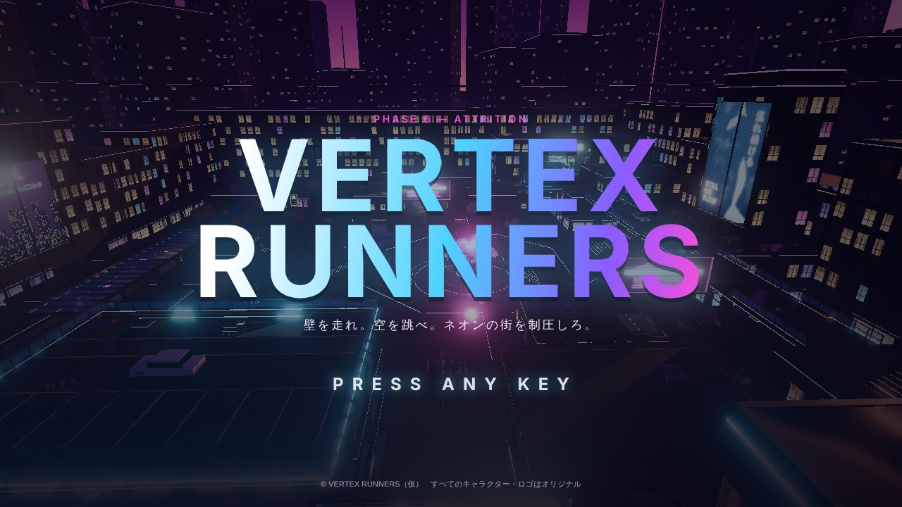

## 遊び方

1. タイトル画面で何かキーを押す → メインメニューで **消耗戦**。
2. キャラクター・メイン／サブ武器・**ボットの難易度**（易・普・難）を選んで「出撃」。全画面で始めると、Ctrl のしゃがみがブラウザのショートカットと重ならない。
3. 4 秒の入場（「試合開始」の表示）のあと、試合が始まる。
4. 画面の上に両チームのスコアと残り時間、右上にキルログ（ヘッドショットは **HS**）。敵を倒すと真ん中に「+5 パイロット撃破」などが出る。**Tab** を押している間スコアボード。
5. 倒されると、倒した相手の名前・キャラクターと復活までの秒数が出て、カメラが倒した相手の方を向く。5 秒後に自動で復活する。
6. 試合が終わると「勝利／敗北／引き分け」→ リザルト（もう一度／メインメニューへ）。**Esc** で一時停止（再開・設定・メニューへ戻る）。

| | |
|---|---|
| 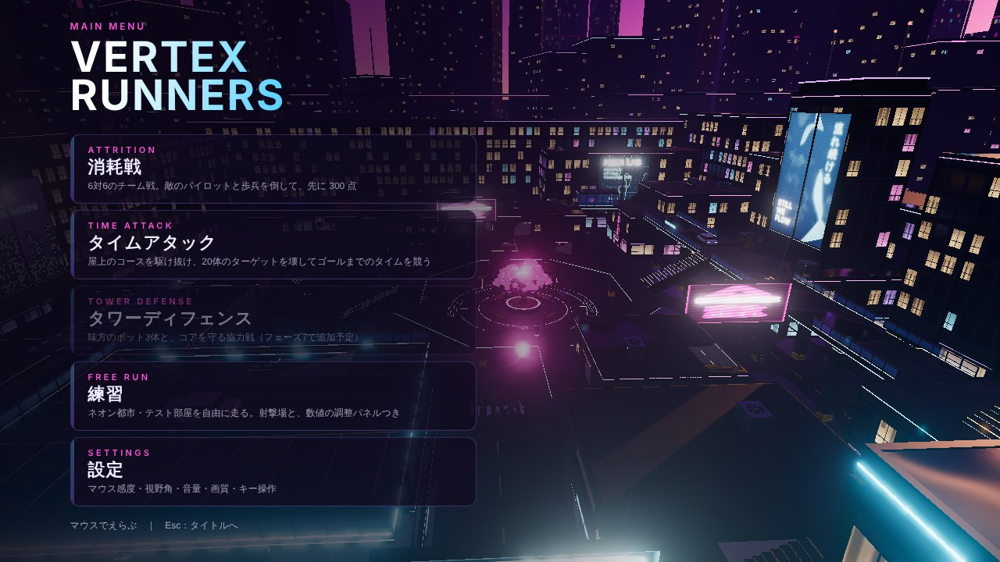 | 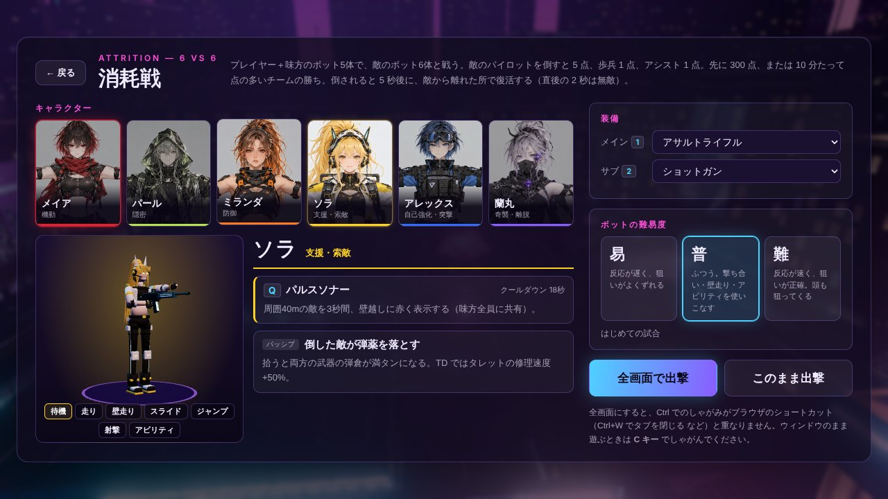 |
| メインメニュー（背景はマップの上をゆっくり回る） | キャラクター・装備・ボットの難易度 |
| 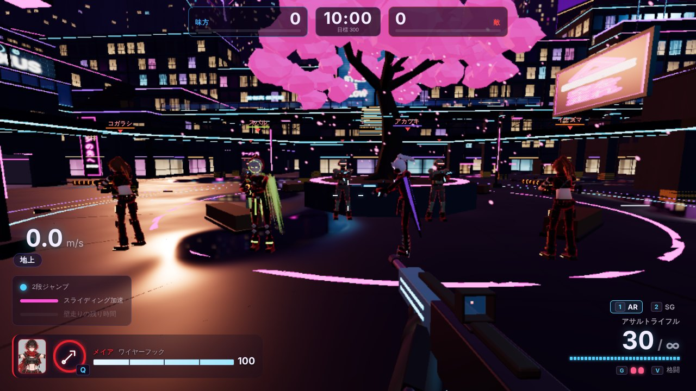 | 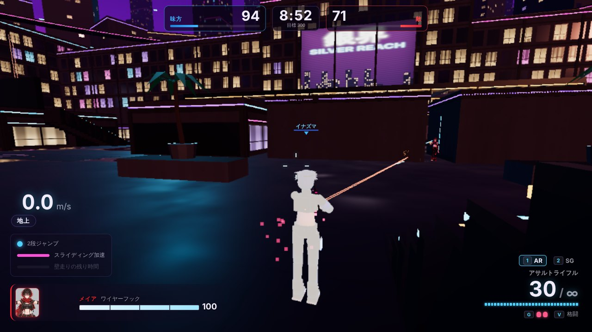 |
| 敵のパイロット（赤い縁取りと名札）と、奥に敵の歩兵 | ボット同士の撃ち合い（味方のボットの後ろから見たところ） |
| 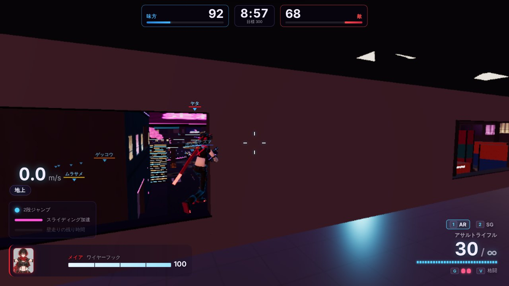 | 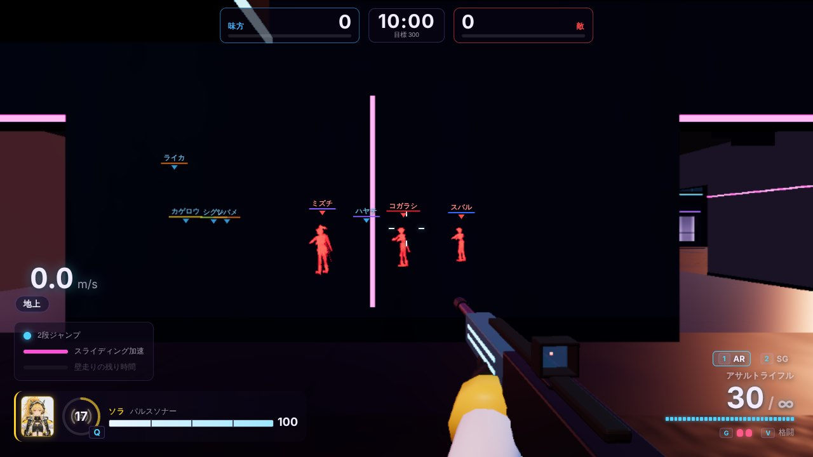 |
| 路地を壁走りして移動するボット | ソラのパルスソナー：壁の向こうの敵が赤い影で見える（味方全員に共有） |
| 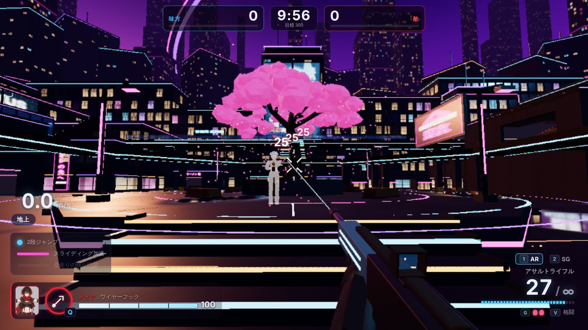 | 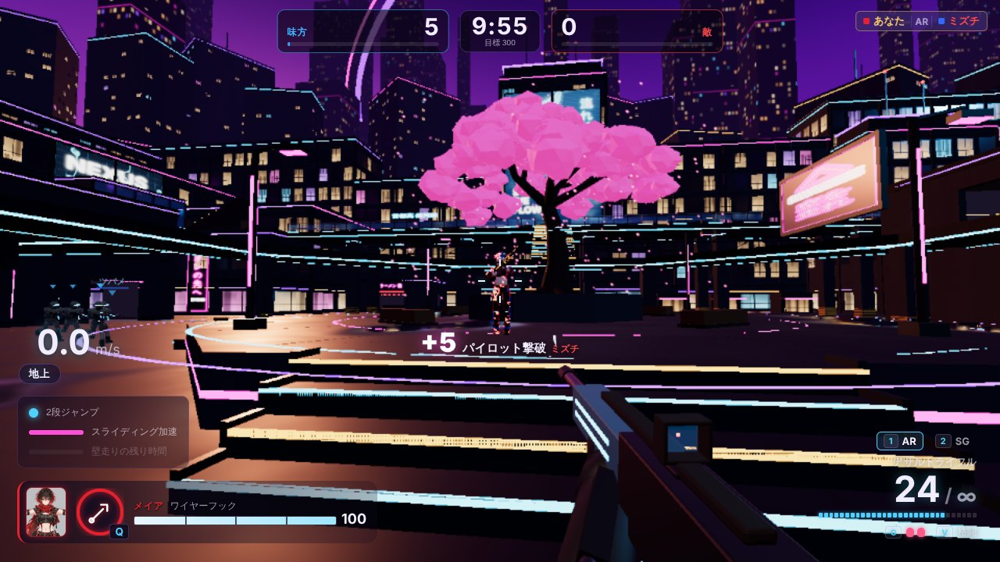 |
| 当たると敵が白く光り、ダメージの数字が出る | 倒すと「+5 パイロット撃破」、キルログ、溶けて消える効果 |
| 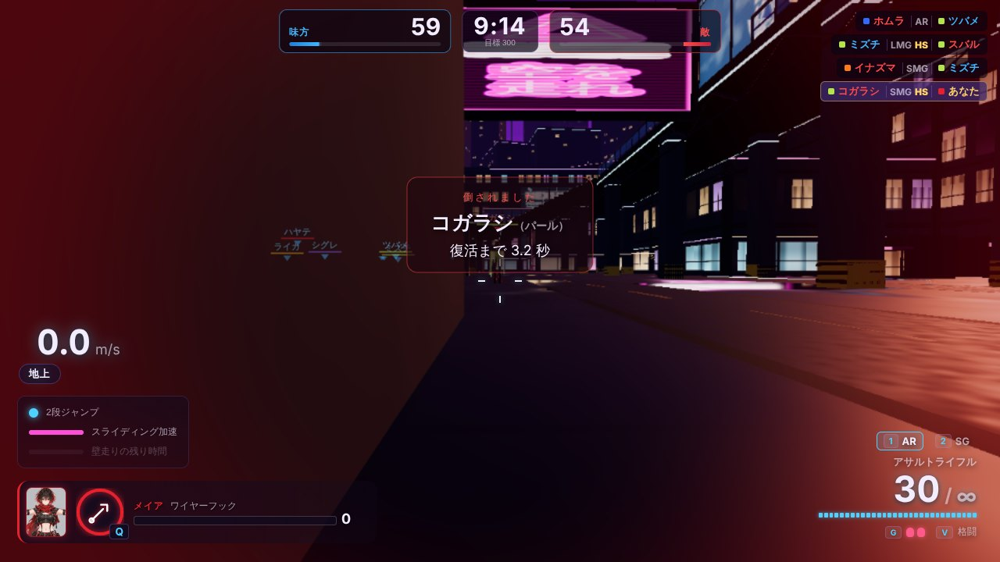 | 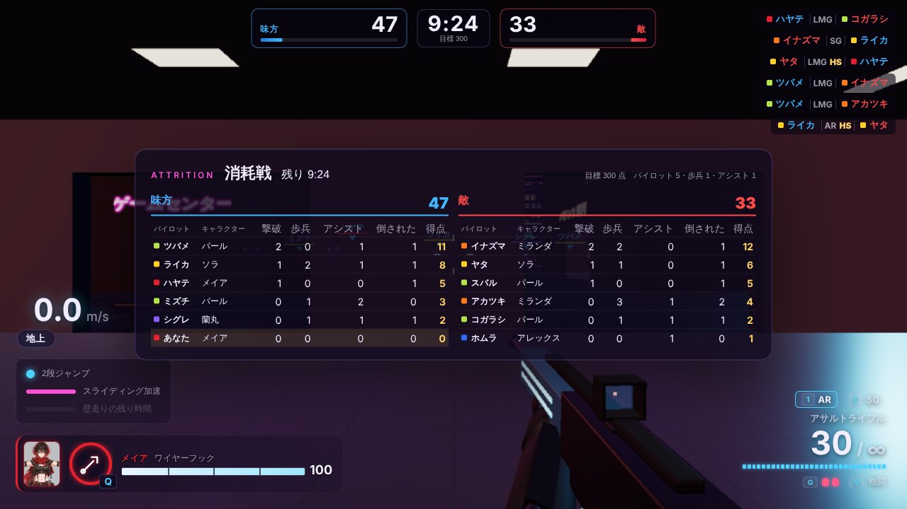 |
| 倒されたとき（倒した相手と復活までの秒数） | Tab のスコアボード |
| 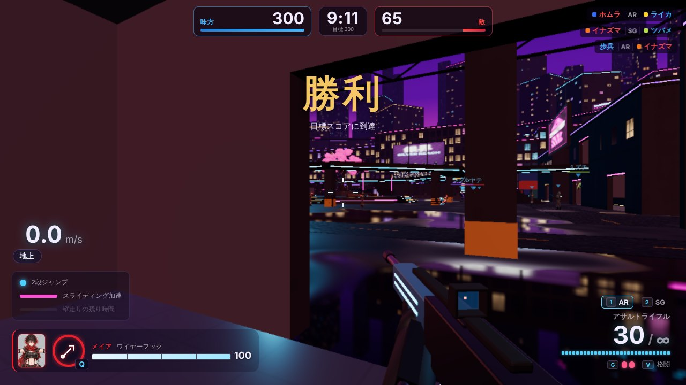 | 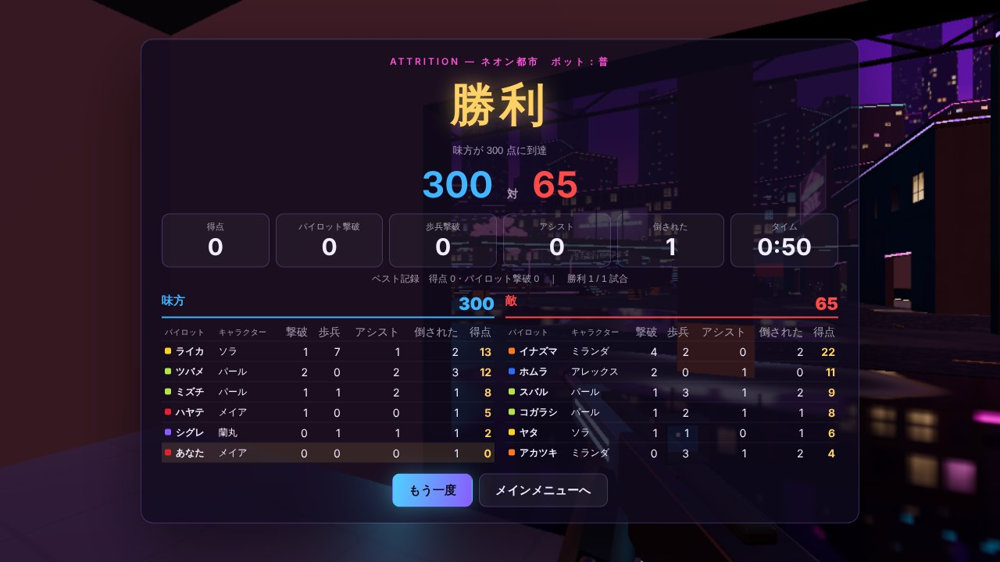 |
| 試合終了 | リザルト（撮影のため、得点を書き換えて早く終わらせた） |

※ 撮影はヘッドレスのブラウザ（ソフトウェア描画）で行ったため、ふだんのブラウザより画質・明るさがやや落ちて見える。

## ボット（パイロット）

### 頭の作り
ボットの頭（`shared/bots/`）は、ゲームの状態から**プレイヤーと同じ入力コマンド**（移動・視点・ジャンプ・しゃがみ・ダッシュ・射撃・エイム・アビリティ・グレネード・持ち替え・リロード）を作るだけで、ボット専用の動きや当たり判定は持たない。そのため、壁走り・スライディング・2段ジャンプ・アビリティの効果はプレイヤーとまったく同じになる。

| 部分 | ファイル | していること |
|---|---|---|
| 見る・狙う | `botBrain.ts` | 0.1 秒ごとに見える範囲（視野角・距離）と遮蔽物を確かめる。28m 以内の銃声・足音、撃ってきた相手、ソナーで見つかった相手にも気づく。光学迷彩の相手は 8m 以内でしか見えない。見つけてから撃ち始めるまでの「反応の遅れ」、照準のゆっくりした揺れ、撃つ・止めるの間隔（バースト） |
| 移動 | `navigator.ts` | フェーズ4で作った経路データ（歩く・飛び降りる・跳ぶ・**壁走り**のつながり）に沿って動く。壁走りのつながりでは、助走 → ジャンプ → 壁走り → 降りるを実際の操作で行う。引っかかったら少し戻って経路を探し直す |
| 判断 | `pilotBot.ts` | 状態：**巡回**（味方が見つけた敵の方・マップの要所へ）→ **交戦** → **遮蔽物**（リロード・体力が減ったとき）→ **退避**（体力が減って撃たれているとき）→ **追跡**（見失った敵の最後の場所へ） |
| 共有 | `botWorld.ts` | 経路探し（1 ティック 2 本まで）、チームで共有する敵の情報、遮蔽物探し、乱数 |

### 交戦の動き
- 武器ごとの得意な距離を保つ（近すぎれば下がり、遠ければ詰める）。横へ動きながら撃つ・2段ジャンプで跳ねる（難しいほどよく跳ぶ）。
- 近くに沿った壁があれば、**壁へ寄って跳び、壁走りしながら撃つ**。
- 近距離の武器で詰めるときは、ダッシュ → スライディング。
- 中・遠距離ではエイムする。上手なボットほど頭を狙う。
- 弾が少なく敵が見えないときはリロード、距離に合わせてメインとサブを持ち替える。グレネードは低い弾道で届く角度を計算して投げる。
- 巡回の途中でも、ときどき壁走り・スライディングを混ぜる（ただ歩くだけにならないように）。

### アビリティ（キャラクター定義の「ボットの使用条件」どおり）

| キャラクター | アビリティ | ボットが使うとき |
|---|---|---|
| メイア | ワイヤーフック | 経路の先の高い所（4m 以上上）へ登るとき、近距離の武器で離れた敵へ詰めるとき |
| パール | 光学迷彩 | 退避するとき、見失った敵へ回り込むとき |
| ミランダ | シールドウォール | 撃ち合いが始まったとき（相手の方へ向けて張り、その後ろで構える）、遮蔽物へ向かうとき |
| ソラ | パルスソナー | 見失った敵を追うとき、しばらく敵が見つからないとき |
| アレックス | オーバードライブ | 撃ち合いが始まったとき、体力が半分以下で撃たれているとき、退避するとき |
| 蘭丸 | フェイズシフト | 体力が半分以下で撃たれたとき、近くに敵が 3 体以上いるとき（そのまま退避する） |

90 秒の試合 1 回で、6 種のアビリティ・グレネード・持ち替え・リロードがすべて使われることを確かめた（下の「確かめたこと」）。

### 難易度（`config/bots.json`）

| | 易 | 普 | 難 |
|---|---|---|---|
| 反応の遅れ | 0.75 秒 | 0.55 秒 | 0.25 秒 |
| 照準のずれ（狙い始め → 落ち着いたとき） | 7° → 3.6° | 5° → 2.4° | 3.2° → 0.7° |
| 振り向く速さ | 240°/秒 | 360°/秒 | 540°/秒 |
| 見える距離・視野角 | 55m・100° | 65m・120° | 80m・140° |
| アビリティ・グレネードを使う割合 | 低い | ふつう | 高い |
| 横の動き・跳ねる量 | 少ない | ふつう | 多い |

照準のずれは、**速く動く相手**（10m/s で 1.6〜1.9 倍）と**遠い相手**（50m で 1.6〜1.8 倍）ほど大きくなる。立ち止まらずに走り続けるプレイヤーほど撃たれにくい（「地面に足をつけず走り続けるほど有利になる」というゲームの考え方に合わせた）。

## 歩兵

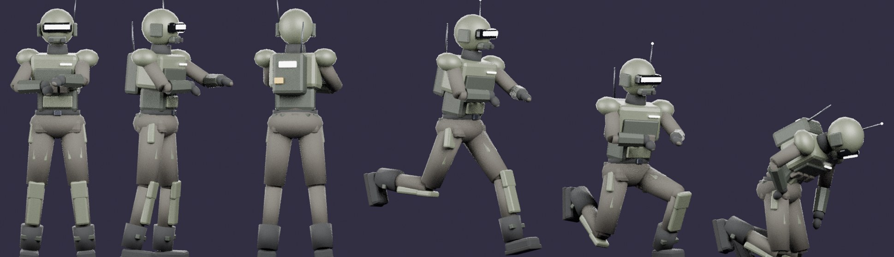

- **モデル**：`assets-src/characters/build_grunt.py`（Blender。`python assets-src/characters/build_grunt.py --preview` で上の確認用画像も描く）。顔を覆うヘルメットと光るバイザー、厚い胸当て・肩当て・背中の無線機。量産型の兵士として、パイロットより角ばった形・くすんだ色にして、ひと目で見分けられるようにした。骨格はパイロットと同じで、アニメーションは待機・走り・しゃがみ・射撃・ジャンプ・倒れる。バイザー・肩・背中の灯りがチームの色（味方は青、敵は赤）で光る。銃はゲームの中で手に持たせる（上の画像には描いていない）。
- **湧き方**：試合開始 2 秒後から、14 秒ごとに 4 人の分隊が、自分のチーム側の中央寄りの出現地点に湧く（チームの最大 12 体まで）。分隊は、中央付近の地上の要所（少し敵の側寄り）へ向かい、20〜30 秒ほどで次の要所へ移る。敵が近くにいればそちらを撃つ。
- **動き**：経路のうち**地上の歩くつながりだけ**を使う（壁走り・ジャンプ・高い足場は使わない）。近くの敵（40m 以内）を撃つ。照準のずれが大きく反応も遅く、与えるダメージはパイロットの 0.32 倍。体力 40。
- 倒されると復活せず、2.5 秒後に消える。

## 試合の仕組み

- **得点**：敵パイロット 5、敵の歩兵 1、アシスト 1。誰の得点か：とどめを刺した相手。自分のグレネードや落下で倒れたときは、直前 5 秒以内にダメージを与えた敵の得点になる。
- **味方への攻撃**：味方には弾が当たらず、通り抜けて後ろの敵に当たる。味方のグレネードの爆風も味方には当たらない（自分には当たる）。
- **出現地点**：ネオン都市に、両チームの基地の出現地点に加えて**中央寄りの出現地点を 15 か所**足した（西側が味方、東側が敵の側）。復活する場所は、出現地点ごとに点数を付けて選ぶ：生きている敵から遠いほど高く、28m より近いと大きく下げ、敵のパイロットから見えていても大きく下げる。自分のチーム側・味方の近く・最近使っていない所は少し上げる。
- **復活直後の無敵**：2 秒。無敵の間は「復活直後：無敵」と出る（ダメージを受けない）。
- **キャラクターの割り当て**：6 種からランダム（重複可。同じキャラクターが何体いてもよい）。
- **パイロットの名前**：カタカナの名前（ツバメ・スバル・アカツキなど）から重ならないように選ぶ。プレイヤーは「あなた」。

## 画面・演出

- **メニュー**（仕様 2.1・2.2）：タイトル（PRESS ANY KEY、背景にネオン都市をゆっくり旋回）→ メインメニュー（消耗戦／タイムアタック／タワーディフェンス（フェーズ7で追加予定）／練習／設定）→ キャラクター・装備・難易度の選択 → ゲーム → リザルト（もう一度／メインメニュー）。ポーズ（再開・設定・メニューへ戻る）。
- **設定画面**：マウス感度・視野角（70〜110）・音量・画質・キー割り当ての表示。ブラウザに保存する。
- **敵味方の見分け**：味方（パイロット・歩兵）は**輪郭を細い青い線で囲む**（体の外側だけ。壁の向こうには出さない）。敵は赤い縁取り。名札は味方が青、敵が赤（敵の名札は、見えている相手だけに出す。遠いほど薄く）。ソナーで見つかった敵は、壁越しに赤い影として見える。
- **当たったとき**：敵が一瞬白く光り、ダメージの数字が出る（ヘッドショットは大きな琥珀色）。倒すと火花が散り、体が溶けるように消える。シールドに当たると青い波紋。
- **立体音響**：ほかの参加者の銃声・足音・着地・爆発・アビリティ・倒れる音を、位置に合わせて左右と遠近（遠いほどこもる）で鳴らす。試合開始・終了・パイロット撃破・得点の音も足した。
- **倒されたとき**：画面が赤く暗くなり、カメラが倒した相手の方へゆっくり向く。

## 確かめたこと（受け入れ条件「5.1 の仕様どおり最後まで遊べる」）

- ブラウザで、タイトル → メインメニュー → 選択 → 消耗戦 → 撃ち合い・倒す／倒される・復活 → 試合終了 → リザルト → もう一度／メインメニュー、までを確かめた。タイムアタック・練習との行き来、全画面での開始、一時停止からの設定も確かめた。
- ボットだけの試合を、最後まで（どちらかが 300 点に届くまで）自動で走らせて、得点・復活・歩兵の湧き・アビリティ・壁走り・グレネードが起きることを確かめた。例（普、10 分の制限）：

| 難易度 | 300 点に届くまで | 移動（試合全体） | アビリティ（試合全体） |
|---|---|---|---|
| 易 | 約 3 分 20 秒 | — | — |
| 普 | 約 3 分 20 秒 | 壁走り 80・スライディング 44・壁ジャンプ 16（ほか 2段ジャンプ・よじ登り） | 6 種すべて・グレネード・持ち替え・リロード |
| 難 | 約 2 分 40 秒 | — | — |

- 自動テストに 25 項目を足した（`tests/attrition.test.ts` 23 項目、`tests/movement.test.ts` 1 項目、`tests/neonCity.test.ts` 1 項目（中央寄りの出現地点が床の上にあること））。当たり判定（頭・体・しゃがみ）、味方を撃ち抜けること、アシスト、自爆したときの得点、爆風、格闘、フェイズシフト、押し離し、ワイヤーフックで敵を引き寄せる、ソナーの共有、復活と無敵、歩兵が復活しないこと、出現地点の選び方、6対6 とキャラクターの割り当て、得点と勝敗、時間切れ、ボットだけの 90 秒の試合（歩兵の数・地上だけを歩くこと）、ボットが経路の壁走りを実際に渡ること、難易度で倒す速さが変わること、**走り回る相手のほうが当たりにくい**こと、光学迷彩。
- 合計 **146 項目すべて合格**（`npm test`）。`npm run build` も通る。（そのあとの修正でスナイパー・ショットガンのテストを 2 項目足し、いまは **148 項目**）

**処理の重さ**：ロジックだけで、12 体のボット＋歩兵（最大 24 体）のとき 1 ティック平均 0.8ms（p99 3.8ms。60Hz の 1 フレーム 16.7ms の 5% ほど）。

## 仕様に書かれていなかったため補った点

1. **アシスト**は、倒された**パイロット**に直前 5 秒以内にダメージを与えていたときだけ数える（歩兵は 1 点なので、アシストも付けると得点が増えすぎるため）。
2. **難易度**は味方・敵の両方のボットに同じものを使う。
3. **中央寄りの出現地点** 15 か所を足した。基地の出現地点だけだと、倒されるたびに戦場から遠い所へ戻され、敵から離れた所を選ぶ規則が働きにくいため。
4. **入場の 4 秒**（「試合開始」の表示）と、**終了の 3 秒**（勝敗の表示のあとリザルト）を入れた。
5. **倒されたときのカメラ**：倒した相手の方を向く。
6. メインメニューに**練習**（ネオン都市・テスト部屋を自由に走る。いままでの遊び方）を足した。**タワーディフェンス**はフェーズ7で追加予定として表示だけしている（選べない）。
7. **視野角（FOV）**は、仕様の範囲 70〜110 を**画面の横の角度**として扱うようにした（前は縦の角度として扱っていて、初期値 95 は横 約124° と広すぎた）。初期値は横 100°。
8. **壁走りの角での浮き**を直した：角で壁走りが終わってすぐ次の壁走りが始まると、角に張りついて浮いたままになることがあった（ボットで見つかった）。壁走りが「遅くなった・時間切れ・壁から離れた」で終わったあと 0.45 秒は、次の壁走りを始めない。壁ジャンプのあとはすぐ壁走りできる。テストを足した。
9. ボットの**照準のずれ**は、速く動く相手・遠い相手ほど大きくなる（上の「難易度」）。

## 調整について（ご確認ください）

ボットだけの試合では、**300 点に 3 分前後で届く**（10 分の制限時間まで行くことはほとんどない）。12 人のパイロットが同じ広さのマップで戦い、5 秒で復活するため、撃ち合いが途切れないことが主な理由。目標スコア 300 は仕様で【仮】なので、そのままにしている。

- もっと長い試合にしたいときは、`config/attrition.json` の **SCORE_LIMIT** を上げるのがいちばん簡単（ボットだけの試合で確かめると、600 で 7 分前後）。歩兵の湧く間隔（GRUNT_SPAWN_INTERVAL）や、ボットの照準のずれ（`config/bots.json`）でも変えられる。
- 実際に遊んでみて、試合の長さ・ボットの強さの感想をいただければ、それに合わせて調整する。

## フェーズ6 のあとの修正（ご依頼による）

| ご依頼 | したこと |
|---|---|
| ① 味方は歩兵を含め輪郭を少し青くハイライト | 味方のパイロット・歩兵の体を細い青い線（画面の上で約 2px）で囲む。体を少し膨らませた形の裏側を描き、ステンシルで体の上には描かないので、輪郭（外側の線）だけが出る。倒れて消えるとき・光学迷彩・フェイズシフトでは薄くなる。`client/characters/actorModel.ts`（`outlineMaterial`）、`client/attrition/actorViews.ts`（色・濃さ） |
| ② 同キャラ制限なし | ボットのキャラクターは 6 種から完全にランダム（同じチームで何体重なってもよい）。テストも「重複の制限がない」ことを確かめる形に変えた |
| ③ スナイパーライフルは胴体 75 | `config/weapons.json` の sniper の DAMAGE を 100 → **75**。頭は 2 倍の 150 で、頭なら一撃のまま。胴は 1 発では倒れない（テストを足した） |
| ④ ショットガンの距離減衰を少なく | `config/weapons.json` の shotgun：減り始める距離 6m → **8m**、最も下がる距離 18m → **22m**、そのときの倍率 0.25 → **0.35**（下の表）。ボットがショットガンを使う距離も少し伸ばした |
| ⑤ 仕様書にロードアウト制を追記 | 仕様書に「7.6 ロードアウト制【今後の方針】」を足した。消耗戦・タワーディフェンス共通。2.1 の画面一覧、5.3 の表、11 の将来の要素からも参照している。あわせて 5.1・7.1・7.4 に今回の変更（同キャラ制限なし・スナイパー・ショットガン・味方の輪郭）を書いた |

ショットガンの威力（8 粒すべてが胴に当たったとき）：

| 距離 | 前 | 今 |
|---|---|---|
| 6m | 80 | 80 |
| 10m | 60 | 73 |
| 15m | 35 | 54 |
| 20m | 20 | 35 |
| 25m 以上 | 20 | 28 |

（遠いほど粒が散って当たる数が減るので、実際のダメージはこれより下がる）

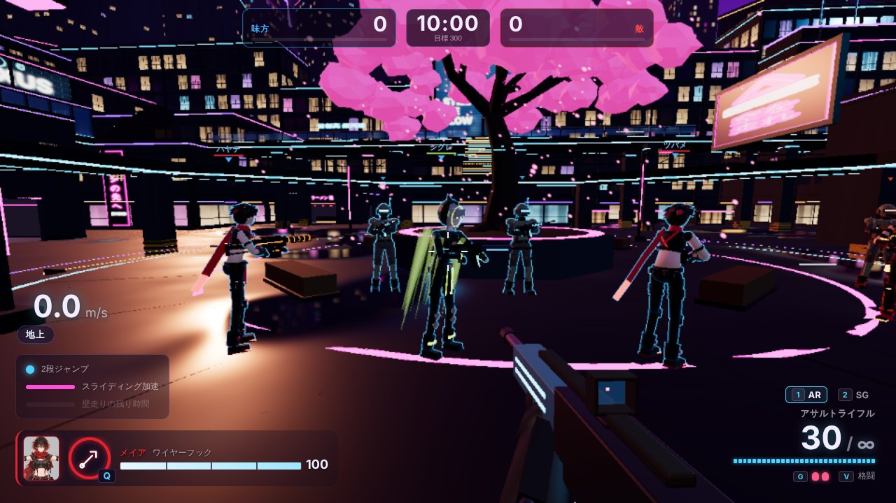

味方のパイロット・歩兵の青い輪郭（右端の赤いのは敵）。

## 次のフェーズへの申し送り

- **タワーディフェンス（フェーズ7）**の味方ボット 3 体は、今回のパイロットのボット（`PilotBot`）をそのまま使える。TD 用には、コアを守る位置取り・ダウンした味方の蘇生（キャラクター定義の「TD では〜」の使用条件）を足す。
- 敵の種類は、歩兵のボット（`GruntBot`）と同じ作り（地上の経路だけを使う・同じ入力コマンド）で増やせる。
- 当たり判定（`shared/hitbox.ts`）、`kill` イベント、立体音響（`client/audio.ts` の位置付きの音）、溶けて消える効果は、TD の敵にもそのまま使える。
- 経路データは軍事要塞マップでも `shared/nav.ts` が地形から自動で作る。壁走りのつながりもマップから見つける。
- メニューの「タワーディフェンス」を有効にし、キャラクター・装備の選択（`client/main.ts` のモード定義）にモードを足す。
