# フェーズ7 実装報告：軍事要塞マップ＋タワーディフェンス

プレイヤー＋味方のボット3体で、**軍事要塞**の中央の**コア**を 10 ウェーブの敵から守る協力モードを作った。マップ・敵・タレット・コアのモデルはすべて Blender のスクリプトで作っている。
受け入れ条件「プレイヤー＋ボット3体で10ウェーブ遊べる」は、ブラウザでの通しプレイと、ボットだけの4人チームで最後まで進める自動テストで確かめた（下の「確認したこと」）。

## 実装したもの

| 仕様の項目 | 状態 | 主なファイル |
|---|---|---|
| 6.2 軍事要塞（防壁・見張り塔・格納庫・テラス・連絡橋・指令塔・レーダー塔・トラック・装甲車・コンテナ・遠くの山と草原） | 済 | `shared/levels/fortress.ts`、`assets-src/maps/build_fortress.py`、`client/scene/fortressMaterials.ts` |
| 3つの侵入ルート（正面ゲート・左の坂道・右の搬入口）、各ルート6か所の推奨設置ポイント | 済 | `shared/levels/fortress.ts`（`td.routes`） |
| 全10ウェーブ、第5・第10は大型兵器 | 済 | `config/td.json`（`WAVES`） |
| 準備時間 30 秒（全員の準備完了で飛ばす） | 済 | `shared/td/towerDefense.ts` |
| クレジット（倒した人に入る。タレットの撃破は置いた人）・ウェーブクリアのボーナス | 済 | 同上 |
| B の購入メニュー（準備時間中だけ）・平らな地面に設置・半額で売却・1人 4 基まで | 済 | 同上（`placeCheck`・`tryPlace`・`trySell`）、`client/td/controller.ts` |
| タレット4種（機銃 300・ロケット 600・減速 400・修理 500） | 済 | `shared/td/towerDefense.ts`、`shared/td/rockets.ts` |
| 敵5種（歩兵・突撃兵・重装兵・ドローン・大型兵器）と狙う対象 | 済 | `shared/td/enemyBot.ts`、`shared/td/flyers.ts` |
| ダウン → 10 秒以内に E 長押し 3 秒で蘇生 → 間に合わなければ 15 秒で要塞の中に復活 | 済 | `shared/simulation.ts`（ダウン・蘇生） |
| 味方ボット3体（5.3.2：タレットの購入と設置、蘇生、コアの防衛、アビリティ）※のちに「人間の穴埋め・遊撃」に変更（下の「フェーズ7のあとの修正」） | 済 | `shared/td/allyBot.ts` |
| 参加人数ごとの敵の量の倍率（将来のオンライン用） | 済 | `config/td.json`（`PLAYER_SCALE`） |
| 5.3.4 ボットは「人間の代わりの参加者」：クレジット・タレット・蘇生の決まりは人間と同じ | 済 | ボットも `tryPlace`・`markReady`・`interactHeld` を使う |
| HUD（7.3 TD）：ウェーブ・コアの体力・残りの敵・次の侵入ルート・クレジット、味方を壁越しに（名前・キャラクター・体力）、ダウンした味方の印と残り時間 | 済 | `client/td/tdHud.ts`、`client/attrition/actorViews.ts` |
| 敵とタレットのモデル（Blender） | 済 | `assets-src/props/build_td.py`、`assets-src/characters/build_grunt.py` |
| メニュー：メインメニューから選べる・難易度・一時停止・もう一度・リザルトとベスト記録 | 済 | `client/main.ts`、`client/td/controller.ts` |

ゲームの進み（ウェーブ・敵の判断・タレット・クレジット・ダウンと蘇生）はすべて `shared/` にあり、描画から切り離して固定 60Hz で進む。プレイヤーの操作（置く・売る・準備完了・指示）は `TdMatch` のメソッドを呼ぶだけなので、将来オンラインにするときはサーバーへの要求に置き換えられる。数値は `config/td.json` にまとめ、`config/README.md` に一覧を書いた。

## 遊び方

1. メインメニューで **タワーディフェンス** → キャラクター・装備・**難易度**（易・普・難：敵の体力・攻撃・数が変わる）を選んで「出撃」。
2. 数秒後に最初の**準備時間（30 秒）**。左上の図と、地面を流れる赤い矢印の帯で、次のウェーブの侵入ルートがわかる。
3. **B** で購入メニュー → **1〜4** でタレットを選ぶ → 見ている地面に影が出る（置けないときは赤くなり、「コアに近すぎる」などの理由が出る）→ **E** か左クリックで置く。右クリック・B でやめる。
4. 自分のタレットを見て **E を長押し**すると売れる（半額が戻る）。
5. **F** で準備完了。全員がそろうか 30 秒たつとウェーブが始まる。
6. 倒されるとダウン。近くの味方が蘇生してくれる。ダウンした味方の近くで **E を 3 秒**押し続けると蘇生できる。
7. 第10ウェーブを守りきると勝ち、コアの体力が 0 になると負け。リザルトに守りきったウェーブ・タイム・チームの成績・ベスト記録（難易度ごと）。

| | |
|---|---|
| 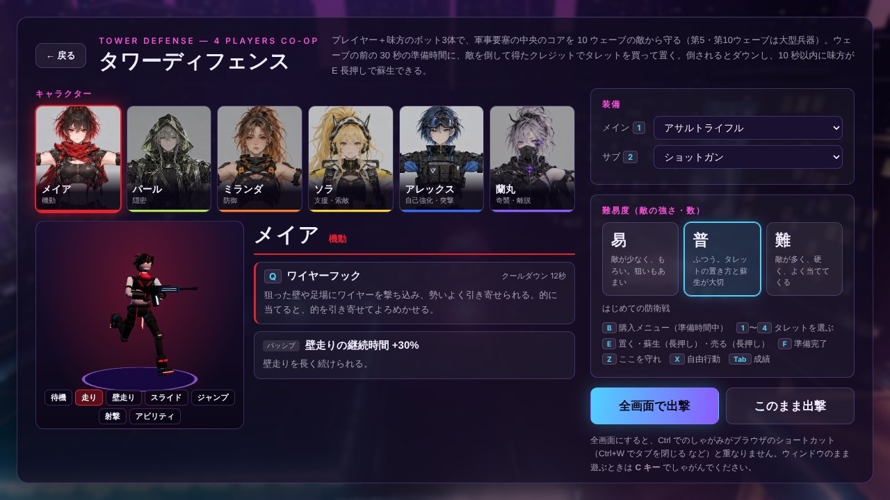 | 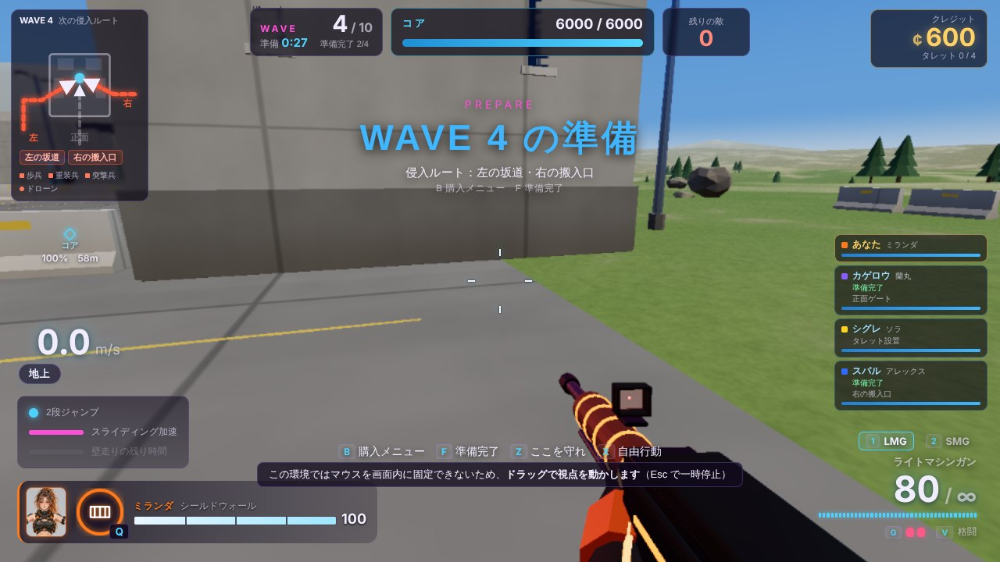 |
| 試合の前の画面（難易度・操作の一覧） | 準備時間。左上の図と地面の帯で、次のルートがわかる |
| 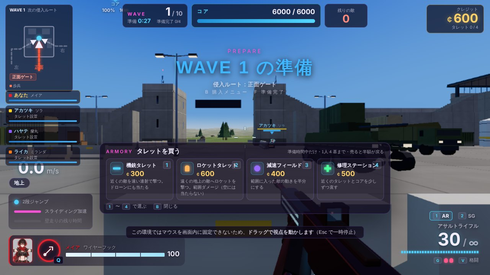 | 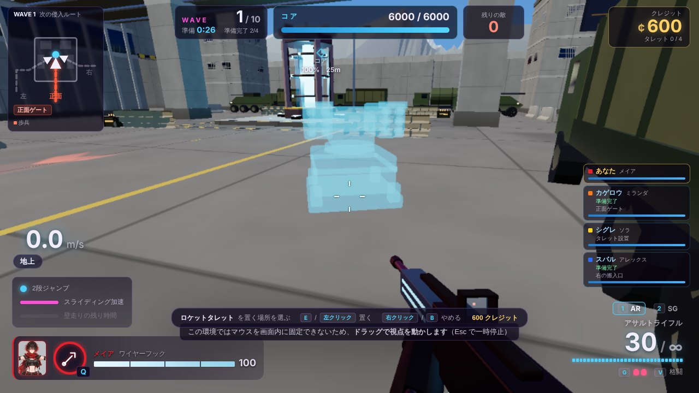 |
| 購入メニュー（B）。値段と説明。足りないものは暗くなる | 置く場所の影（置ける：青、置けない：赤）と、届く範囲の輪 |

## 軍事要塞（6.2）

晴れた昼の高原。灰色のコンクリートの要塞を厚い防壁が囲み、四隅に見張り塔、左右の建物群を中央の屋根付きの連絡橋がつなぐ。コアは橋の下の広場にある。

- 高さ：西の岩場 -6m、要塞の中と草原 0m、テラス 5m、防壁の上 7m（胸壁つきで歩ける）、連絡橋と別棟の屋上 10m、見張り塔 11m、格納庫の屋上 12m。防壁・塔・建物・コンテナの側面で壁走りができ、階段・坂でも上れる
- 侵入ルート：**正面ゲート**（南の草原。道が広く大型兵器も通る）、**左の坂道**（一段低い西の岩場から長い坂を上って西門へ）、**右の搬入口**（東の草原から、ひさしのある搬入口をくぐって荷役場へ）
- 弾薬補給所・味方の出現地点（8か所）・ドローンの浮かぶ場所・タレットを置ける範囲をデータで持つ
- 見た目は Blender で作り（約 3.6 万面・515KB に圧縮）、コンクリート・舗装・草・土・岩・塗装は、世界の位置から模様を作るシェーダーでつなぎ目なく描く。空は昼の青空、遠くの山まで見える

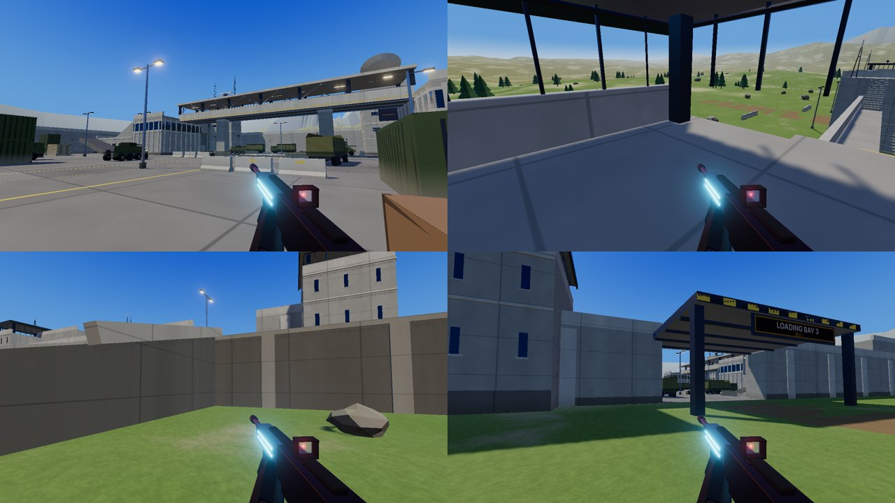

上から見た配置（★コア、□推奨設置ポイント、▲味方の出現地点、線は侵入ルート）：

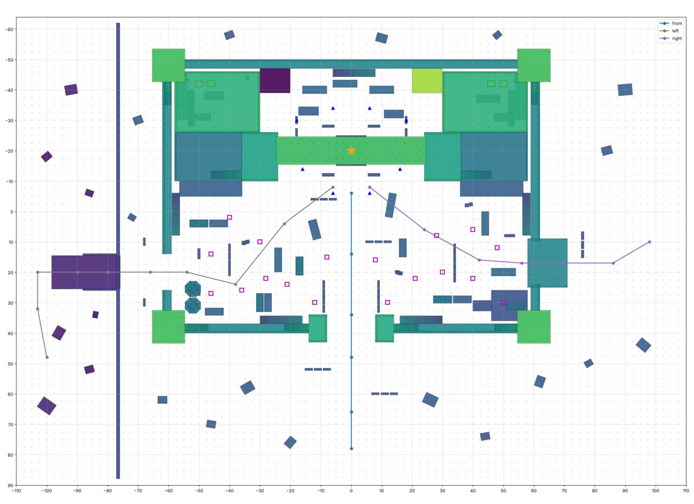

## 敵（5.3.3）

| 敵 | 動き | 弱点など |
|---|---|---|
| 歩兵 | ルートの道すじを歩いてコアへ。近くのプレイヤー・タレットを撃つ（同じくらいの距離ならパイロットを狙う）。いなければコアを撃つ | 体力 100 |
| 突撃兵 | 足が速く、撃たない。コアに取り付くと自爆（コアに大きなダメージ・まわりにも爆風） | 体力 70。早く倒す |
| 重装兵 | 遅いが硬い。タレットを優先して撃ち、正面の大きな盾を撃つ相手に向ける | 盾は弾を止める。**盾の上からのぞく頭**と**背中の動力パック**が弱点 |
| ドローン | 壁より高く飛んで入り、コアのまわりの上が開けた所まで降りてコアを撃つ。コアが見えなければ別の場所へ移る | 機銃タレット・プレイヤーで落とす。正面の赤い目が弱点 |
| 大型兵器 | 二本足で道すじを歩き、コアの 24m 手前で止まる。ロケット4発でタレット（なければコア、コアが遠ければ近くのプレイヤー）を狙い、近くのプレイヤーには機銃 | 体力 7000。**背中の炉心**と**正面のセンサー**が弱点。上に体力のバー |

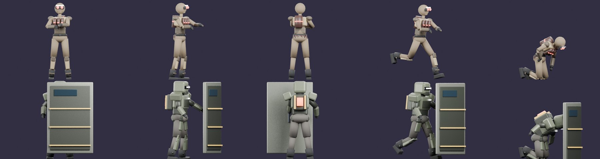

突撃兵・重装兵は歩兵と同じ骨格で作り、走り・倒れる動きを共有する（重装兵は盾を構える腕の形を別に作った）。ドローン・大型兵器は物理で動かさず、決めた動きで位置を進める。大型兵器の足の動きは、歩いた距離から太もも・すね・足首の角度を作る（足が地面に着くたびに地響きの音と画面の揺れ）。

| | |
|---|---|
| 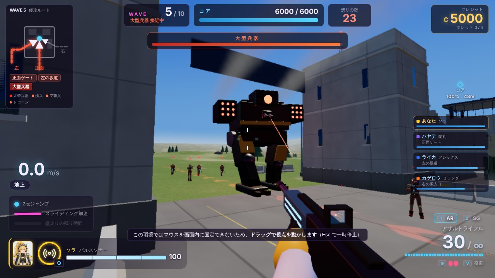 | 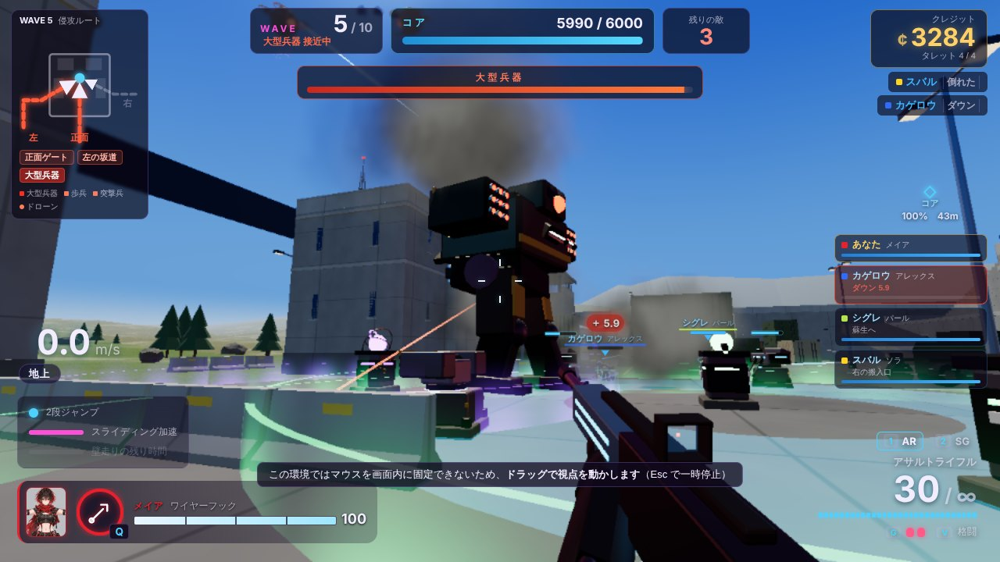 |
| 大型兵器（第5ウェーブ） | タレット・減速フィールドと戦う大型兵器 |
| 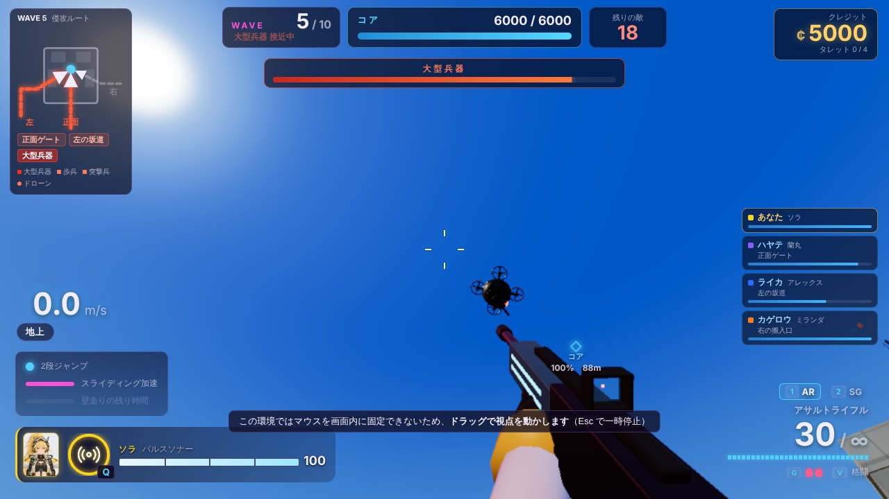 | 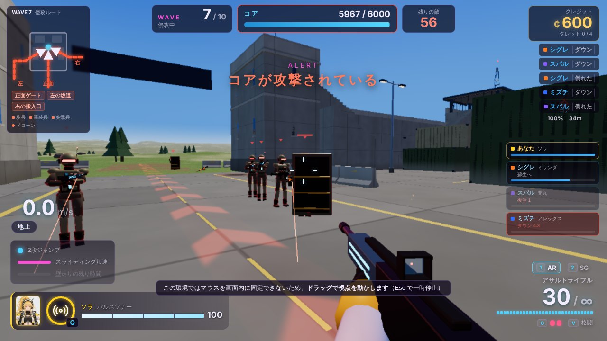 |
| ドローン | 重装兵（正面の盾） |

## タレット（5.3.1）

| タレット | 値段 | 動き |
|---|---|---|
| 機銃 | 300 | 30m 以内の敵を連射（ドローンにも当たる）。盾を向けた重装兵には頭を狙う |
| ロケット | 600 | 44m 以内の地上の敵へ、動く先を読んでロケット（範囲ダメージ） |
| 減速フィールド | 400 | 半径 9m の敵の動きを半分に（紫の光の壁で範囲を示す） |
| 修理ステーション | 500 | 半径 12m のタレットとコアを少しずつ直す（緑の光の輪） |

- 置く条件：準備時間中・要塞の中・平らな地面（四隅の高さがそろう）・まわりが空いている・コアから 6.5m 以上・ほかのタレットから 2.4m 以上・人と出現地点の上でない・自分から 7m 以内・1人 4 基まで・クレジットが足りる
- タレットは装甲で銃弾のダメージを 60% に減らす（爆発はそのまま）。弱ると煙を出し、壊れると爆発する
- 置くと組み上がる動きと光の輪。砲塔は左右・上下に向き、撃つと反動で下がる

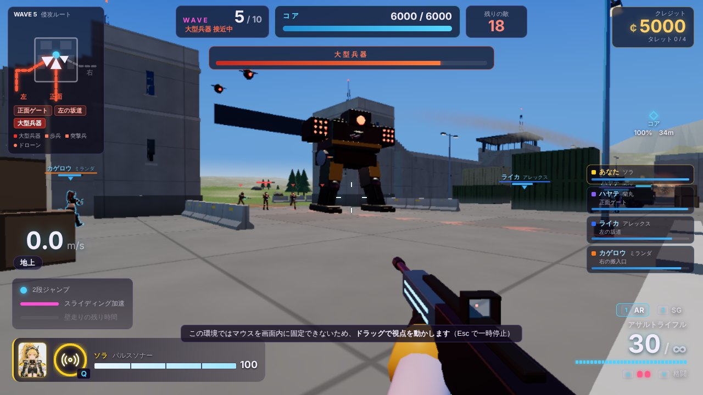

Blender で作ったモデル（タレット4種・コア・ドローン・大型兵器）：

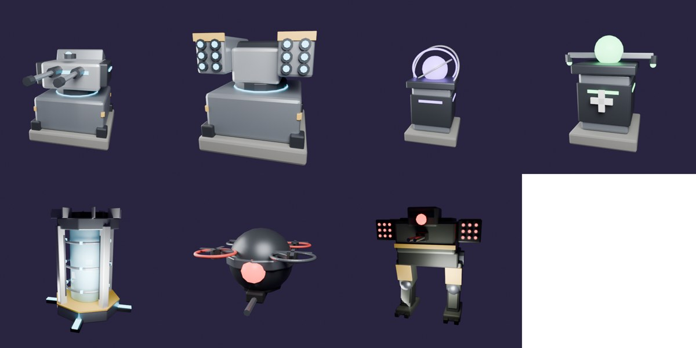

コアは体力で光の色が変わる（青 → 黄 → 赤。3割を切ると脈打つ）。撃たれると光り、輪が速く回る。画面には ◇ の印でいつもコアの位置と体力が出る（画面の外なら端に寄る）。

## 味方のボット（5.3.2）

※ この節はフェーズ7の最初の形。いまは指示を受けない「人間の穴埋め・遊撃」のボットに変えてある（下の「フェーズ7のあとの修正」）。

- 3体はプレイヤーと違うキャラクターを選び、正面・左・右のルートを1つずつ受け持つ。敵の来ないルートの担当は、手薄なルートへ応援に行く
- 準備時間：自分のクレジットで、担当ルートの推奨設置ポイントへ歩いてタレットを置く（ルートごとに順番を決めてある。例：正面は 機銃 → ロケット → 機銃 → 修理、左は 機銃 → 機銃 → 減速 → ロケット）。済んだら準備完了にする
- ダウンした味方（プレイヤーも）がいれば、近くの敵が少ないのを確かめて蘇生へ（ほかのボットが向かっていれば重ならない）
- コアが攻撃されていると、コアを守りに戻る
- アビリティ：ミランダはコアの前でシールド、ソラはウェーブの始めにソナー（ほかのキャラクターは消耗戦と同じ使い方）
- **Z**「ここを守れ」の間は指示した場所の近くで戦い、**X** で自由行動に戻る
- 盾を向けている重装兵には、盾の上の頭を狙う

| | |
|---|---|
| 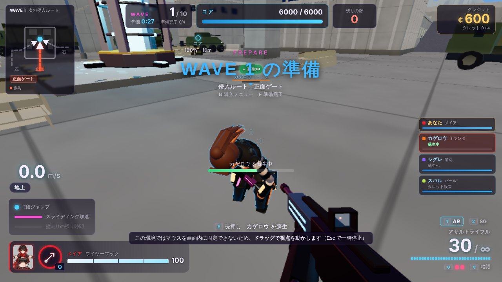 | 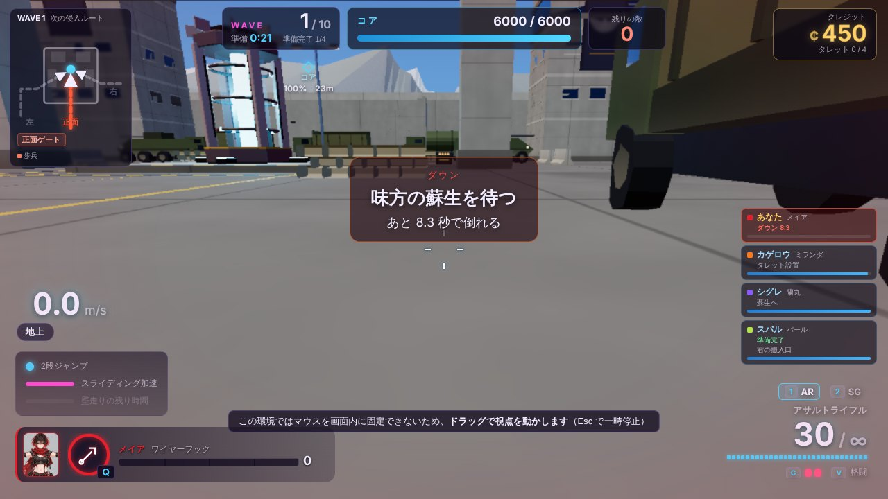 |
| ダウンした味方を蘇生（E 長押し）。名札に「蘇生中」 | 自分がダウン。視点が下がり、倒れるまでの時間 |
| 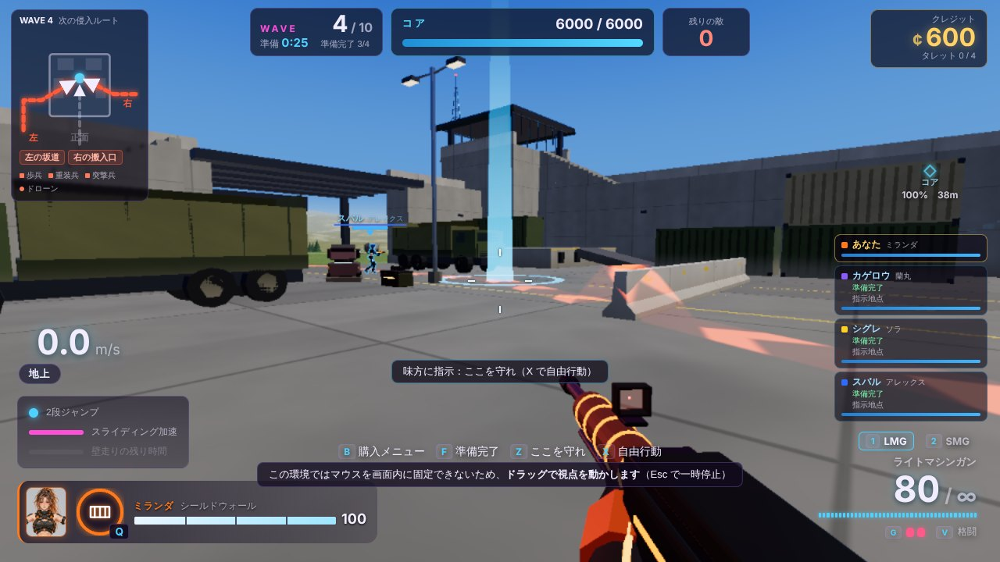 | 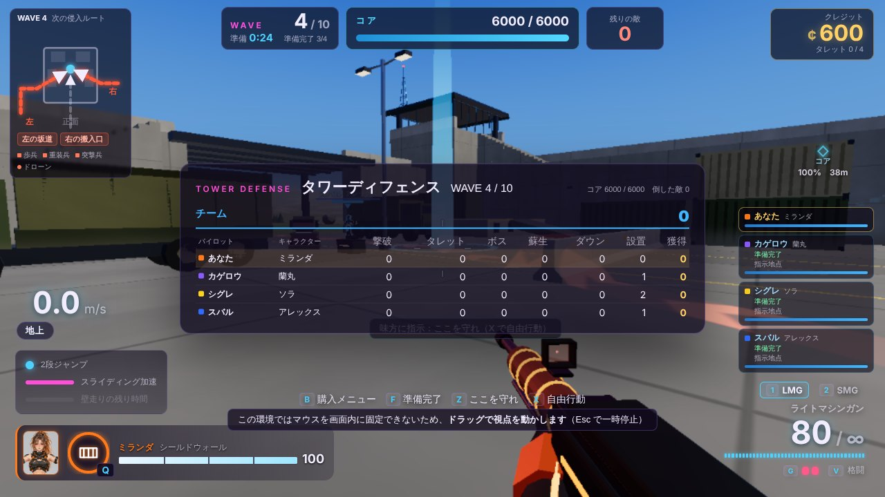 |
| Z「ここを守れ」の目印（青い光の柱） | Tab でチームの成績 |

## 画面表示（7.3）

- 上：ウェーブ（何番目 / 10）と準備時間の残り・準備完了の人数、コアの体力（減ると黄・赤）、残りの敵の数。大型兵器がいる間はその体力のバー
- 左上：侵入ルートの図（次の・いまのウェーブで敵が来るルートが赤く流れる）と、出てくる敵の種類
- 右上：クレジット（増えると跳ねる）と置いたタレットの数、その下に記録（ダウン・蘇生・タレットの破壊・大型兵器の撃破）
- 右：チームの4人（キャラクターの色・体力・担当や行動・ダウンの残り時間・準備完了）
- 味方の名札：名前・キャラクター・体力。**壁越しにも見える**。ダウンすると赤い「＋」と残り秒数、蘇生中は緑
- 下：その場でできる操作（購入・準備完了・蘇生・売る）と、押し続ける操作の進みのバー
- 真ん中：ウェーブの準備・開始・クリア、コアへの攻撃、クレジットの知らせ（+12 ¢ 突撃兵撃破 など）

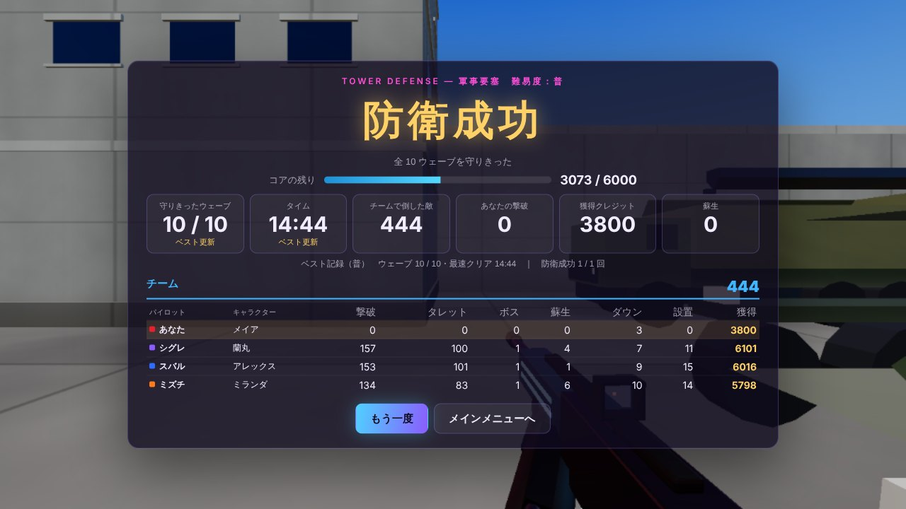

## 音

タレットの射撃・ロケットの発射と爆発・大型兵器の足音（遠くまで響く）・ドローンの電子音・修理の音・タレットを置いた／売った／壊された音・クレジット・ウェーブの開始（ボスのときは長く低い）とクリア・コアの警報・ダウン・蘇生の進み（だんだん高くなる）と蘇生・準備完了。どれも Web Audio で合成し、位置のある音は 3D で鳴らす。

## 確認したこと

### 自動テスト（162 項目、すべて合格）
フェーズ7で 14 項目を足した（`tests/td.test.ts`）：
- 要塞にコア・3ルート・出現地点・弾薬補給所がある。推奨設置ポイントの 8 割以上に実際に置ける
- どのルートの歩兵も、道すじをたどってコアのまわりまで歩ける
- ドローンは壁を越えてコアを撃ち、突撃兵はコアで自爆する
- タレットは準備時間だけ・要塞の中だけに置け、4 基まで・クレジットが減る・売ると半額が戻る。機銃タレットが敵を倒すと、置いた人にクレジットが入る。装甲で銃弾のダメージが減る
- 重装兵の盾は正面の弾を止め、頭と背中は弱点
- 第5・第10ウェーブだけに大型兵器
- ダウン → E 長押し 3 秒で蘇生（体力 50%）。蘇生されないと 10 秒で倒れ、15 秒で要塞の中に復活
- 全員の準備完了で準備時間を飛ばし、守りきるとボーナス。コアが壊れると負け
- **ボットだけの4人チームで、10 ウェーブを最後まで遊べる**（易しい。引っかかって取り除いた敵 0）

### ボットだけの4人チームでの通し（頭の中で数えたものではなく、実際に動かした結果）

| 難易度 | 結果 |
|---|---|
| 易（3 試合） | すべて勝ち。コアの残り 94〜98%、約 10 分 |
| 普（5 試合） | すべて勝ち。コアの残り 52〜87%、11〜13 分 |
| 難（5 試合） | すべて負け。守りきったのは 5〜9 ウェーブ（人間が加わって、タレットの置き方と蘇生がうまくいけば勝てる強さにしてある） |

1 ティックの処理は平均 0.44ms・99% が 2.9ms 以下（最大 44 体の敵、16 基のタレット）。

### ブラウザでの通しプレイ
- 実際のゲーム画面（ビルドしたもの）を自動操作のブラウザで動かし、メニューから「タワーディフェンス・普」で出撃して、**プレイヤー＋ボット3体で第1〜第10ウェーブを最後まで**進めた（プレイヤーは準備完了を押すだけ）。結果は防衛成功・コアの残り 3073 / 6000・14 分 44 秒・倒した敵 444（下のリザルトの画面がそのときのもの）。画面のエラーは 0
- それとは別に、購入メニュー → 置く場所の影 → 設置、E 長押しでの売却と蘇生、自分のダウン、Tab の成績、負け（コアの破壊）→ リザルト → もう一度・メニューへ、を1つずつ確かめた

## ほかの仕組みに入れた変更

- **体の形の当たり判定**：パイロット以外の参加者（重装兵・ドローン・大型兵器・タレット・コア）は、箱・球・カプセルを組み合わせた形で当たり判定を持つ（`shared/hitbox.ts` の `BodyDef`）。「弱点」の部品はヘッドショット扱い、「盾」の部品は弾を止める
- **ダウンと蘇生**を `Simulation` の決まり（`SimRules`）として入れた（消耗戦では使わない）
- 大型兵器・タレットの体と押し合う箱は、**弾や視線を通す**ようにした（弾は当たり判定の形に当たる）。以前は箱が弾を止め、大型兵器の体のほとんどに弾が当たらなかった
- **ダメージの倍率の決まり**（`damageScale`）：タワーディフェンスではタレットの装甲に使う
- 入力に「調べる」（E）と、モードごとのキー（B・F・Z・X・1〜4）を足した
- 経路データは、ステージごとに1度だけ作って取っておく（消耗戦とタワーディフェンスを行き来しても作り直さない）
- タワーディフェンスのモデルは、タワーディフェンスを始めるときに初めて読み込む（起動を遅くしない）。シェーダーも先に準備して、敵が初めて出たときに止まらないようにした

## 仕様書に書き足したこと
- 3 操作方法：F（準備完了）、Z・X（指示）、購入メニューの 1〜4、E 長押しで売却
- 5.3：準備完了は F。ボットは準備が済むと自分で準備完了にする
- 5.3.1【フェーズ7で決定】：置く場所の影と理由の表示、E・左クリックで置く、E 長押し（0.8 秒）で売る、タレットの装甲（銃弾 60%）

## 残っていること・次の候補
- 難易度「難」はボットだけでは勝てない強さにしてある。人間が遊んで、強すぎるようなら `config/td.json` の `DIFFICULTY.hard` を下げる
- 味方ボットの蘇生は「近くの敵が少ない」ことしか確かめないので、重装兵の正面へ蘇生に行って続けてダウンすることがある
- 突撃兵・重装兵は歩兵の動きを使い回している（重装兵だけの重い歩き方はない）
- フェーズ8（仕上げ）で、音・演出・設定・パフォーマンスをまとめて見直す

## フェーズ7のあとの修正

ご依頼の2点を直した。

### ① ミニマップ（消耗戦・タワーディフェンス）
- 画面の左上の円。自分を真ん中に、向いている方向が上になるように回る（N の印が北）。**M** で広い範囲（半径 140m）に切り替える（ふつうは半径 60m）
- 地形は、ステージの箱を上から見て描いた絵（高い所ほど明るい。橋や屋根は下が透ける）。ステージごとに1回だけ作る
- **範囲の中の味方**の位置：パイロットは向きの分かる青い矢印、歩兵は小さな青い点
- **銃を撃った敵**：撃った場所に赤い点が出て、約 2.5 秒で消える（撃ち続けている間は場所が更新される）。ソナーで見えている敵は、見えている間ずっと出る
- タワーディフェンスでは、ほかに：コア（範囲の外なら縁に）、タレット（自分のものは明るい）、大型兵器、ダウンした味方（赤い＋。範囲の外なら縁に）、次の・いまのウェーブの侵入ルート（流れる赤い点線。入り口が範囲の外なら縁に矢印）
- タワーディフェンスの左上にあった侵入ルートの図は、ミニマップに線を描くようにしたので外し、ルートの名前と敵の種類だけをミニマップの下に残した。画面の外のコアの印もミニマップの縁に任せた

| | |
|---|---|
| 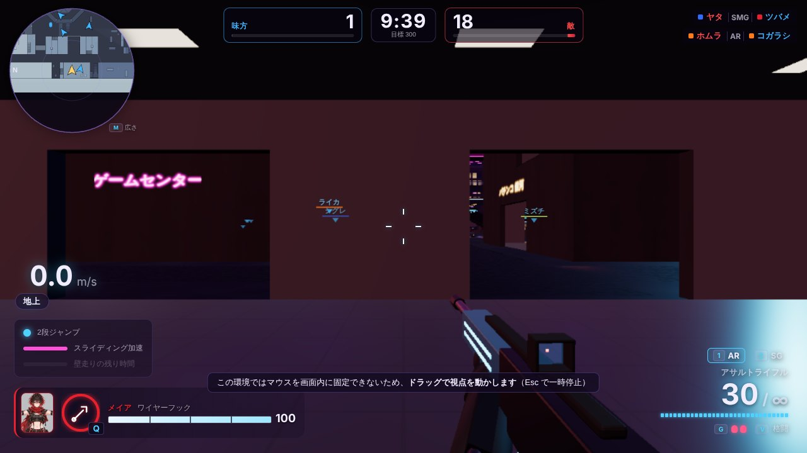 | 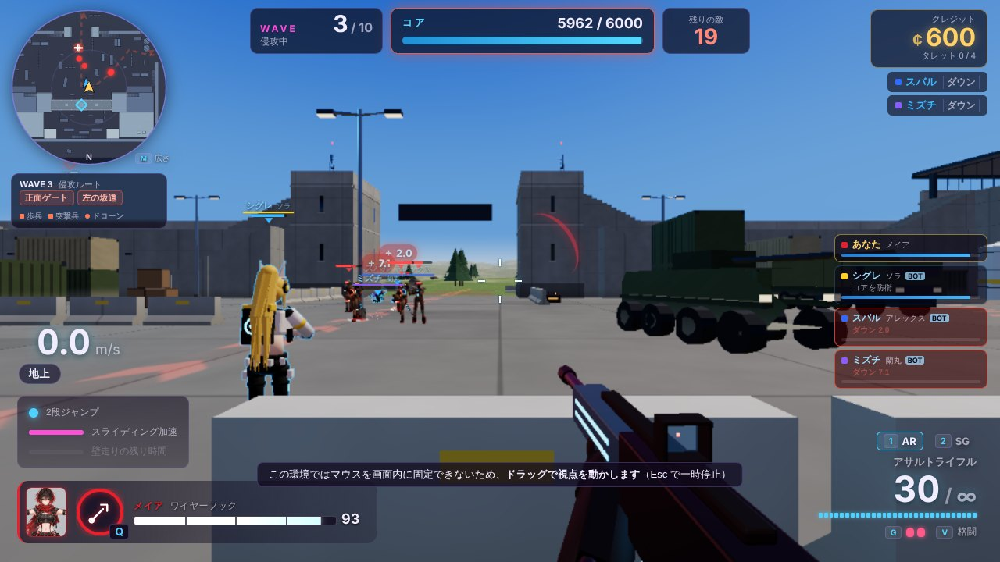 |
| 消耗戦：範囲の中の味方の矢印 | タワーディフェンス：撃った敵の赤い点・ダウンした味方・コア・侵入ルート |

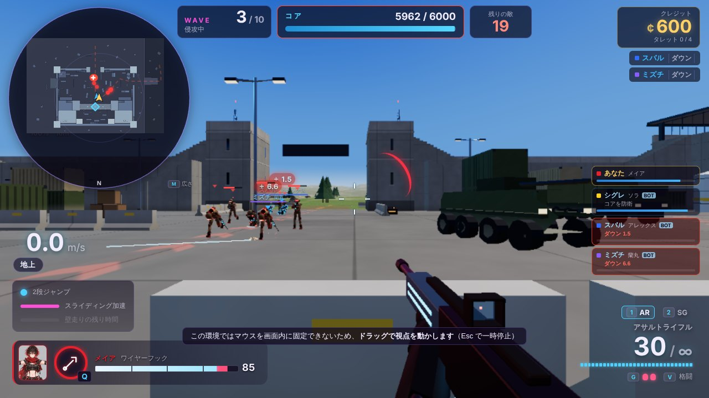

M で広い範囲（要塞のほぼ全体が入る）

### ② タワーディフェンスの味方ボットを「人間の穴埋め・遊撃」に
- ボットは、将来オンラインで人間2人＋ボット2体、人間3人＋ボット1体のように、**人間が足りない枠を埋める参加者**として作り直した。**指示（Z・X）はなくした**（キー・画面の案内・目印も）
- 担当ルートは持たず、**ずっと遊撃**する：
  - ウェーブ中は、敵がいちばん押し込んでいる所（コアに近い敵ほど・大型兵器や重装兵ほど重く数える）へ向かい、守る場所（入り口の内側。敵がそれより奥まで来ていれば、その敵とコアの間）で戦う
  - ほかの味方（人間も、近くにいればその場所を守っているとみなす）がもう行っているルートは避け、**誰も守っていないルートを大きく優先**する。行ったり来たりしないように、いま向かっているルートは少しひいきする
  - コアの近くまで来た**突撃兵**は、まわりに味方がいなければ、いちばん近いボットが止めに行く
  - コアが攻撃されていればコアを守り、ダウンした味方は安全を確かめて蘇生する（ここは前と同じ）
- **買い物は人間と同じ**：準備時間に、自分のクレジットで、次のウェーブで敵が来るルートのうち、チームのタレットが足りないルートを選び（近いルートから）、そのルートに置きたい組み合わせで足りない種類を、推奨設置ポイントとそのまわりに歩いて行って置く。人間が置いたタレットも数に入れるので、人間と同じ場所に重ねて置かない。ボットどうしは同じ場所へ向かわない。置き終わったら準備完了
- チームの表示では、ボットに **BOT** の印と、いまの行動（タレット設置・蘇生へ・コアを防衛・左の坂道へ・遊撃）を出す
- 準備時間（30 秒）のうちに置き終わらないことがあったので、近い場所から置くようにし、16 基（4人 × 4 基）が1回の準備時間で置けることを確かめた

### 難しさの調整
ボットが遊撃になり、守りの形が変わったので、次の2つを少し弱めた。
- 突撃兵の自爆のコアへのダメージ 170 → 140
- 第9ウェーブの重装兵 10 体 → 7 体

確かめた結果（実際に動かした試合）：
- ボットだけの4人（普）：6 試合すべて勝ち（コアの残り 25〜74%）
- 易：3 試合すべて勝ち。難：3 試合すべて負け（守りきったのは 7〜8 ウェーブ）
- **プレイヤーが何もしない（立っているだけ）＋ボット3体**（普）：6 試合で 2 勝。実質3人で4人分の敵と戦うことになるので、プレイヤーが戦い、タレットを置くことが前提の強さになっている。ブラウザでの通しプレイ（立っているだけ）は第9ウェーブで負けた。実際に遊んで厳しければ、`config/td.json` の数値を下げる

### テスト
16 項目（タワーディフェンス）を含む 164 項目、すべて合格。足したもの：
- ボットは指示を受けず、敵の来ている複数のルートへ手分けして向かう
- 準備時間に、人間と同じ値段・決まりで、次に敵が来るルートの推奨設置ポイントのそばにタレットを置き、準備完了にする

## 動作を軽くした
「全体的に重くなってきた」ので、CPU（JavaScript）と GPU（描画）の両方で、手間の大きいところを減らした。見た目はできるだけ変えず、近くは今までどおり細かく、遠く・画面の外を手抜きする方針。

### 何を変えたか
- **遠くのキャラクター・武器は、面を減らしたモデル（LOD）にする**：Blender で部品ごとに面を減らしたモデルを作った（`assets-src/characters/build_lod.py`）。キャラクター約 8,500 → 約 2,700 三角形、武器 2,000〜3,400 → 600〜1,000 三角形。30m より遠いと LOD に替えて影も落とさない、60m より遠いと武器を描かない（境目で切り替えが行ったり来たりしないよう 2m の幅を持たせた）
- **動きの計算を間引く**：画面の外の遠いキャラクターは動きも描画もしない（影の届く近くだけは描く）。※最初は画面に見えている遠いキャラクターも 1 秒に 15〜30 回に間引いていたが、動きがカクカクして見えるうえ軽くなるのは 0.2ms ほどだったので、下の「カクつきの修正」でやめた
- **武器を手に持たせる計算**を、骨組み全体ではなく手の骨だけ更新するようにした。見えない武器は計算しない
- **ミニマップ**の描き直しを 1 秒に 20 回にし、重い描き方（影のぼかし）をやめた
- **光**：コアとボスの点光源をやめた（光の数が変わるたびにシェーダーを作り直していた）。画質「中」ではマップの点光源を使わない（「高」では使う）
- **爆発・煙の粒**の数と上限を減らした
- **シェーダー**：キャラクターの「消えていく模様」は消えている間だけ計算する。要塞の地面・壁の模様のノイズを 1 段減らした
- **画質の設定が解像度に効いていなかった不具合を直した**：後処理の描き込み先が最初の解像度のまま変わらず、「低」や自動で下げても描く画素の数が減っていなかった。ブルームも決めた解像度（中：画面の 35%）ではなく 50% で計算していた
- **画質「自動」**：遅いと解像度を下げる（設定画面に「いま：中（解像度 85%）」のように出る）。下げる基準は 50fps。くわしくは下の「カクつきの修正」

### 測った結果（タワーディフェンス・第7ウェーブ・敵 43〜44 体、画質「中」）
| | 前 | 後 |
|---|---|---|
| 1フレームの JavaScript の時間（描画を除く） | 8.1 ms | 2.2 ms |
| キャラクター表示の更新 | 2.5 ms | 0.5〜0.7 ms |
| ミニマップ | 1.1 ms | 0.2 ms |
| 描く三角形（タワーディフェンス） | 65 万 | 26〜31 万 |
| 描く三角形（消耗戦） | 57 万 | 24 万 |
| 描画の呼び出し（タワーディフェンス） | 304 | 266〜273 |

ゲームの計算そのもの（1 フレーム約 1ms）は前から重くなかった。GPU の時間はこの確認環境（ソフトウェアで描く）では正しく測れないので、三角形・描画の呼び出し・画素の数・シェーダーの手間を減らした数で確かめた。

### カクつきの修正（軽くしたあとに「試合中にカクつく」と言われて）
原因を調べて、次の3つを見つけて直した。

1. **画面に見えている遠いキャラクターの動きを間引いていた**（軽くしたときに入れたもの）：20m より遠いと 1 秒に 30 回、45m より遠いと 15 回しか体の向き・姿勢を変えず、敵の動きがカクカクして見えた。測ると、間引いても軽くなるのは 1 フレーム 0.2ms ほどだったので、画面に見えているキャラクターは毎フレーム動かすように戻した（画面の外の遠いキャラクターを動かさないのはそのまま）
2. **試合の途中でシェーダー（描き方の計算）を作っていて、その瞬間に画面が止まっていた**（前からあったもの）：
   - 読み込みのときに作っておく準備が、画面に直接描く用の別のシェーダーを作っていて、役に立っていなかった（実際は後処理の描き込み先に描くので、色の変換が違う）。描き込み先を合わせて作るようにした
   - タワーディフェンスの敵・味方のキャラクターは、試合が始まってから表示を作るので、準備に入っていなかった。爆発・盾・ソナーの波・減速と修理の範囲の表示も、起きたときに初めて作っていた。読み込みのときに1つずつ作ってシェーダーを用意し、隠したまま残しておくようにした（使う物がすべて消えるとシェーダーも捨てられ、次に出たときにまた作ることになるため）
   - 確かめ：試合中に新しく作られたシェーダーの数　消耗戦 5 → 0、タワーディフェンス 13 → 0
3. **画質「自動」が試合の途中で影・ブルームを切っていた**：影の有無を変えると、すべてのシェーダーを作り直すので、その間画面が止まる。軽くしたときに下げる基準を 45fps → 50fps にしたので、起きやすくなっていた。試合の途中では解像度だけを下げる（100% → 85% → 70%。すぐ変えられて止まらない）ようにし、それでも遅いときは、次の試合の読み込みのときに画質を1つ下げるようにした

なお、画質「高」は、軽くしたときに直した不具合（解像度の設定が効いていなかった）のため、前より本当に高い解像度（最大 1.5 倍）で描くようになっている。重いときは「自動」か「中」にする。

## ロードアウト制（仕様 7.6）
試合に持っていく「キャラクター＋メイン武器＋サブ武器」の組み合わせを、メインメニューから設定できるようにした。

- **メインメニューに「ロードアウト」**を足した（項目の下に、使用中のロードアウトが出る）。画面は左から「保存した 5 つの枠」「キャラクター」「名前と武器」。押した枠が**使用中**になり、名前（12 文字まで）・キャラクター・メイン武器・サブ武器を変えると、すぐ保存される。「最初の組み合わせに戻す」で枠を初めの状態に戻せる
- 最初から入っている 5 つ：突撃（メイア／AR＋SG）、狙撃（パール／SR＋SMG）、防衛（ミランダ／LMG＋SG）、索敵（ソラ／AR＋SMG）、奇襲（蘭丸／SMG＋SG）。前の版で選んでいたキャラクターと装備は、1 枠目に引き継ぐ
- **武器の選択**：5 種の武器を、3D モデルから作った横向きの絵のカードで並べた。選んだ武器の威力・連射・射程・装弾数の目安（いちばん高い武器を満タンにした棒）と、有効距離・説明・リロードの時間を出す。メインとサブに同じ武器は選べず、もう一方と同じ武器を選ぶと入れ替わる
- **試合の前の画面**は「ロードアウトの選択」になった。上に 5 つの枠が並び、選んだ枠で出撃する。その場でキャラクター・武器も変えられる（使用中の枠が書き換わる）。リザルトの「もう一度」は同じロードアウトで続ける
- 練習の一時停止画面でも、これまでどおりキャラクター・武器を変えられる（使用中の枠が書き換わる）
- **データとして扱う**：形と確認は `shared/loadout.ts`。`checkLoadout` は、存在するキャラクター・武器か、同じ武器が 2 つでないか、名前が決まりどおりかを確かめる（オンラインではサーバーがマッチングのときに使う想定）。保存が壊れていても `repairLoadout` で使える形に直す。武器の説明・有効距離は `config/weapons.json` の `DESC`・`RANGE`
- 武器のカスタマイズ（スコープ・拡張マガジンなど）は、内容が決まっていないのでまだ入れていない（決まったら、ロードアウトの項目に足して保存の版を上げる）。試合中（復活のとき）に選び直す機能も、仕様で未定なので入れていない
- テスト：5 項目を足して 169 項目、すべて合格（最初の 5 つが正しいこと、正しくない組み合わせを通さないこと、壊れた保存を直すこと、名前の整え方、同じ武器を選んだときの入れ替え）

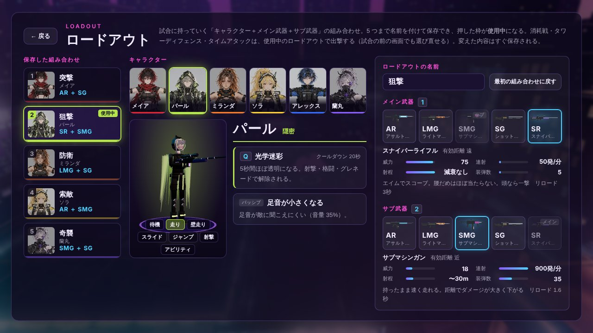
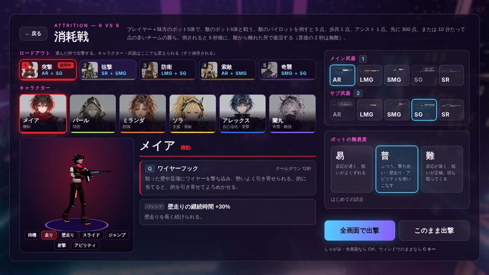

## 武器のカスタマイズとロードアウト画面（仕様 7.6）
ロードアウト画面で、武器ごとに **サイト 1 つ** と **アタッチメント 2 つまで** を選べるようにした。画面はタイタンフォール 2 のロードアウト画面にならって作り直した。

### ロードアウト画面
- 左：保存した 5 つの枠。中央：その中身を板で並べる（キャラクター／メイン武器［武器］［サイト］［アタッチメント 1］［アタッチメント 2］／サブ武器も同じ）。右：キャラクターの 3D（メイン武器をサイト・アタッチメント付きで持つ）と能力
- 板を押すと「選ぶ画面」に入れ替わる（タイタンフォール 2 と同じく、一覧から選ぶと元の画面に戻る。Esc で戻る）。選ぶ物にカーソルを合わせると、右に **3D の武器**（付けたときの見た目。ドラッグで回せる）、説明、**性能の棒**が出る。棒は今の性能からの変化を、増える所は緑、減る所は赤の斜線で示し、数字も「0.16秒 → 0.19秒」のように出す（COD のガンスミスの見せ方も参考にした）
- 板と一覧の絵：武器・サイトは 3D モデルから描いた絵（付けたサイト・アタッチメントも描く）。アタッチメントは白い線の印
- 試合の前の画面・練習の一時停止画面には、枠の列と中身の要約（武器の絵・サイトとアタッチメントの名前）を出し、「ロードアウトを編集」でこの画面を開く（閉じると元の画面に戻る）

### サイト（タイタンフォール 2・ほかの FPS を参考に 8 種）
アイアンサイト／レッドドット／ホロサイト（約 1.5 倍）／2倍スコープ／3倍スコープ（距離の目盛り）／スレットスコープ（約 1.6 倍。のぞくと、見えている敵を赤く浮かび上がらせる。壁の向こうは映らない）／スナイパースコープ（狙撃銃）／可変スコープ（狙撃銃。のぞいている間にホイールで 4 倍 ⇄ 8 倍）。倍率が高いほどのぞく時間が長い。武器ごとに付けられる物が決まっている（例：狙撃銃はスナイパー・可変・3倍・スレット）

- **Blender でサイトのモデルを作った**（`assets-src/weapons/build_sights.py` → `sights.glb`）。のぞく所は中空の筒にし、前後に半透明のレンズを入れた。武器のモデルも作り直し、組み込みだったドットサイトを外して、折りたたみ式の照門・照星と、サイト・レーザーを付ける位置を足した。どのサイトも、のぞく線の高さを照門・照星とそろえてある
- エイムすると、サイトの後ろの端が目の前に来る（倍率の高いスコープほど目を近づける）。照準は画面の中央に重ねて描くので、サイトのレンズの中に浮かんで見える。狙撃用の 2 種は画面いっぱいのスコープ（可変スコープは太い線が中央で細くなる照準と、倍率の表示）

### アタッチメント（8 種から 2 つ）
拡張マガジン（装弾数 ×1.4）／クイックリロード（リロード ×0.7）／サプレッサー（敵のミニマップに映らず、敵のボットに聞こえる距離 28m → 9m。射程 ×0.85。音もこもった音になる）／コンペンセイター（反動 ×0.65）／クイックストック（エイム・持ち替え ×0.7）／レーザーサイト（腰だめのばらつき ×0.6。狙っている所に赤い点と、銃から出る赤い光の筋）／ガンランナー（エイム中の移動 +20%、動いているときのばらつき ×0.5）／ロングバレル（射程 ×1.3、エイム ×1.1）。銃口に付ける物（サプレッサー・コンペンセイター）は 1 つまで（もう一方の枠と入れ替わる）

- サプレッサー・コンペンセイター・ロングバレル・レーザー・クイックリロードの引き手もモデルで付く。拡張マガジンは弾倉が長くなる。サプレッサーを付けるとマズルフラッシュが小さくなる
- 数値は `config/attachments.json`。ゲームのロジック（`shared/weaponCustom.ts`）は「付けた物を当てはめた武器の数値」だけを見るので、オンラインでもサーバーが同じ数値で計算できる。カスタマイズは武器ごとに覚えていて、メイン武器を替えて戻すと前の付け方に戻る
- 最初から入っている 5 つのロードアウトにも、役割に合わせたサイトとアタッチメントを付けた（前の版の保存は、その枠の初期のカスタマイズを使う）
- 試合の途中で初めて出たときに画面が止まらないよう、サイト・アタッチメントのシェーダーも読み込みのときに作っておく

### テスト
12 項目を足して 181 項目、すべて合格（付けられない物・3 つ以上・同じ物・銃口の部品 2 つを通さない、壊れた保存を直す、入れ替え、効き目が数値に入る、サイトの倍率とスコープ、調整パネルで変えたら作り直す、試合で拡張マガジン・クイックリロードが効く、サプレッサーの印、ガンランナーで速く歩ける、武器ごとに覚えている など）

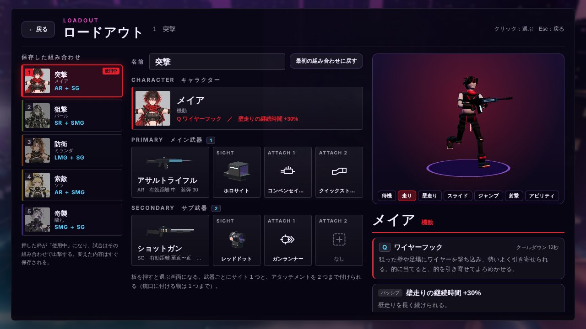
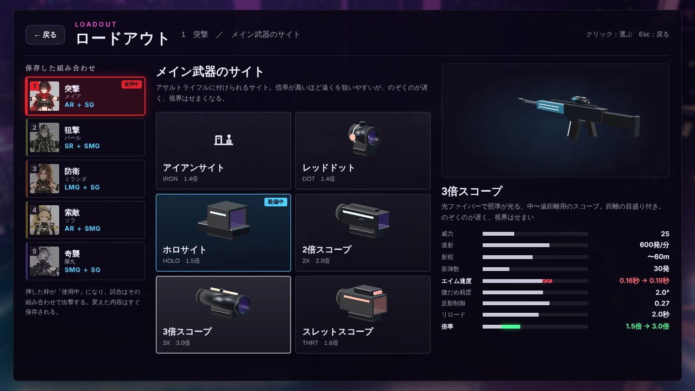
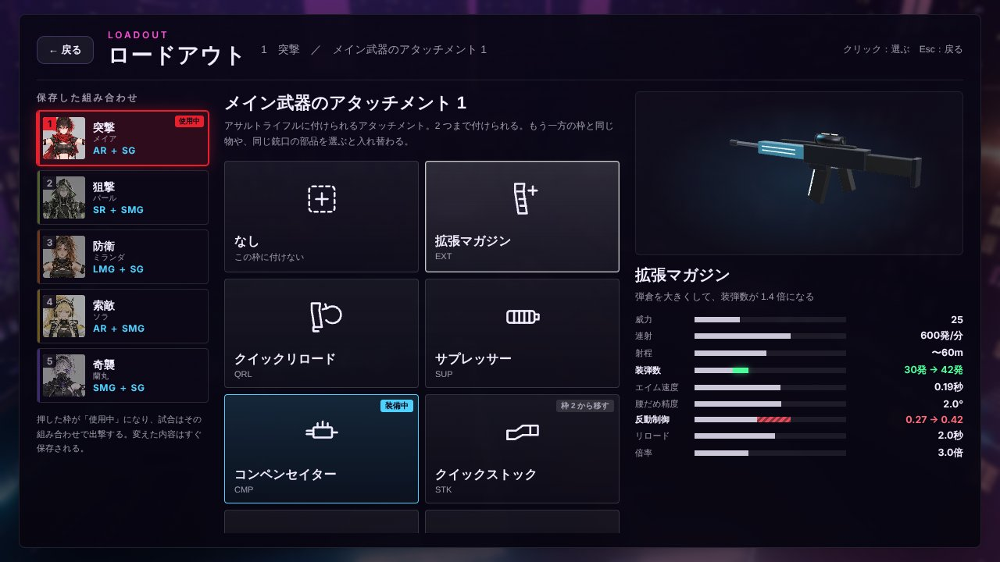
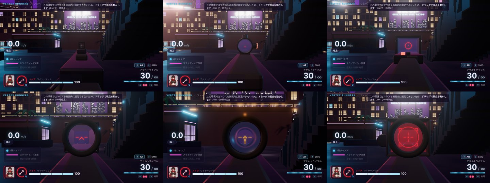

## ボットのカスタマイズとハンドガン
- **ボットもランダムにサイト・アタッチメントを付ける**：消耗戦の両チームのパイロットと、タワーディフェンスの味方ボット。その武器に付けられる物から選ぶ（サイトは 3 割ほどが最初のまま、アタッチメントは 2 つが多く、ときどき 1 つ。銃口の部品は 1 つまで）。ほかの判断の乱数の並びを変えないよう、別の乱数で選ぶ。サプレッサーを付けたボットの銃声は、ミニマップに映らない
- **三人称の武器にも付けた物が見える**：ほかの参加者が持つ武器にも、サイト・銃口の部品・レーザー・長い弾倉をモデルで付ける（武器とカスタマイズの組み合わせごとに 1 つの形にまとめて作り置き。30m より遠いときは今までどおり軽いモデル）
- **ハンドガンを足した**（6 種目の武器）：単発 420 発/分・ダメージ 40（頭 64。体に 3 発で倒せる）・**ダッシュしたまま撃てる**（ほかの武器は撃つとダッシュが止まる。撃つ間だけ銃を前に向ける）・装弾 12・リロード 1.3 秒。持ち替え 0.25 秒・エイム 0.13 秒と一番速く、持ったまま一番速く走れる（×1.1）。腰だめでもよく当たる。Blender でモデルを作った（スライド・3 点の照門と照星・グリップの中の弾倉。弾倉はリロードのときに抜ける）。サイトはアイアン・レッドドット・ホロ、アタッチメントは拡張マガジン・クイックリロード・サプレッサー・コンペンセイター・レーザー・ガンランナー。ボットの装備の組み合わせにも入れた（狙撃銃＋ハンドガンなど）
- タワーディフェンスのボットだけの 4 人（普）：5 試合で 4 勝（味方の装備の組み合わせとアタッチメントが変わったため。前は 6 戦 6 勝）
- テスト：4 項目を足して 185 項目、すべて合格（ランダムに選んでも正しい組み合わせになる・いろいろな物が選ばれる、消耗戦のボットが付けている、ハンドガンは単発・3 発で倒せ・一番速い・ダッシュしたまま撃てる）

## タワーディフェンスの購入メニューの拡張（仕様 5.3.5）
- **購入メニューをマウスで選ぶ形にした**（ARMORY）：B で開くとマウスのカーソルが出る（一時停止にはならず、キーボードで動ける）。左に分類（タレット／設置物／強化／装備）、真ん中にカード（Blender のモデルを描いた絵・名前・値段・持っている数・買えない理由）、右にマウスを乗せた物の説明と数値。置く物のカードを押すと、メニューが閉じて見ている先に半透明の影が出る → 左クリックか E で置く、R・ホイールで向きを 45° ずつ回す、右クリックでメニューへ戻る、B でやめる。置くとメニューに戻る。メニューの外をクリック・B で閉じ、Esc は一時停止。準備時間中はすべて、ウェーブ中はアーマーだけ買える
- **ダミーバルーン**（150・2 つまで）：パイロットの形にふくらむ囮（体力 320）。置くとシューッとふくらみ（弾むように伸びる）、風で揺れ、撃たれるとぶるっと震え、割れると破片が散ってしぼむ。兵士・ドローン・大型兵器の機銃はパイロットと思って撃ち（目立つので少し優先して狙う）、14m 以内の突撃兵は囮へ走って自爆する（コアは無事）。モデルは Blender のメタボールで作った、ふくらんだビニールの人形（ライフルを構えた形）と空気入れの台
- **ワイヤートラップ**（250・2 つまで）：タイタンフォール2のイオンのトリップワイヤーを参考にした。置くと中央の機雷が落ち、左右の機雷が弧を描いて最大 3.6m ずつ飛び（壁の手前で止まり、足場が切れていれば手前へ寄る）→ 3 本の脚が開く → 頭が伸びる → レーザーがちらついてつながる（1.1 秒で使えるようになる）。地上の敵がレーザーを横切ると光が強まって点滅し、近い機雷から順に 3 つが爆発する（1 つ 130 ダメージ・範囲 4.2m。1 回きり）。倒した分は置いた人のクレジット・撃破になる。ドローンには反応しない
- **バリケード**（200・2 つまで）：幅 4.2m・高さ 1.25m の装甲の壁（体力 1200。銃弾は半分）。両端の柱が出て、3 枚の板が順に地面からせり上がる（土ぼこり）。道をふさがれた兵士は足を止めて壊すまで撃つ（近くにパイロット・囮がいればそちらを撃つ。止められている間は「引っかかった敵」として消さない）。突撃兵はぶつかって自爆し、バリケードに大きなダメージ。大型兵器は踏みつぶす。味方の弾は通り、パイロットは乗り越えられる。修理ステーションで直る。壊れると爆発して板が倒れる
- **ジャンプパッド**（120・2 つまで）：味方のパイロットが乗ると約 5.8m 跳ね上がる（進んでいる向きへ勢いが付く。二段ジャンプと壁走りはまた使える）。乗ると板が跳ね、光の柱が上がる
- **タレット強化**（レベル 3 まで）：メニューの「強化」に自分のタレットの一覧（絵・レベル・場所・体力）。押すと次のレベルへ（値段はタレットの値段の 0.6 倍・0.9 倍。機銃なら 180・270）。マウスを乗せたタレットは世界の中に金の輪が出て、右に今のレベル → 次のレベルの数値が出る。威力・体力・射程・連射（ロケットは爆発の範囲も、減速は範囲と効き 50% → 40% → 32%、修理は範囲と速さ）が上がる。見た目はレベル 2 で側面の装甲板と金の山形、レベル 3 で四隅の柱と桃色の灯りが下からせり上がって付く（Blender で作った強化パーツ）。体力の札に Lv2・Lv3。売ると強化に使った分も半分戻る
- **アーマー**（200・1 ラウンドに 1 回）：買うとすぐ、体力の上に装甲 +50 が付く。ダメージは先に装甲が受ける。そのラウンド（ウェーブが終わるまで）だけ。体力ゲージの上に青いゲージで出て、受けると光り、割れると音が鳴る
- **味方ボットも同じ値段・同じ決まりで買う**：タレットが足りたら、次に敵が来るルートの道（要塞の中、コアから 16m より外）にワイヤートラップ（道を横切る向き。まだ誰のトラップもないルートに）、自分のタレットの強化（敵が来るルートの攻撃するタレットから）、クレジットに余裕があればダミーバルーン（タレットの前）、アーマーの順
- ミニマップに設置物（小さなひし形）を出す。設置物の音（ふくらむ・割れる・展開・作動・跳ぶ・せり上がる・壊れる）は 3D で鳴る
- ゲームロジックは `shared/td/towerDefense.ts`（置く・売る・強化・アーマー・設置物の1ティック）と `shared/td/devices.ts`（形と置き場所の計算）、敵の反応は `shared/td/enemyBot.ts`。表示は `client/td/deviceViews.ts`、メニューは `client/td/buyMenu.ts`・カードの絵は `client/td/tdThumbs.ts`。数値は `config/td.json` の `ITEMS`・`UPGRADE`（`config/README.md`）
- 試合中に新しいシェーダーが作られないことを確かめた（設置物・強化パーツ・レーザーの線も、試合の前に準備する）
- バランス（ボットだけの4人、6 試合ずつ）：易 6 勝、普 6 勝（コアの残り 1300〜5300）、難 0 勝（6〜9 ウェーブまで）。ボットがアイテムを買わないと普は 6 戦 4 勝なので、アイテムの分だけ守りやすくなった
- テスト：10 項目を足して 196 項目、すべて合格（置ける時間・値段・上限・売る、トラップの機雷の位置、バルーンを兵士が撃つ・突撃兵が囮で自爆してコアが無事、バリケードで兵士が止まって壊そうとする・突撃兵がぶつかって自爆、トラップが横切られて 3 つ爆発し置いた人の撃破になる、ジャンプパッドで跳ぶ、強化のレベル・値段・数値・売値、アーマーの装甲・1 ラウンド 1 回・ウェーブ中も買える・終わると無くなる、ボットが設置物・強化を買う）

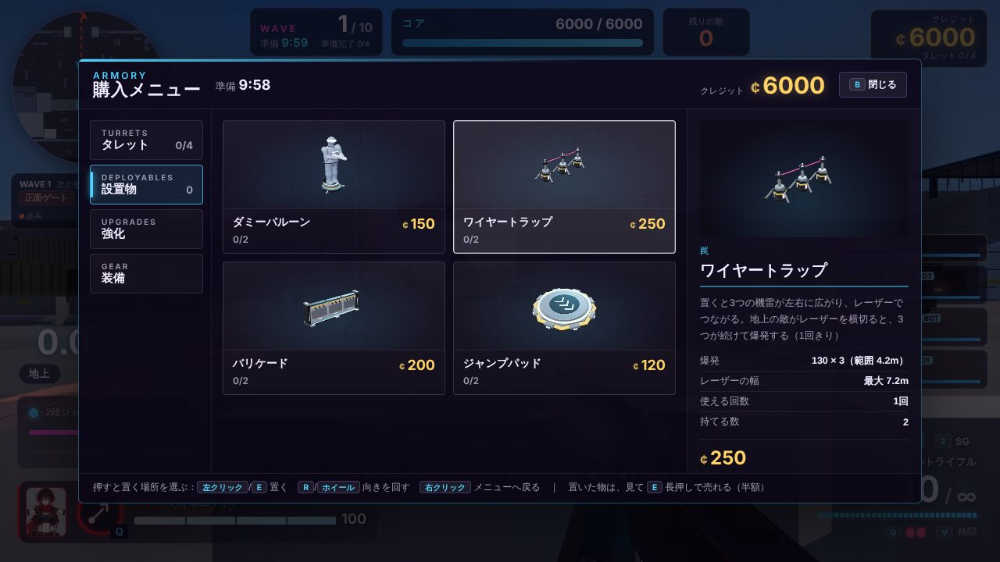
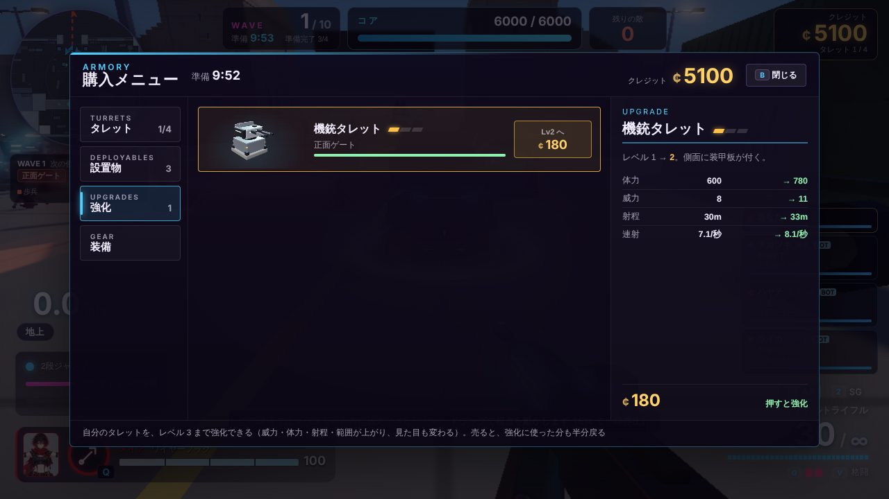
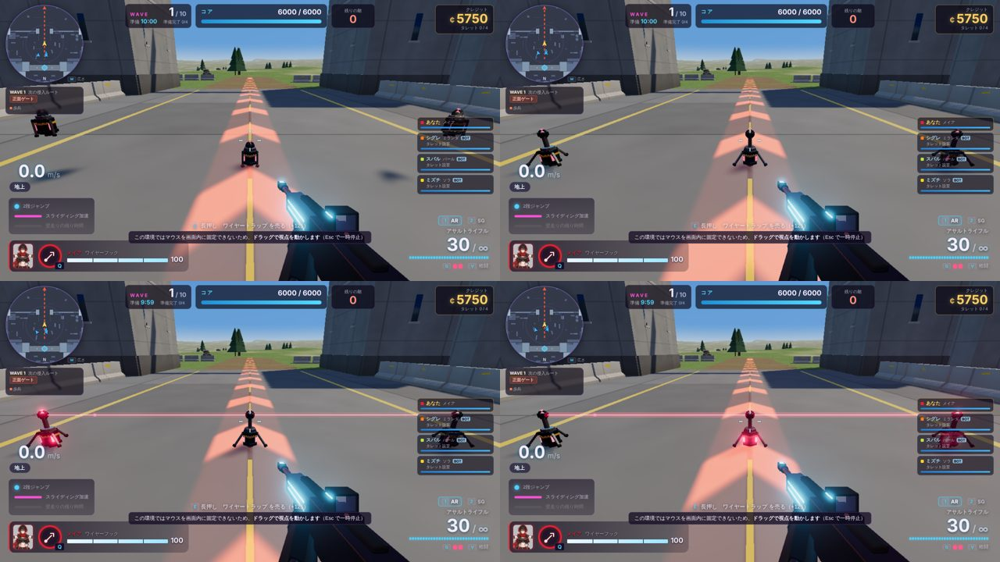
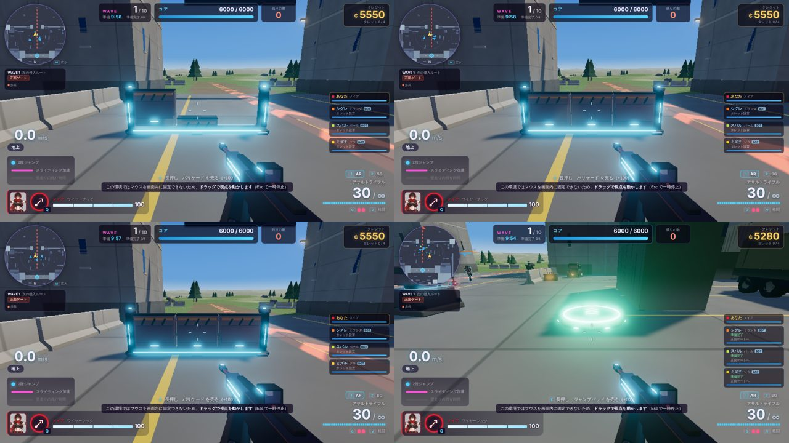
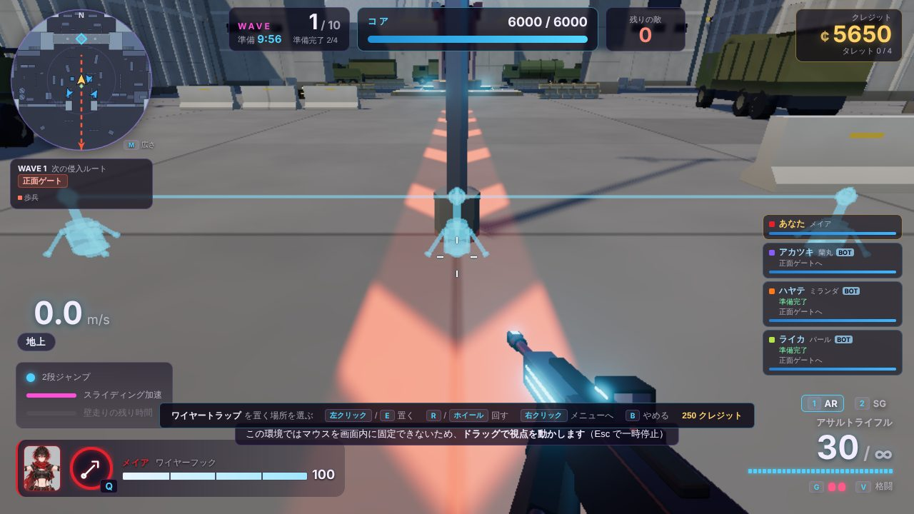
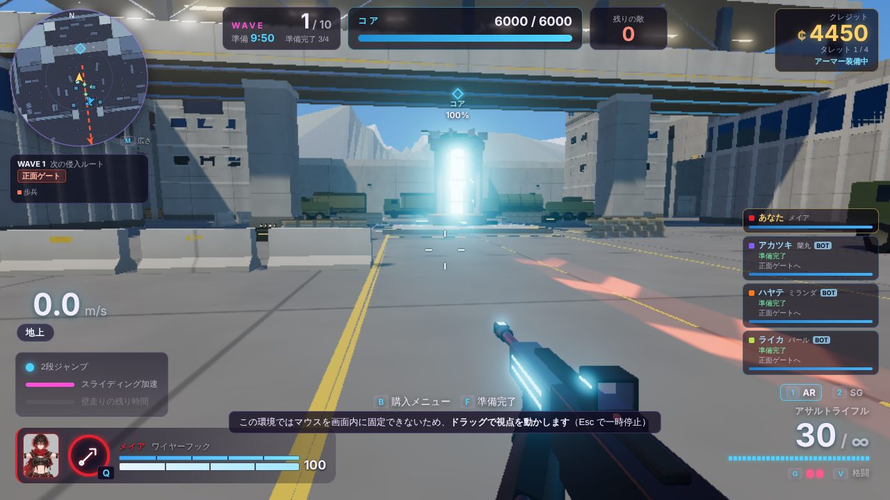

- **自分のタレットの輪郭を青く**：自分が置いたタレット（強化パーツも含む）は、味方のキャラクターの縁取りと同じやり方（形を少し外へ膨らませた裏側だけを塗り、本体の上には描かない）で、青い輪郭が付く。画面の上でほぼ同じ太さ（1080p で約 4px）で、明るさがゆっくり揺れる。ほかの人のタレットには付かない

## 消耗戦のブースト（仕様 5.1.1）
タイタンフォール 2 の「ブースト」を参考にした、いわゆるキルストリーク。消耗戦だけで使い、タワーディフェンスには入れていない。

- **ゲージ式**：得点（パイロット 5・歩兵 1・アシスト 1）がそのままゲージにたまる。満タンに要る得点はブーストごとに違う。満タンで「ブースト準備完了」の知らせと音、**X キー**で使うとゲージは 0 に戻る。倒されてもゲージは減らない。倒されずにパイロットを続けて倒すと、2 体目から 25% ずつたまり方が増える（最大 2 倍）
- **ロードアウトで 1 つ選ぶ**：ロードアウトの板に「ブースト」を足し、6 つのアイコンから選ぶ（右にアイコン・説明・満タンの得点・数値）。最初の 5 枠は順にフェイズリワインド・ホロパイロット・ハードカバー・マップハック・ティック。保存の形を v3 にし、ブーストの無い古い保存は、その枠の最初のブーストで補う。試合中に一時停止画面で変えると、たまった分はそのまま新しいブーストへ
- **HUD**：アビリティの隣にブーストのアイコンを丸いゲージで囲んで出す。満タンで金色に光って脈打つ。使ったとき・味方や敵がマップハックを使ったときは画面の中央下に知らせが出る

| ブースト | 満タン | 中身 |
|---|---|---|
| マップハック | 30 | 15 秒間、1.5 秒ごとに敵のパイロットと歩兵の位置をチームのミニマップへ赤い点で映す（少しずつ薄れる）。相手のチームにも知らせる |
| ホロパイロット | 25 | 自分そっくりの立体映像（キャラクター・武器・名前も同じ）5 体が、前へ扇状に広がって 9 秒走る（段差は跳び、壁なら向きを変える）。シミュレーションの中の本物の「体」（体力 1）なので、敵のボットは本物と思って狙い撃つ。撃たれると光の粒になって消え、得点にはならない。味方からは半分透けてちらつく青い映像に見える（名札なし、ミニマップにも出ない） |
| フェイズリワインド | 25 | 毎ティック記録している位置をたどって、5 秒前にいた場所へ 0.6 秒でさかのぼる。戻る間はフェイズシフトと同じ扱いで弾が当たらず、画面も紫になる |
| ハードカバー | 30 | 目の前 2.2m に幅 6m・高さ 2.8m の盾を 20 秒立てる（ミランダのシールドと同じ仕組み。敵の弾を止め、味方の弾は通す）。色は少し暗めの青 |
| ティック | 35 | Blender で作ったクモ型の地雷（胴・赤い目・6 本の脚）を 2 つ投げる。着地すると這って敵へ向かう（見えていれば 28m、見えていなくても 12m まで気づく）。2.2m まで近づくと爆発（最大 110・範囲 4m。壁の向こうには届かない）。低い段差（1.1m まで）は跳ねて越え、高い壁は沿って回り込み、2.5 秒近づけなければしばらく別の敵を狙う。12 秒で自爆。脚は這った距離で動き、狙う相手がいると目が速く点滅する。倒した分は投げた人のもの（キルログは TICK） |
| ダイスロール | 20 | ほかの 5 つのどれかが出る（出た物を知らせる） |

- **ボット**（両チームのパイロット）もランダムに 1 つ持ち、同じ決まりでためて、効く場面で使う（マップハック：敵を見失っているとき／ホロパイロット：敵が 10〜45m に見える・追い込まれたとき／フェイズリワインド：体力が減って撃たれているとき／ハードカバー：撃たれている・物陰にいるとき、敵の方へ／ティック：敵が 5〜24m に見えるとき、敵の方へ投げる／ダイスロール：敵が見えるとき）。ボットだけの試合（約 3 分）で、どのブーストも使われることを確かめた
- 音：準備完了、使ったとき（種類ごと）、ティックを投げる・着地・爆発、ダイスを振る音を Web Audio で合成（3D）
- ゲームロジックは `shared/boosts.ts`（`BoostSystem`。ゲージ・使う・ホロパイロットの入力・戻る動き・ティックの動き）。消耗戦の進行（`shared/attrition.ts`）が、シミュレーションの前後で呼ぶ。表示は `client/attrition/boostViews.ts`（ティック・光の粒）と `actorViews.ts`（ホロパイロット）、アイコンは `client/ui/boostIcons.ts`。数値は `config/boosts.json`
- 試合中に新しいシェーダーが作られないことを確かめた（ティック・立体映像の見た目を試合の前に準備。あわせて、画面全体の効果［フェイズ・被弾など］も試合の前に準備するようにした。これまでは初めて被弾したときやフェイズのときに 1 回作られていた）
- テスト：11 項目を足して 207 項目、すべて合格（ゲージのたまり方・続けて倒したときの増え方・倒されても減らない、満タンでないと使えない、マップハックの間隔、ホロパイロットが走り撃たれると消えて得点にならない、5 秒前へ戻り戻る間は当たらない、ハードカバーが敵の弾を止める、ティックが這って爆発し投げた人の撃破になる、高い壁を回り込み低い段差を越える、ダイスロール、ロードアウトの確認と直し方、消耗戦でボットも使う）

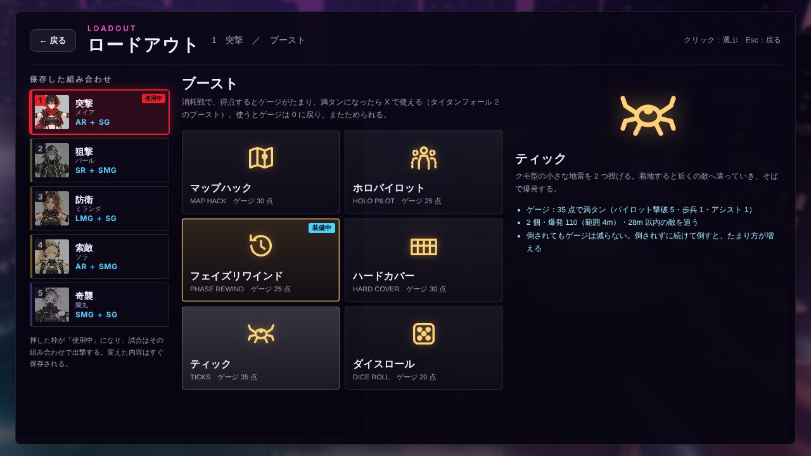
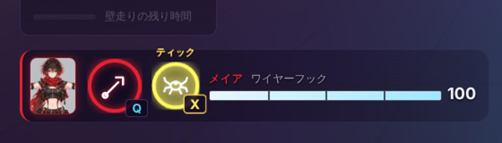
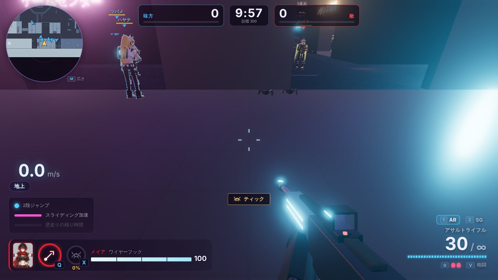
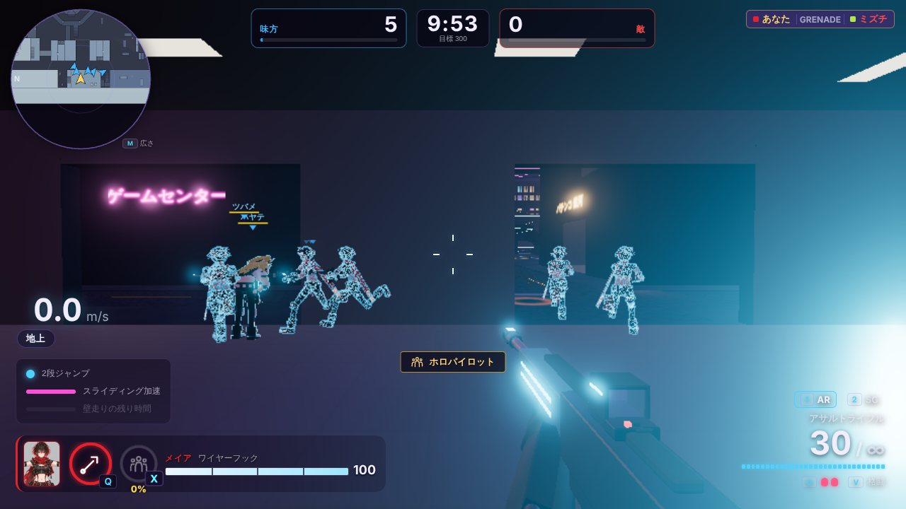
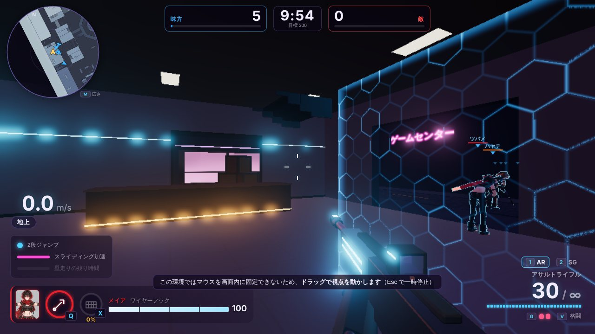
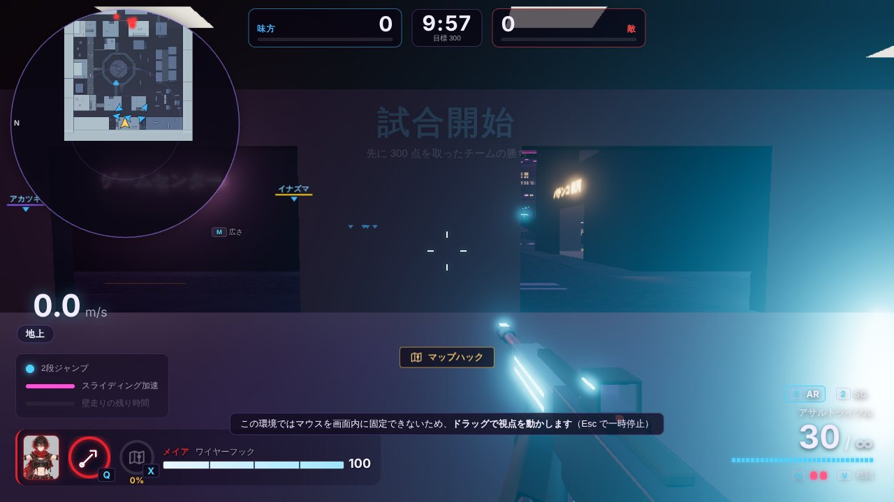
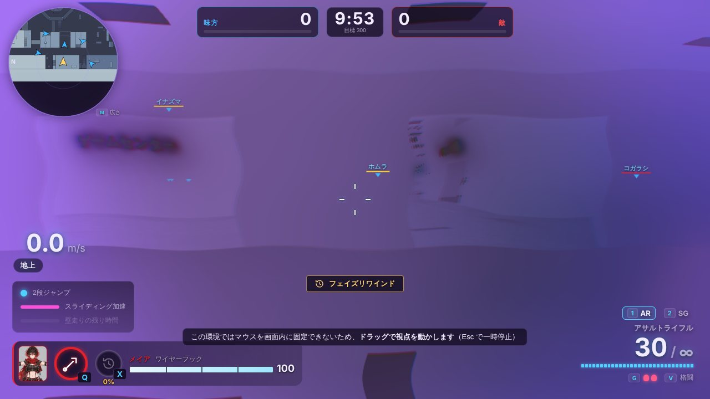

## グレネードの種類（仕様 7.1.1）
タイタンフォール 2 の「オードナンス」（Apex Legends の投げ物も参考）にならい、グレネードを 6 種にして、ロードアウトで 1 つ選ぶようにした。消耗戦・タワーディフェンス・練習のどれでも使える。

| 種類 | 飛び方 | 中身 |
|---|---|---|
| フラググレネード | 跳ねて転がる | いままでのグレネード（3 秒で爆発・110〜20・範囲 6m） |
| アークグレネード | 跳ねる | 1.4 秒で放電（32〜12）。電撃を受けた敵は 3 秒、動きが最大 50% 鈍り、ボットは狙いが大きく乱れて振り向きも遅くなる。自分が受けると画面が青白くちらつく。ドローンには 3.5 倍 |
| ファイアスター | まっすぐ速く飛び、刺さる | 刺さった所が 5 秒燃える（半径 2.6m・毎秒 30）。壁に刺されば、その下の地面に炎が垂れる。敵に刺されば敵ごと燃え、敵と一緒に動く |
| グラビティスター | まっすぐ速く飛び、刺さる | 1.8 秒、7m 以内の敵を渦の中心へ引き寄せて浮かせ（自分では動けない）、そのあと爆発（70〜25） |
| スモークグレネード | 跳ねる | 1 秒で半径 6.5m の煙の幕を 12 秒。ボットも煙越しには見えず、敵の名札も出ない。中に入ると画面も煙る |
| サッチェル | 張り付く（敵にも） | 置いてあるときに G を押すと、まとめて起爆（150〜35）。HUD に「起爆」と点滅。置いた人が倒されると消える |

- **投げる前**：G を押している間の軌道の予測線と範囲の輪が、種類の色になる。刺さる種類は、刺さる所に面に沿った印が出る。範囲の輪は爆風・炎・渦・煙の広さ
- **飛び方**：刺さる種類は速く飛ぶので、通り抜けないように線で当たりを調べ、地形・敵の体の最初に当たった所に刺さる（体の中から始まる線も、点で調べて刺さる）。刺さった敵が倒れると落ちる
- **一人称**：手に持つグレネードが種類ごとのモデルに変わる（ピンのある種類は構えるとピンが抜ける）。サッチェルの起爆は左手でスイッチを押す動き
- **HUD**：G の横に種類のアイコンと所持数（種類の色）。サッチェルを置いてあると「起爆」が点滅
- **ロードアウト**：「ORDNANCE　グレネード」の板を足し、6 つのカードから選ぶ（Blender のモデルを描いた絵・飛び方・数・数値）。最初の 5 枠は順にフラグ・スモーク・サッチェル・アーク・グラビティスター。保存の形を v4 にし、古い保存は枠の最初の種類で補う。試合中に一時停止画面で変えると、所持数は満タンから（置いたサッチェルは消える）
- **ボット**（消耗戦のパイロット・TD の味方）もランダムに 1 つ持つ。刺さる星は胸を狙ってまっすぐ、フラグ・アークは放物線で投げる。スモークは追い込まれて退くとき自分と敵の間に張り、サッチェルは投げておいて敵がそばに来たら（敵に張り付いたらすぐ）起爆する。ボットだけの消耗戦で、6 種すべてが使われ、それぞれで倒していることを確かめた
- **見た目**（Blender でモデル 5 つを作った：アークは青白い輪の筒、ファイアスターは橙の芯の 4 枚刃、グラビティスターは紫の球の 3 枚刃、スモークは灰緑の缶、サッチェルは赤い灯りの平たい袋）：アークは稲妻が走る放電（火の玉なし）、ファイアスターは揺らめく炎と床の照り返し、グラビティスターは吸い込まれる光の粒の渦・黒い核・縮む輪と紫の爆発、スモークはもこもこした煙の塊（明かりを受けない色）、サッチェルは大きめの火の玉。電撃を受けた敵の体には青白い火花、渦に吸われる敵には紫の光が散る。光源は増やさない（シェーダーの作り直しを起こさないため）
- **音**（Web Audio、3D）：刺さる金属音・張り付く音（自分に刺さると警告音）、煙が噴き出す音、燃え上がる音とぱちぱち、渦のうなり、放電、グラビティの爆発、電撃を受けた音、起爆スイッチ
- **キルログ**：倒したグレネードの種類（FRAG・ARC・FIRESTAR・GRAVITY・SATCHEL）を出す
- ゲームロジックは `shared/grenades.ts`（種類ごとの数値・飛び方・刺さる・爆風・予測線）と `shared/simulation.ts`（刺さる・燃える・引き寄せる・煙・起爆・電撃）。数値は `config/grenades.json`（フラグは `weapons.json` の `COMMON.GRENADE_*`）。見た目は `client/weapons/grenadeView.ts`、画面の電撃は `client/scene/screenFx.ts`、アイコンは `client/ui/grenadeIcons.ts`
- 試合中に新しいシェーダーが作られないことを確かめた（消耗戦・TD とも、6 種を投げて煙の中に入り、電撃の画面効果も出して 0）
- バランス：TD（ボットだけの 4 人・普通）は 6 戦 6 勝のまま（味方ボットも種類を持つので、コアの残りは 3700〜5800 に増えた）。グラビティスターは引き寄せる範囲を 8m → 7m・爆発を 80 → 70 に弱めた
- テスト：9 項目を足して 216 項目、すべて合格（種類ごとの数・ロードアウトの確認と直し方・試合中に変える、アークのダメージと電撃で鈍る、ファイアスターが壁に刺さって焼き続け倒すと種類が残る・敵に刺さって一緒に動き燃える、グラビティスターが引き寄せて浮かせて爆発、スモークが見通しをふさいで時間で消える、サッチェルが張り付いて G で起爆・置いた人が倒されると消える、ボットが煙越しに見えない）

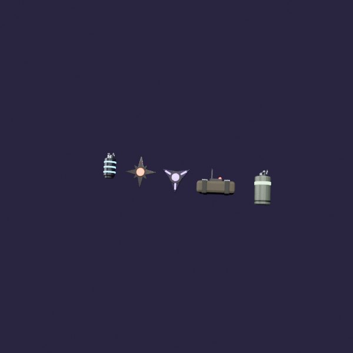
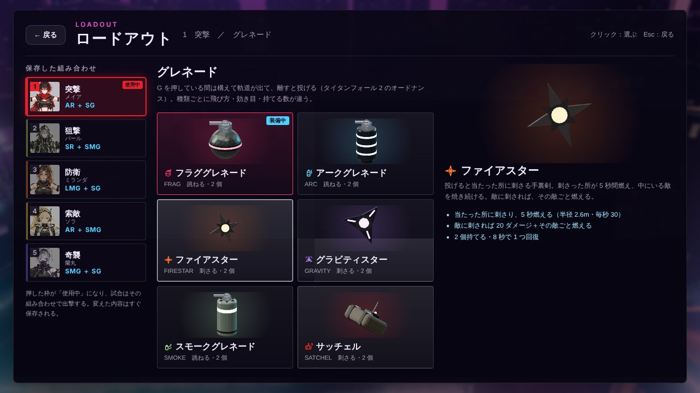
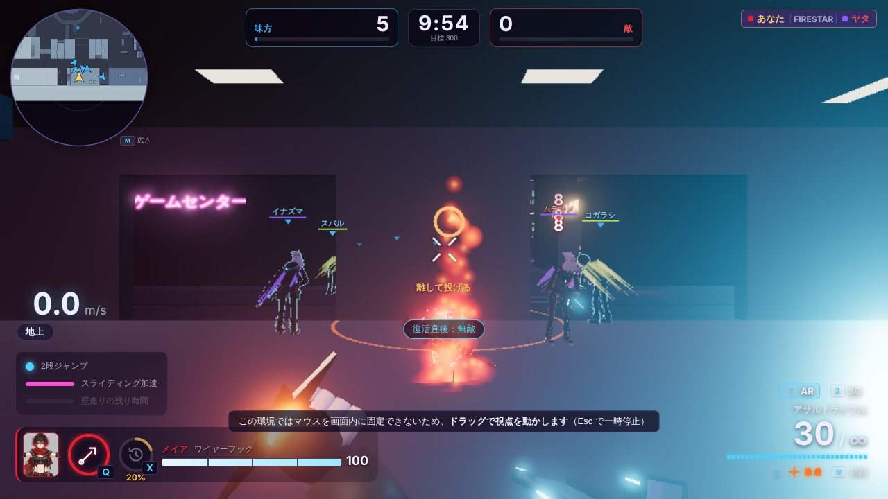
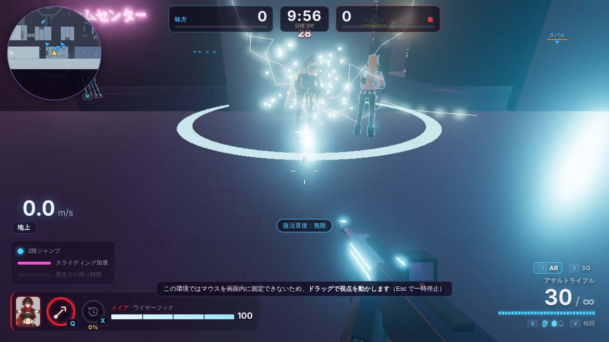
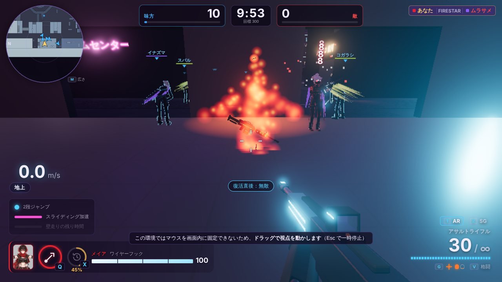
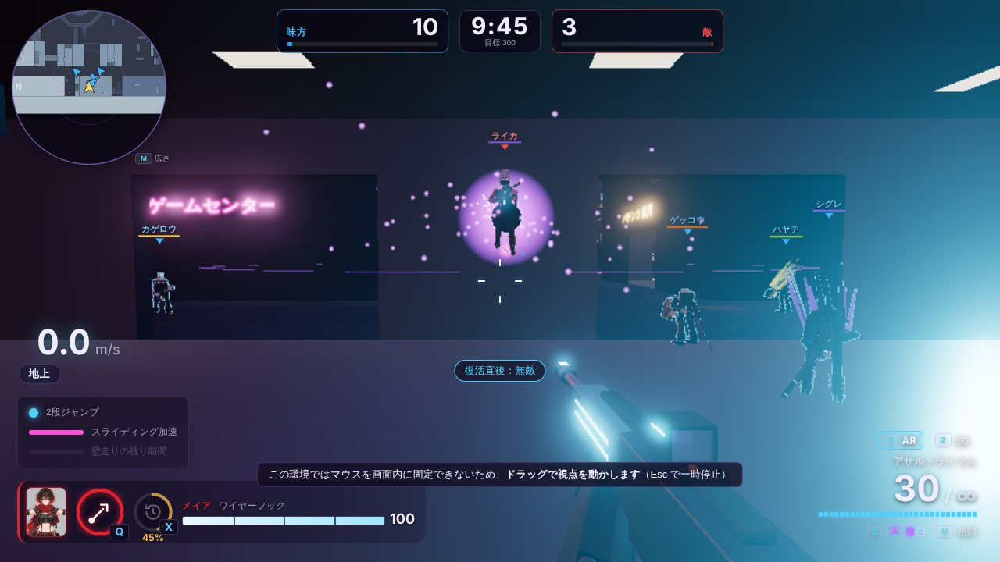
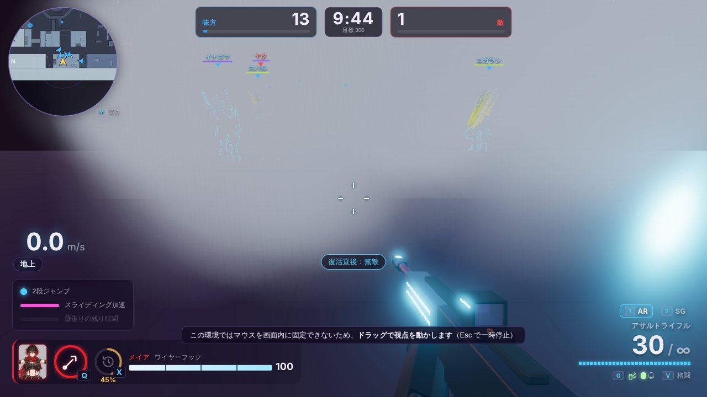
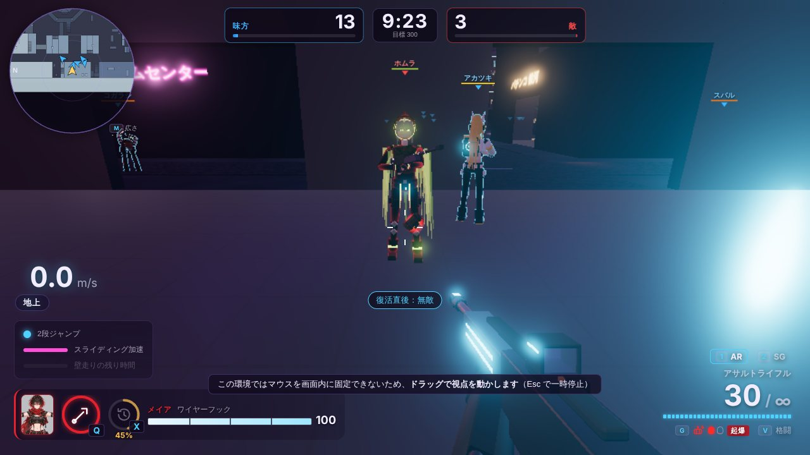
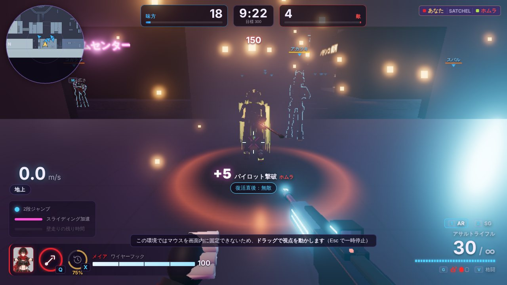
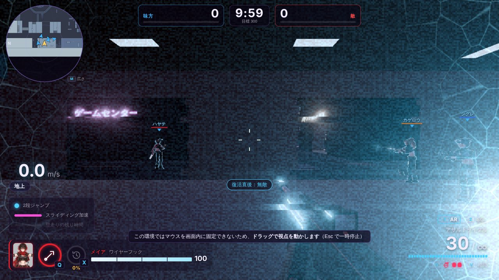

## 武器の追加と固有の名前（仕様 7.1・11.1）
仕様 11.1 で予定していた「今ある武器種に入る 6 丁」を実装し、もとの 6 丁も含めて 12 丁すべてに固有の名前を付けた。武器ごとの一言の説明も簡単に表示する。

| 武器種 | もとの武器 | 追加した武器 | 追加した武器の特徴 |
|---|---|---|---|
| アサルトライフル | ストラタ（STRATA） | トライデント（TRIDENT） | 3点射（1 回の引き金で 3 発。押し続けると 0.3 秒おいて次の 3 発）。1 発 28 で、1 回の点射で体に倒せる。ブルパップ式（弾倉がグリップの後ろ）、三角の銃身カバーと銃口の 3 本の爪 |
| サブマシンガン | ワスプ（WASP） | ニードル（NEEDLE） | 21・650 発/分。反動が小さく、SMG の中では遠くまで当たる（15〜35m）。細長い銃身に放熱のひれ、骨組みの銃床 |
| ライトマシンガン | ブルワーク（BULWARK） | サイクロン（CYCLONE） | 回転式。撃ち始め 400 発/分から、撃ち続けると 1.2 秒で 950 発/分。止めると回転はゆっくり落ちる。一人称では 6 本の銃身が回り具合に合わせて回り、回り始め・止まるときにうなる音（ほかの人のも 3D で聞こえる） |
| ショットガン | ブリーチャー（BREACHER） | テンペスト（TEMPEST） | 全自動（240 発/分）・箱型弾倉 10 発の散弾銃。1 発は 8×8 と弱いが続けて撃てる |
| スナイパーライフル | ゼニス（ZENITH） | ファルコン（FALCON） | 半自動のマークスマンライフル（200 発/分・最初のサイトは 2 倍）。体 3 発・頭 2 発で倒せる。アイアンサイト・レッドドットなども付けられる |
| ハンドガン | スパロー（SPARROW） | ガベル（GAVEL） | リボルバー（65・頭 130・6 発）。体 2 発・頭 1 発で倒せる。撃つたびに大きく跳ね、シリンダーが 1 発ぶん回る。リロードはシリンダーを左へ振り出す。ダッシュしたまま撃てる |

- **名前**：架空のメーカーの銃として、カタカナの固有の名前と英字の短い名前（キルログ・HUD の武器の欄）を付けた。実在の銃・ほかのゲームの武器の名前は避けた
- **武器種**（`CLASS`）：持ち方・射撃音・照準の形・ボットの使い方は武器種を元にし、武器ごとに少しずつ変えた（構える位置・反動・銃口の光の色と大きさ・曳光弾の色・音の高さと長さ）
- **一言の説明**（`BRIEF`）を表示する場所：ロードアウトの武器の板（武器種・装弾数の下）、武器を選ぶカード、選ぶ画面の右（太字。その下に詳しい説明）、ゲームの HUD（武器名と武器種の下に、持ち替えたとき・出たときの約 3 秒）
- **ロードアウトの武器選び**：12 丁を武器種ごとの見出し（ASSAULT RIFLE　アサルトライフル など）の下に 2 丁ずつ並べた。性能の棒の連射は、3点射は点射の待ちを入れた速さ、回転式は「400〜950」と出す
- **ボット**（消耗戦のパイロット・TD の味方）も新しい武器を持つ（装備の組み合わせを 7 つ・4 つ追加）。保ちたい距離と距離ごとの向き不向きを武器ごとに決め、回転式は長く撃ち続け、リボルバーは中距離でエイムする。ボットだけの消耗戦 3 試合で、新しい武器でもパイロットを倒していることを確かめた。テンペストはボットの手で弱かったので、1 粒 7 → 8・威力が落ちる距離を少しのばした
- **モデル**：Blender で 6 丁を作った（`assets-src/weapons/build_weapons.py`。遠く用の面を減らしたモデルも）。サイクロンの持ち手は、のぞく線をふさがないように左の横に付けた。明るい色の光る線（ライム・黄・白金）は、ブルームで広がりすぎないよう弱めた
- ゲームロジックは `shared/weapons.ts`（3点射 `BURST`・`BURST_DELAY`、回転式 `RPM_MIN`・`SPINUP_TIME`、`currentRpm`・`sustainedRpm`）。数値は `config/weapons.json`（`config/README.md`）
- 試合中に新しいシェーダーが作られないことを確かめた（6 丁に持ち替えて撃っても 0）。TD（ボットだけ・普通）は 6 戦 6 勝のまま
- テスト：10 項目を足して 226 項目、すべて合格（12 丁の名前・短い名前が重ならない・説明がある・武器種ごとに 2 丁、新しい武器をロードアウトに入れられる、3点射が 1 回で 3 発・押し続けると待ちを入れて続く・1 回の点射で倒せる、回転式が撃ち続けると速くなり止めると落ちる、テンペストの全自動、ファルコンの半自動と倒すまでの弾数、ガベルが 2 発で倒せる、ニードルの数値）

## 調整：スパローの威力・ガンランナーの効果
- **スパロー**（ハンドガン）の 1 発のダメージを 40 → 25 に下げた（頭 64 → 40）。体に 4 発で倒せる（前は 3 発）
- **ガンランナー**（アタッチメント）の効果を「走りながらでも撃てる」に変えた（前は「エイム中の移動 +20%・動いているときのばらつき半分」）。付けた武器は、撃ってもダッシュが止まらない（ハンドガンと同じ）。ハンドガン（スパロー・ガベル）は最初から走りながら撃てるので、ガンランナーは付けられないようにした（保存してあった付け方は、読み込むときに外れる）。ロードアウトの右の説明にも「走りながらでも撃てる」と出る
- テスト：227 項目、すべて合格（ガンランナーを付けると撃ってもダッシュの速さが保たれる・ハンドガンには付けられない、スパローは体 4 発）

## タワーディフェンスの作り直し：広いマップ・降下ポッド・据え付けのジャンプパッド（仕様 5.3.6・5.3.7・6.2）
「単調なので、マップを広げ、敵は降下ポッドで降りてくる設定にして、防壁の上や要塞の中（コアから離れた所）にも出るようにし、ウェーブの敵も増やす。壁走りとジャンプパッドを活かした、機動力の高いタワーディフェンスにしたい」というご依頼で作り直した。

### マップを広げた（仕様 6.2）
- プレイできる範囲を 216m × 150m から **264m × 208m** に広げた（東西 -132〜132m、南北 -92〜116m）。要塞そのもの（防壁の中）は前と同じ
- 要塞の外に、壁走りの足場・遮蔽物になる物を置いた
  - 南の草原：南西の**前哨陣地**（中に入れる小さなトーチカ。外の階段で屋上 3.5m へ。中に弾薬補給所）、2段に積んだコンテナの列が路地になる**コンテナ置き場**、通信塔、壊れた車両、南東の**見張り台**（9m）
  - 東の草原：東の前哨陣地、燃料タンクの集積所、コンテナ置き場、北東の見張り台
  - 北の草原（前は細い草地だった所）：北の通信所（屋上にレーダー）、コンテナ
  - 西の岩場：**崩れたコンクリートの壁**（高さの違う箱を並べて崩れた形にし、見た目は上の縁をさらに崩して鉄筋を出した）、コンテナ
  - 地面に土の地面と砲弾の跡（見た目だけ）
- 要塞の外にも弾薬補給所（3つの前哨陣地の中）
- 見た目は Blender のマップ（`assets-src/maps/build_fortress.py`）に、崩れた壁・土の地面・砲弾の跡を足した。外の見張り台は窓の高さを塔の高さに合わせた。太陽の影は要塞のまわりの草原まで落とす（影の範囲 120 → 158m）

### 降下ポッド（仕様 5.3.6）
- 地上の敵（歩兵・突撃兵・重装兵）は、分隊（4体まで）ごとに降下ポッドで降りてくる
- 降下地点は **24 か所**。どれも、いずれかのルートの方面に属する
  - **外**（10 か所）：ルートの遠くの草原（前の湧く場所）のほか、北の草原（東・西）、北西の岩場、南西・南東の草原など。降りた敵は歩いてルートの道すじに合流し、門から入ってくる（北の草原からは、西の台地・東の草原を回り込む）
  - **高い所**（10 か所）：南・西・東・北の防壁の上、西・東の格納庫の屋上、西・東のテラス。階段・飛び降りで下りてコアへ。下りるまでは立ち止まらずに撃つ（防壁の上に居座らない）
  - **中**（4 か所）：正面ゲートの内側（東・西）、西の資材置き場、東の荷役場（コアから 49〜55m）
- ウェーブのグループごとに降りる場所を決める（`drop`：降下地点の名前か種類。種類のときは準備時間の始めに、その方面の同じ種類の降下地点から選ぶ）。準備時間中は、次のウェーブの降下予定地点を世界の中（回る点線の輪と光の柱）・ミニマップ（点線の輪）・左上の「降下ポッド」の欄・準備の知らせで示す。タレットを置く場所の目安になる
- 降りてくるとき
  - 着地の 3.2 秒前：降りる場所の地面に輪（だんだん縮む）と、空へ伸びる光の柱。色は外＝赤・高い所＝橙・中＝桃。ミニマップにも出る（高い所・中は範囲の外でも縁に出す）。高い所・中に降りてくるものは、画面の上に場所・数・着地までの秒数と警告音
  - 最後の 1.5 秒：空の高い所から、火の尾を引いて斜めに落ちてくる。地面の近くで脚の付け根の噴射口から逆噴射して減速し、着地（土ぼこりの輪・火花・画面の揺れ・重い音）。着地の衝撃に巻き込まれた味方はダメージ（最大 60）を受けて吹き飛ぶ
  - 着地の 0.8 秒後：扉 4 枚が外へ倒れて開き（蒸気と音）、分隊が外を向いて出てくる。底の耐熱板は赤く焼けていて、ゆっくり冷める
  - 着地の 5 秒後：扉を閉じて噴射し、空へ戻っていく
- ポッドは、タレット・設置物・ジャンプパッド・出現地点・ほかのポッドから離れた、上が開けた平らな所に降りる。同時にいられる敵の数には、降りてきている途中のポッドの中の敵も数える
- 味方のボットは、降りてくるポッドの所へ（地面の印を見た人間と同じように）先に駆けつけ、真下にいれば着地の前に輪の外へ逃げる
- 降下ポッドのモデルは Blender で作った（`assets-src/props/build_td.py` の `pod`。高さ 3.6m。焼けた底・扉 4 枚・安定板・逆噴射の噴射口・赤い灯り）
- 大型兵器は前と同じく草原の遠くから歩いて来て、ドローンは飛んで来る

### 据え付けのジャンプパッド（仕様 5.3.7）
※ 次の変更（迫撃砲兵の追加）で、ご依頼により取りやめた（マップには置かない）。
- マップに 14 か所。乗ると、決まった行き先へ放物線で飛んでいく（乗った所から行き先へちょうど着く速さで飛ばすので、どこから乗っても同じ所に着く。空中で向きは変えられる）。味方のパイロットだけ（敵は使わない）
- 中央の広場 → 南の防壁（西・東）・西の防壁・東の防壁、車両置き場 → 西・東の格納庫の屋上、外の草原 → 要塞の中（正面の西・東・資材置き場・荷役場・車両置き場）、西の岩場 → 西の台地、南東・北東の見張り台へ
- 防壁の上・屋上の降下地点へすぐ上がれ、外の降下地点へ迎え撃ちに出ても、すぐ要塞の中へ戻れる
- 行き先までの放物線を流れる光の点線で示し（近づくと濃くなる）、近くでは行き先の名前を出す。ミニマップには行き先へ向いた印。上や横にはタレット・設置物を置けない
- 味方のボットも、経路のつながり（新しい種類 `pad`）として近道に使う
- どのパッドも、乗って飛ぶと行き先に 0.3m 以内で着地することを確かめた（建物・胸壁・階段にぶつからない軌道に調整した）

### ウェーブの敵を増やした
| ウェーブ | 1 | 2 | 3 | 4 | 5 | 6 | 7 | 8 | 9 | 10 | 合計 |
|---|---|---|---|---|---|---|---|---|---|---|---|
| 前 | 12 | 22 | 27 | 36 | 29 | 48 | 57 | 68 | 75 | 72 | 446 |
| 今 | 18 | 30 | 43 | 54 | 45 | 74 | 82 | 89 | 89 | 92 | 616 |

- 第2ウェーブで初めて防壁の上に、第3ウェーブで初めて要塞の中に降りてくる。後半は1つのウェーブで、外・高い所・中のいくつもの所に降りてくる
- 同時にいられる敵 44 → 56 体、コアの体力 6000 → 8000、突撃兵がコアで自爆したときのダメージ 140 → 110、難しい（難）の敵の体力の倍率 1.15 → 1.1・数の倍率 1.1 → 1.0

### 敵の動きの修正
- 高い所に降りた敵は、ステージに書いた「胸壁を乗り越える飛び降り」（パイロット用）を使わないようにした（連絡橋の胸壁で止まっていた）
- 経路のデータで、細い胸壁（厚さ 0.5m）を飛び越えた飛び降りができていた（調べる間隔が粗かった）。0.35m ごとに調べるようにした（格納庫の屋上の縁で止まっていた）。経路を作る時間が増えないよう、ぶつかりの確かめを先に絞り込んだ
- 西の坂道の縁石を下の端まで延ばした（北西の岩場から来た敵が、坂の横から上ろうとして止まっていた）
- 動けなくなった敵の確かめ：撃ち合っている敵は数えない。行ったり来たりは進んだとみなさない
- 北の草原などの遠い降下地点には、通る点（`via`）を決めた（経路探しが長くなりすぎないように）

### 確かめたこと
- ボットだけの4人チーム（6 試合ずつ）
  - 普通：6 戦 5 勝（勝ったときのコアの残り 3582〜6176 / 8000）。前は 6 戦 6 勝で、コアがほとんど減らなかった（5546 / 6000 など）
  - 易しい：6 戦 6 勝（7023〜7626）
  - 難しい：ボットだけでは 6 戦すべて第6〜7ウェーブで負ける（前も第6〜9ウェーブで負けていた。人間が入って腕で補う難しさ）。敵の体力の倍率 1.15 → 1.1、数の倍率 1.1 → 1.0 にして、前と同じくらいにした
- 重さ：1 ティック平均 0.8ms（Node・ボットだけ・第7ウェーブ・敵 54 体）。経路の点は 5692 → 9276 個
- 試合中に新しいシェーダーが作られないこと（ポッド・輪・光の柱・炎・放物線の線も、はじめに用意する）
- テスト：12 項目を足して 239 項目、すべて合格（マップの広さと外の建物、降下地点の種類と方面・コアからの距離、どの降下地点にも着地点がありコアまで行ける、ポッドの知らせ → 着地の衝撃 → 扉 → 分隊 → 飛び去る、防壁の上・屋上の敵がコアまで来る、グループの `drop` と予告、ポッドの中の敵も `MAX_ALIVE` に数える、タレットの近くに降りない、14 か所のジャンプパッドがどれも行き先に着く、試合で味方だけ飛ぶ・パッドの上には置けない、ボットの経路にパッドが入る、ウェーブの敵の数）

## 迫撃砲兵の追加と、据え付けのジャンプパッドの取りやめ（仕様 5.3.3・5.3.7・5.3.8）
「ジャンプパッドは配置しないでください。また、敵の種類を増やしたい。降下後少し高いところに移動してからその場でコアに向かって迫撃砲を撃つ敵を追加して欲しい」というご依頼で変えた。

### 据え付けのジャンプパッドを取りやめた
- マップの 14 か所のジャンプパッドと、その表示（台・行き先の放物線・名札・ミニマップの印）、経路のつながり（`pad`）、設定（`MAP_PAD`）を取り除いた。購入メニューのジャンプパッドはそのまま
- 外の見張り台は、西の面のコンテナの階段（1段・2段・3段）を2段ジャンプとよじ登りで上る（いちばん上のコンテナ 7.8m → 塔の上 9m。西の胸壁を開けた）

### 迫撃砲兵（仕様 5.3.8）
- 3 ウェーブ目から、2 体ずつ降下ポッドで降りてくる（全 10 ウェーブで 24 体。外・防壁の上・要塞の中のどこにも降りる）
- 降りると**据える所**（少し高い所）へ上る。外に降りたら外、防壁の上・要塞の中に降りたら中の据える所のうち、その降下地点から歩いて（低い段は跳んで）行ける、近くて空いている所を選ぶ（降下地点ごとに一度だけ調べて覚えておく）
  - 外（14 か所・コアから 59〜110m）：南西・東の前哨陣地と北の通信所の屋上（外の階段で上る）、新しく作った**砲撃陣地**（南東・東・西・北西。高さ 2.4m のコンクリートの台に坂で上る。縁に土のう）
  - 中（9 か所・コアから 44〜73m）：西・東のテラス、西・東・南の防壁の上、東の荷役場の台
- 着くと、背負っていた迫撃砲を前に据えてしゃがみ、4 秒後から約 8 秒ごとにコアへ砲撃する。上る途中は撃たれても立ち止まらない（近くのパイロットには拳銃で撃ち返しながら進む）。50 秒たっても着けなければ、射程の中ならその場に据える
- 砲弾は高い放物線で飛ぶ（距離 100m で頂点 30m 以上・約 4 秒）。コアの真上は空中連絡橋の屋根なので、屋根のない南・北の脇を狙う。遠くから撃つほどばらつき、屋根に落ちた砲弾はコアに届かない
- 爆発：コアの中心から 7.5m 以内ならコアにダメージ 14（5m より遠いと減る）。まわりの味方にもダメージ（半径 4.5m・45。タレット・設置物は半分）
- 据えた所の 11m 以内にパイロットが来ると、砲撃をやめて拳銃で応戦する。倒すまで砲撃が続くので、壁走り・2段ジャンプで屋上・台へ駆け上がって倒すのが基本の対処になる
- 迫撃砲の砲撃は「コアが攻撃されている」に数えない（ボットがコアの前に集まって、砲撃している所へ行かなくなるので）
- 味方のボット：砲撃を始めた迫撃砲兵を倒しに行く（1体に 1 人、45m 以内なら 2 人まで。追うのはボットの半分まで。近いボットが優先）。追っている間はその迫撃砲兵を最優先で狙い、ほかの敵は近く（18m）にいるか撃ってくるときだけ相手にする
- 見た目
  - 迫撃砲兵のモデル（Blender。`assets-src/characters/build_grunt.py` の `mortar`）：砂色の軽装、つばのあるヘルメットと額のゴーグル・右目の光る測距儀・ヘッドセット、胸に斜めの砲弾の帯、背中に砲弾を 2 列 × 3 発立てた背負い枠。遠く用の面を減らしたモデルも作った
  - 迫撃砲のモデル（`assets-src/props/build_td.py` の `mortar`）：据えた形（底板・二脚・照準器の光るレンズ・砲身・ふたの開いた弾薬箱）、背負った形（砲身・たたんだ二脚・小さな底板）、砲弾
  - 運ぶ間は迫撃砲を背負う（キャラクターの胸の骨に付けるので、走る・しゃがむ動きについてくる）。据えると、兵の前（コアの向き）に据えた迫撃砲が少し上から下ろされて置かれる
  - 撃つと砲身が軸に沿って沈み、砲口から火と煙が広がる。こもった発射音。砲弾は煙の尾と火を引いて飛ぶ
  - 落ちる所には、撃ったときから地面に赤い輪が出て、着弾が近いほど縮む。落ちる 1.4 秒前に、落ちる所で風切り音。爆発は火の玉・土煙・画面の揺れ
  - 倒されると、据えた迫撃砲は 4 秒残ってから沈んで消える
- 知らせ：据えると画面の真ん中に「迫撃砲兵が陣取った（場所）」と警告音（続けては出さない）、キルログ。左上の侵入ルートの欄の下に、据えた迫撃砲兵の場所・砲撃中か応戦中か・距離（近い順に 3 体まで）。頭の上に「迫撃砲」の札（壁越しにも見える。距離つき。砲撃中は四角が点滅）。ミニマップにはいつも出る（範囲の外でも縁に。撃つたびに輪が広がる）

### 経路と敵の動きの修正
- 前哨陣地の屋上へ歩いて上れなかった：外の階段が壁から 0.1m 離れていて、階段から屋上へ入るつながりができていなかった。壁にぴったり付け、経路の点（2.5m 間隔）が上から 2 段目に乗るように階段の位置を合わせた
- テラスへ上る坂：坂の幅を 5m → 6.2m に広げた（広場側の縁に経路の点が来て、歩く敵が坂の横から落ちていた）。坂に面したテラスの縁に胸壁を付けた（坂の途中から横のテラスへ入ろうとして縁に引っかかっていた。坂の上の端と、広場へ飛び降りる東の端は開けてある）
- 経路のデータ：歩くつながりを調べる間隔を 0.35m ごとにし、行き先の点との段差も見るようにした（坂の横の高い床へ入るつながりができていた）。変わったつながりは 63000 本のうち 140 本ほど
- ボットの経路の進み方
  - 坂・階段の横から落ちたら、経路を作り直す
  - 次が平らなつながりなら、同じ高さまで来てから次へ進む（坂の途中で曲がって、横の高い床の縁に引っかかっていた）
  - 胸壁・段に当たって近づけないときは、そこから跳ぶ（テラスから防壁の上へ跳ぶつながりで、胸壁の手前で止まっていた）
  - 何度も失敗したつながりは、25 秒のあいだ経路に使わない
- 迫撃砲兵は、低い段へのジャンプ（経路のつながりがジャンプのときだけ）も使う。動けなくなったときの抜け出しのジャンプはしない（防壁の胸壁を越えて落ちないように）

### 調整
- ウェーブの敵の数（迫撃砲兵を足した）：18・30・45・56・47・78・86・93・93・94（合計 640）。※ 下の「同じ壁での壁走り」のときに調整し直した後の数
- ボットだけの4人チーム（6 試合ずつ）
  - 普通：はじめは 6 戦 5 勝（勝ったときのコアの残り 1720〜4861 / 8000）だったが、試す試合を 12 に増やすと勝ち越しが少なかったので調整し直した（下の「同じ壁での壁走り」の節）
  - 易しい：6 戦 6 勝（6624〜7224）
  - 難しい：ボットだけでは第5〜9ウェーブで負ける（前は第6〜7）。人間が迫撃砲兵を倒しに行くことで補う難しさ
- 迫撃砲の数値は `config/td.json` の `ENEMIES.mortar`（`config/README.md` に説明）

### 確かめたこと
- テスト：243 項目、すべて合格（据え付けのジャンプパッドの 3 項目を「置かない」1 項目にし、迫撃砲兵の 6 項目を足した。数値と出てくるウェーブ、据える所の高さと射程・どの降下地点からも行ける所がある、降りて上って据えて砲撃しコアが削られる・コアの「攻撃されている」に数えない、近づいたパイロットには砲撃をやめて応戦する、砲弾の高さとまわりへのダメージ、味方のボットが倒しに行く。据え付けのジャンプパッドがなく、防壁の上へ歩き・壁走り・ジャンプで上れる）
- 試合中に新しいシェーダーが作られないこと（迫撃砲・背負った迫撃砲・砲弾・落ちる所の輪も、はじめに用意する）

- 重さ：1 ティック平均 0.57ms（Node・ボットだけ・普通・全 10 ウェーブ）。迫撃砲兵の据える所へ行けるかは、試合を作るときに降下地点ごとに 1 度だけ調べる（0.3 秒ほど。経路のデータごとに覚えておく）

## 同じ壁での壁走り（仕様 4.3）
「壁走りは同じ壁でも一回離れた後また走れるようにして」というご依頼で変えた。

### 前の決まり
- 壁から離れると、着地するか別の壁に張り付くまで、その壁には張り付けなかった

### 今の決まり
- 同じ壁でも、一度離れたあとはまた壁走りできる。ただし、同じ壁で壁ジャンプと張り付きをくり返して、どこまでも登ったり、いつまでも浮いていたりできないように、次の決まりを付けた
  - 離れてから 0.3 秒たってから（`WALLRUN_REATTACH_DELAY`）
  - 離れたときの高さより上では張り付けない（`WALLRUN_REATTACH_MAX_RISE` 0m）。壁ジャンプで跳び上がったあとは、落ちてきて離れた高さまで戻ると張り付ける
  - 張り付き直したときは上向きの勢いが付かない（落ちている途中なら、落ちる速さをゆるめるだけ）。高さを保つ時間もなく、すぐにゆっくり落ち始める
- 別の壁には、これまでどおり離れてすぐに張り付ける
- 壁走りの時間切れ・失速・後ろ入力・しゃがみで離れたときに、0.45 秒どの壁にも張り付けない決まり（壁の角で張り付きをくり返して浮き続けないため）は、そのまま
- 試した結果：同じ壁で壁ジャンプ → 戻って張り付く をくり返すと、約 0.6 秒ごとに張り付き直せて、1 回ごとに約 0.5m ずつ下がり、6〜7 回目で着地する

### 変えたファイル
- `shared/movement.ts`：直前に離れた壁と、離れたときの高さ・離れてからの時間を覚えておき、張り付けるかを決める。張り付き直したときの上下の速さと、壁走りの経過時間（高さを保つ時間を飛ばす）
- `config/movement.json`：`WALLRUN_REATTACH_DELAY` 0.3、`WALLRUN_REATTACH_MAX_RISE` 0.0 を足した（`config/README.md` に説明）
- テスト：「同じ壁には連続で張り付けない」を、「一度離れたあとはまた壁走りできる（離れてすぐ・離れたときより高い所では張り付けない）」「くり返しても高さは稼げない」「別の壁には離れてすぐ張り付ける」の 3 つにした。消耗戦の「歩兵は地上だけを歩く」のテストは、爆風で浮いた高さを数えないようにした（地面に立っている間の高さだけ見る）
- テスト：245 項目、すべて合格

### あわせて直したこと（タワーディフェンスの確認中に見つけた）
- ボットだけの試合を確かめたとき、1 試合で第8ウェーブが終わらなくなった。東の防壁の上から迫撃砲兵が落ちて、東の格納庫・兵舎と防壁の間の**幅 1m のすき間**（細い路地。経路の点がなく、味方のボットが入れない）に入り込み、そこで「着けないのでその場に据える」をして砲撃を続けていた
  - 西・東のすき間を、防壁と同じ高さの壁で埋めた（そこだけ防壁の上の通路が 1m 広くなる）
  - 迫撃砲兵が「その場に据える」のは、経路の点の近く（味方が倒しに来られる所）に限った。そうでない所では据えず、動けないままなら、ほかの敵と同じく取り除かれる

### 迫撃砲兵の調整し直し・味方のボットの直し
- ボットだけの試合を 12 試合（前は 6 試合）で確かめ直したところ、普通の勝ちが半分ほどだった。ボットだけの試合は、少しの違いで結果が大きく変わる（同じ設定でも、試合の流れが少し変わると勝ち負けが入れ替わる）ので、12 試合で見ることにした
- 迫撃砲兵を少し弱くした：コアへのダメージ 20 → 14、第8・第9ウェーブの迫撃砲兵 6 → 4 体、第10ウェーブ 4 → 2 体（全部で 30 → 24 体）
- 味方のボットが、迫撃砲兵のそばまで行ったのに壁の向こう側（前哨陣地の中など）で止まり、倒せないことがあった（そのウェーブが終わらなくなった）。迫撃砲兵を追うときの行き先を、まわり 7m の経路の点のうち「そこから迫撃砲兵が見える所」にし、着いても見えなければ別の点へ行くようにした
- 結果（ボットだけの4人チーム・普通・12 試合）：8 勝 4 敗（勝ったときのコアの残り 1063〜5082 / 8000）。負けはどれも最後の第10ウェーブ（大型兵器 2 体）。人間のプレイヤーが迫撃砲兵を倒しに行けば勝ちやすくなる難しさ

## キャラクターの顔の絵の差し替え（仕様 7.2.2）
「キャラ選択の際などに表示されるキャラの絵を差し替えたい」というご依頼で、用意していただいたイラスト 6 枚から顔のまわりを切り抜いて差し替えた。

- どのイラストがどのキャラクターかは、色とアビリティで決めた：赤・ワイヤー＝メイア、黄緑の透けるマント＝パール、オレンジ・盾＝ミランダ、黄色・ソナーの球＝ソラ、青・ゴーグル＝アレックス、紫・分身＝蘭丸
- 切り抜き方：顔の中心が横の真ん中・上から 45% に来るように、縦長（4:5）に切り抜き、360×450 にした（前の絵は 240×300 で、頭から胸までだった）。顔が大きく写るので、試合中の左下の小さな絵でも誰か分かりやすい
- 出る所：キャラクター選択の札、ロードアウト画面（左の組み合わせの一覧・キャラクターの板）、試合中の左下の体力表示
- 元のイラストは `assets-src/portraits/<名前>_art.jpg` に置いた。切り抜く位置・幅は `assets-src/portraits/crop_portraits.py` の `FACES` で決めていて、`python assets-src/portraits/crop_portraits.py` で作り直せる（前の絵は使わなくなった）

## 6人の全身のモデルの差し替え（仕様 7.2.2）
用意していただいたモデル（Tripo で作った、テクスチャ付きのモデル。メイア・パール・ミランダ・ソラ・アレックス・蘭丸）を、それぞれのキャラクターの全身のモデルとしてゲームに入れた。どのモデルが誰かは、ファイルの中のテクスチャの名前（「アレックスモデル」など）で決めた。メイアは、先に動きを確かめたモデルを使った。

### 作り方（`assets-src/characters/build_imported.py`）
- 元のモデルは `assets-src/characters/models/<名前>.glb` に置き、骨の位置はキャラクターごとに `rig.json` の数字で決めた（正面・横の絵に骨を重ねて、肩・ひじ・手首・腰・ひざ・足首の位置を合わせた）
- 骨の名前・親子関係・向きは、これまでのモデル（`build_characters.py`）と同じ。そのため、これまでの動き（待機・走り・壁走り・スライディング・ジャンプ・射撃・アビリティ・倒れる）と、武器を両手に持たせる処理がそのまま使える
- 重み：細かい部品が多い形にはボーンヒートが直接は効かないので、ボクセルで作り直した閉じた形で求めて元の形へ写した。腕・脚の骨から離れた所（メイアのスカーフ・蘭丸のマント・パールの結晶片のマントと袖・ソラとミランダの髪）は胸・腰で動かし、腕を下ろしたり脚を振ったりしたときに布が引き伸ばされないようにした。パールは脚が近く細いので、左右の脚の取り違えを直し、脚とみなす範囲を狭くした
- およそ 12,000 面（元は 5 万面前後）、テクスチャ 2048×2048 にした。1体 2.3〜2.7MB。遠く用は約 3,000 面
- `python assets-src/characters/build_imported.py --preview` で確認用の絵を描く（下の1枚目）

### ゲーム側
- `client/characters/actorModel.ts`：取り込んだモデル（1つのスキンメッシュ）を、部品をまとめる処理をせずにそのまま使うようにした。演出（倒れて消える・光学迷彩・フェイズシフト・被弾の光・チームの色の縁）はこれまでと同じシェーダーで、テクスチャを貼る。面が細かいと縁の光が体じゅうに出て白っぽく見えたので、縁の光を 0.3 倍にした。遠く用のモデルは、骨の名前で近く用の骨格に付け替えて同じ骨格で動かす
- `client/characters/characterView.ts`：キャラクター選択の画面・タイムアタックのゴーストで、モデルを骨ごと複製するようにした（骨で曲がる皮のモデルは、ふつうの複製では動かない）
- `build_characters.py` は、取り込んだモデルがあるキャラクターでは一人称の腕だけを作る（全身を上書きしない。昔の全身を作るときは `--legacy`）。`build_lod.py` は 6 人の遠く用を作らない
- テスト `tests/characterModels.test.ts`（6 項目）：骨 19 本・動き 8 つ・テクスチャ・面の数・遠く用の骨を確かめる

### 確かめたこと
- テスト 251 項目がすべて通る
- 消耗戦（味方は青い輪郭、敵は赤い縁）、走り・遠く用のモデル、キャラクター選択の画面、タワーディフェンスの味方のボットで、表示と動きを確かめた

### 気をつけること
- 一人称視点の腕は、これまでの腕のモデルのまま（全身のモデルとは別）
- 布や髪は胸・腰に付いて動くだけで、なびきはしない（揺れの計算はしていない）。脚を大きく上げると、長いマントやコートを脚が突き抜けることがある

## 歩兵（一般兵）のモデルの差し替え（仕様 7.2.2）
用意していただいたモデル（白と黒の装甲に水色の灯り、顔を覆うヘルメットの兵士。Tripo で作成）を、消耗戦の歩兵とタワーディフェンスの一般兵（敵の種類 grunt）のモデルにした。

- 作り方はパイロットと同じ `build_imported.py`（`rig.json` の `grunt`）。動きは歩兵の動き（待機・走り・射撃・しゃがみ・ジャンプ・倒れる）。腕が手首の先で前へ曲がっているモデルなので、手首・指先の前後の位置を別に決められるようにした（`wr_y`・`tip_y`）
- 元のモデルは約 11,500 面なので、面はほとんど減らしていない。テクスチャ 2048×2048、1.9MB。遠く用は約 3,000 面
- **チームの色**：前の歩兵はバイザー・肩などの「TeamGlow」の部品をチームの色で光らせていた。新しいモデルは1枚のテクスチャなので、テクスチャの水色の灯り（緑と青が強く赤が弱い所）をシェーダーで見つけて、暗い下地にしてチームの色（味方は青、敵は赤）で光らせる。マテリアルの名前 "TeamGlowMap" が印（`client/characters/actorModel.ts`）
- `build_grunt.py` は、取り込んだモデルがある歩兵を作らない（昔のモデルは `--legacy`）。突撃兵・重装兵・迫撃砲兵はこれまでのモデルのまま
- テスト：歩兵のモデルの骨・動き・テクスチャ・印を確かめる 1 項目を足した（252 項目）

## 重装兵のモデルの差し替え（仕様 7.2.2・5.3）
用意していただいた2つのモデル（兵士と盾。Tripo で作成）から、タワーディフェンスの重装兵のモデルを作った。銃はこれまでのブルワーク（LMG）のモデルを、ゲームが両手の位置に持たせる。

- 作り方は `build_imported.py`（`rig.json` の `heavy`）。動きは重装兵の動き（盾を構えて待機・走り・射撃・しゃがみ・ジャンプ・倒れる）
- **盾**：盾のモデルを読み込み、体の前・左寄りに置いて腰の骨で動かす（体と1つの形にまとめる）。左手は盾の取っ手、右手は腰だめの銃
- **テクスチャを1枚に**：体と盾のテクスチャを、幅 2048・高さ 3072 の1枚（上 2/3 が体、下 1/3 が盾）にまとめ、UV をそれに合わせた。マテリアルが1つになるので、演出・遠く用のモデルはほかのキャラクターと同じ仕組みで動く
- **大きさ**：骨と動きは 1.7m の体で作り、書き出すときに骨格ごと 1.235 倍（高さ約 2.1m）にした。当たり判定（高さ 2.25m・頭の中心 1.96m）に合わせるため（前のモデルは約 1.75m で、当たり判定より小さかった）
- **盾の当たり判定を変えた**（`shared/td/units.ts` の `HEAVY_BODY`）：体の前 0.66m → 0.45m、幅 1.04m → 0.82m、厚さ 0.12m → 0.18m（高さ 0.15〜1.75m・左寄り 0.22m は同じ）。前の位置では盾が遠すぎて手が届かず、また盾のモデルの縦横の比（幅は高さの約半分）に合わせたため。盾は少し細くなったので、横からは少し撃ちやすい
- 腕の太い服なので、腕の骨から 15cm までを腕で動かすようにした（9cm だと袖の外側が胸に残って、腕を下ろしたときにとがって伸びた）
- テスト：重装兵のモデル（骨・動き・テクスチャ1枚・大きさ）を確かめる 1 項目を足した（253 項目）。盾が弾を止める・背中と頭が弱点のテストも通る

### 気をつけること
- 背中の弱点（動力パック）は、新しいモデルには光る部品がない。当たり判定はこれまでどおり背中にあるので、後ろから撃てば弱点に当たる
- 倒れるとき、盾は腰に付いたまま立っている（前のモデルと同じ）

## 突撃兵を「爆弾兵」に・ティック・迫撃砲兵のモデル（仕様 5.3・7.2.2・5.1）
用意していただいた6本脚のクモ型の爆弾ロボットのモデル（Tripo で作成）を、突撃兵のモデルにして名前を「爆弾兵」に変えた。同じモデルを小さくしてティックにも使った。迫撃砲兵は、重装兵の体のモデルを使うようにした。

### 爆弾兵（`assets-src/characters/build_spider.py`）
- 高さ 0.8m（普通の兵士の約半分）。脚を広げた幅は約 1.25m
- モデルは、胴と6本の脚がそれぞれ別の部品になっていた。つながった部品ごとに、中心から離れていて低い部品を脚とし、6本の脚の向きのうち近いものに割り当てた。脚の付け根（いちばん内側）で回る
- 骨は胴（hips）と脚（leg0〜leg5）。動き：待機・走り（3本ずつ交互。ゲームが走る速さに合わせて速くする）・ジャンプ（脚をたたむ）・倒れる（脚が開いて胴が落ちる）
- 目と小さな灯りを光らせる：テクスチャの赤い所をシェーダーで見つけて光らせる（マテリアルの名前 "GlowRedMap"）
- 銃は持たせない。名札は高さ 0.8m の上に出す
- 当たり判定を小さいクモ型に合わせた（`ASSAULT_BODY`：丸い胴・腹・正面の目が弱点。細い脚には当たらない）。前は人の形（高さ 1.8m）だったので、見た目より上を撃っても当たっていた。体の高さ（壁とのぶつかり・経路）は 1.8m のまま
- 攻撃（コアに近づくと自爆。ダミーバルーン・バリケードでも自爆）・体力・速さ・報酬は変えていない
- 名前：画面・設定・説明の「突撃兵」を「爆弾兵」にした（プログラムの中の種類の名前は assault のまま）

### ティック
- 同じモデルを幅 0.5m（前のティックとほぼ同じ）にして、胴（目の面は "TkRed"）と6本の脚に分けて `client/assets/props/tick.glb` に書き出した。ゲーム側は前と同じ仕組みで、這った距離で脚を振り、狙う相手がいると目を速く点滅させる
- `build_props.py` はティックを作らない（昔の形は `--legacy`）

### 迫撃砲兵
- 重装兵の体のモデルを、盾なし・普通の大きさ（1.7m）で使う（`rig.json` の `mortar`。`src: heavy.glb`）。動きは歩兵の動き。背中の迫撃砲は前と同じように胸の骨に付く

### テスト
- 爆弾兵・ティック・迫撃砲兵のモデル（3 項目）と、爆弾兵の当たり判定（1 項目）を足した（257 項目）

### 気をつけること
- 迫撃砲兵と重装兵は同じ体のモデルなので、盾・大きさ・背中の迫撃砲で見分ける
