# ゲーム仕様書：VERTEX RUNNERS（仮）

> **この文書について**
> この仕様書はAI（Claude）に読み込ませてゲームを実装させることを前提に書かれています。
> 規模が大きいため、「12. 実装フェーズ」の順に段階的に実装させてください（1回の依頼で全部は作らせない）。
> `【仮】` と付いた項目は仕様書作成時に置いた仮の値・仮の決定です。必要に応じて書き換えてください。

---

## 0. 実装者（AI）への指示

- この仕様書に書かれた内容を**最優先**で実装すること。
- 記載のない細部は、ハイスピードFPSの一般的な慣習に従って補ってよい。補った点は実装後に一覧で報告すること。
- 仕様に矛盾や実装不能な点があれば、実装前に質問すること。
- 実装は「12. 実装フェーズ」の**指定されたフェーズのみ**行い、そのフェーズの受け入れ条件を満たしたら止まること。
- 既存の商用ゲームの名称・キャラクター・ロゴ・固有デザインは使用しないこと。参考にするのは操作感とゲーム性のみ。
- 数値パラメータはすべて `config/` 以下の設定ファイルにまとめ、コードを触らずに調整できるようにすること。
- **初期実装はすべてオフライン（プレイヤー1人＋ボット）**。ただし将来オンライン化するため、以下を守ること。
  - プレイヤーとボットは同じ「入力コマンド」（移動・視点・射撃・アビリティなど）で動かす。ボットAIは入力コマンドを生成するだけにする。
  - ゲームの状態更新（ダメージ、得点、敵の出現、タレット、コア）は描画から分離した「ゲームロジック層」にまとめ、後でサーバーに移せるようにする。
  - ゲームロジックは固定時間刻み（例：60Hz）で更新する。

### 0.1 作業方針（品質優先）
- **作成にかける時間とトークンに制限はない。** 速さや簡潔さより、仕様どおりの完成度と品質を優先すること。
  - 途中で省略・簡略化・「仮実装のまま」で止めないこと。やむを得ず省略した点は必ず報告すること。
  - 1つのフェーズの中でも、実装 → 動作確認 → 修正 を納得いくまで繰り返してよい。
  - 見た目・操作感の調整（特に移動の気持ちよさ、マップとキャラクターの再現度）には十分に時間をかけること。
- **Blender などの外部ツールを積極的に使ってよい。** コードだけで作ることにこだわらず、より良い結果が出るならツールを使うこと。
  - 3Dモデル（キャラクター、武器、マップの建物・小物、敵、タレット）は Blender で作成し、glTF（`.glb`）形式で書き出して Three.js で読み込む。Blender は Python スクリプト（`bpy`）からの操作でもよい。
  - キャラクターは 7.2.2 の参考画像（正面・背面・側面）を下絵にしてモデリングし、骨格（リグ）と基本アニメーション（待機、走り、壁走り、スライディング、ジャンプ、射撃、アビリティ）を付ける。
  - テクスチャ・画像の作成や加工には GIMP、Krita、ImageMagick など、効果音の作成や加工には Audacity、sfxr 系ツールなども使ってよい。
  - 使用したツール、作成手順、元データ（`.blend` ファイルや生成スクリプト）はリポジトリに残し、後から修正・再生成できるようにすること。
  - ツールが使えない環境では、その旨を報告したうえで、プリミティブ形状による代替で進めてよい（後でモデルに差し替えられる作りにする）。

### 0.2 技術構成【仮】

| 項目 | 内容 |
|---|---|
| 実行環境 | PC ブラウザ（Chrome / Edge 最新版）。スマホ非対応 |
| 言語 | TypeScript |
| 3D描画 | Three.js（ポストエフェクトに EffectComposer の Bloom を使用） |
| 物理・当たり判定 | 自前のカプセル vs. ボックス判定（またはRapier.js） |
| ビルド | Vite |
| マルチプレイ | 初期実装ではなし。将来、Node.js + WebSocket（`ws`）のサーバー権威型でオンライン化する |
| 3Dモデル | Blender で作成し glTF（`.glb`）で読み込む（0.1 参照）。キャラクターは 7.2.2 の参考画像をもとに作る。他者が作った既製の素材は使わない |
| 素材 | 発光マテリアルとブルームでネオンを表現。効果音は Web Audio API での合成、または外部ツールで作成した音声ファイル |
| ファイル構成 | `client/`（描画・入力・UI）、`shared/`（ゲームロジック。将来サーバーと共用）、`config/`（パラメータ）、`assets/`（書き出したモデル・テクスチャ・音声）、`assets-src/`（`.blend` などの元データと生成スクリプト）、`images/`（参考画像） |

---

## 1. 基本情報

| 項目 | 内容 |
|---|---|
| タイトル | VERTEX RUNNERS（仮） |
| ジャンル | 一人称視点シューター（FPS）／高機動アクション |
| 対象プラットフォーム | PC ブラウザ |
| 想定プレイ時間 | 1試合 5〜15分 |
| 対象プレイヤー | FPS 経験者〜中級者 |
| 画面 | 16:9、ウィンドウサイズに追従。目標 60fps |
| 視点 | 一人称（自キャラの腕と武器を表示） |

### 1.1 コンセプト
壁走りと2段ジャンプで縦横無尽に駆け回る、スピード感重視のFPS。地面に足をつけず走り続けるほど有利になる。消耗戦・タイムアタック・協力タワーディフェンスの3モードを遊べる。

### 1.2 参考にしたいゲーム・雰囲気
- 操作感・機動力：『タイタンフォール』シリーズのパイロット操作（壁走り、2段ジャンプ、スライディングによる勢いの維持）
- キャラクター能力の設計：『Apex Legends』のように、キャラクターごとに役割と固有アビリティが分かれている
- 見た目：添付画像を参照（「6. マップ」に詳細）
  - `images/map_neon_city.png`：夕暮れのネオン未来都市
  - `images/map_fortress.png`：晴天の高原に建つ軍事要塞

---

## 2. 画面構成と遷移

### 2.1 画面一覧

| 画面名 | 内容 | 主な要素 |
|---|---|---|
| タイトル画面 | ゲーム開始 | タイトルロゴ、背景にネオン都市マップをゆっくり旋回表示、「PRESS ANY KEY」 |
| メインメニュー | モード選択 | 消耗戦／タイムアタック／タワーディフェンス／ロードアウト／練習／設定。ロードアウトの項目に、使用中のロードアウトを出す |
| ロードアウト | 組み合わせの保存と編集 | タイタンフォール 2 にならった画面。左に 5 つの枠（押した枠が「使用中」）、中央にその中身を板で並べる（キャラクター／メイン武器［武器］［サイト］［アタッチメント 1］［アタッチメント 2］／サブ武器）、右にキャラクターの 3D。板を押すと選ぶ画面になり、選ぶ物にカーソルを合わせると、右に 3D の武器と、付けたときの性能の変化（増える所は緑、減る所は赤）が出る（「7.6」参照） |
| ロードアウト選択 | 試合前の準備 | 使用中のロードアウトを 5 つの枠から選ぶ。中身の要約（武器・サイト・アタッチメント）を出し、「ロードアウトを編集」でロードアウトの画面を開く（閉じると戻る）。能力の説明、ボットの難易度（易・普・難）（「7.6」参照） |
| ゲーム画面 | プレイ中 | HUD（「7.3 HUD」参照） |
| ポーズ画面 | 一時停止 | 再開／設定／メニューへ戻る |
| リザルト画面 | 試合結果 | 勝敗、スコア、キル数、タイム、ベスト記録 |
| 設定画面 | 各種設定 | マウス感度、視野角(FOV 70〜110)、音量、キー割り当て表示 |

### 2.2 画面遷移
```
タイトル → メインメニュー ─┬→ 消耗戦 ─────────→ ロードアウト選択 → ゲーム → リザルト
                          ├→ タイムアタック ───→ ロードアウト選択 → ゲーム → リザルト
                          ├→ タワーディフェンス → ロードアウト選択 → ゲーム → リザルト
                          ├→ ロードアウト（5 枠の保存・編集）
                          ├→ 練習
                          └→ 設定
リザルト → 同じモードでもう一度 / メインメニュー
```

---

## 3. 操作方法

| 入力 | 動作 | 備考 |
|---|---|---|
| マウス移動 | 視点操作 | 画面クリックでポインターロック |
| W A S D | 移動 | |
| Shift | ダッシュ | 押しっぱなし。前進中のみ有効 |
| Space | ジャンプ ／ 空中で2段ジャンプ ／ 壁走り中は壁から跳ぶ | |
| Ctrl / C | しゃがみ ／ ダッシュ中はスライディング | |
| 左クリック | 射撃 | |
| 右クリック | エイム（ADS） | 押しっぱなし |
| R | リロード | TD で設置物を置く場所を選んでいる間は、向きを 45° 回す |
| 1 / 2 / マウスホイール | 武器切り替え | 可変スコープをのぞいている間は、ホイールで倍率（4 倍 ⇄ 8 倍）を切り替える |
| Q | キャラクター固有の戦術アビリティ | |
| G | グレネード | 押している間は構えて軌道を表示、離すと投げる。種類はロードアウトで選ぶ（「7.1.1」参照）。サッチェルは、置いてあるときにもう一度押すと起爆 |
| V | 近接攻撃 | |
| X | ブースト（消耗戦のみ） | ゲージが満タンのときに使う（「5.1.1」参照） |
| E | 調べる／蘇生（長押し）／タレット・設置物を置く（TD） | TD：自分のタレット・設置物を見て長押しすると売却（準備時間中） |
| B | 購入メニュー（TD） | マウスのカーソルが出て、マウスで選んで買う（「5.3.5」参照）。準備時間中はすべて、ウェーブ中はアーマーだけ買える。開いている間は 1〜4 でタレットも選べる |
| F | 準備完了（TDの準備時間中のみ） | 全員が準備完了なら準備時間を飛ばす |
| M | ミニマップの広さの切り替え（消耗戦・TD） | |
| Tab | スコアボード | 押しっぱなし |
| Esc | ポーズ | |

---

## 4. 移動アクション（このゲームの核）

### 4.1 基本移動
- 歩き → ダッシュ → スライディング → ジャンプ、と繋ぐことで**勢い（速度）を保てる**ことが最重要。
- 空中でもある程度の方向転換ができる（空中制御）。

### 4.2 2段ジャンプ
- 空中で1回だけ追加ジャンプできる。
- 着地、壁走りの開始、壁からのジャンプで回数が回復する。

### 4.3 壁走り
- 条件：空中で、壁に対して横向き（壁との角度がおおむね 15〜75°）に接触し、一定以上の水平速度があること。
- 壁走り中は重力がほぼ無くなり、壁に沿って前進する。時間経過でゆっくり下に落ち始める。
- 最大継続時間を過ぎる、速度が落ちる、壁が途切れる、後ろ向きに入力すると壁から離れる。
- 壁走り中に Space で壁の反対側斜め前に跳ぶ（2段ジャンプは回復済み）。
- 壁走り中も射撃可能。視点（カメラ）は壁と反対側に少し傾く。
- 【フェーズ7で変更】同じ壁でも、一度離れたあとはまた壁走りできる。ただし次の決まりがある（別の壁なら、これまでどおり離れてすぐに張り付ける）。
  - 離れてから 0.3 秒（`WALLRUN_REATTACH_DELAY`）たってから
  - 離れたときの高さより上では張り付けない（`WALLRUN_REATTACH_MAX_RISE` 0m）。壁ジャンプで跳び上がった後は、落ちてきて離れた高さまで戻ると張り付ける
  - 張り付き直したときは上向きの勢いが付かず、高さを保つ時間（`WALLRUN_HOLD_TIME`）もなく、すぐにゆっくり落ち始める
  - このため、同じ壁で壁ジャンプと張り付きをくり返すと、1回ごとに約 0.5m ずつ下がっていき、やがて着地する（同じ壁で高さを稼いだり、いつまでも浮いていたりはできない）

### 4.4 スライディング
- ダッシュ中に Ctrl で発動。一瞬加速した後、摩擦で減速する。
- 下り坂では加速し続ける。スライディング中のジャンプで勢いを維持できる。
- 連続発動にはクールダウンあり。

### 4.5 その他
- 段差よじ登り：胸の高さ程度の縁に向かってジャンプ中に前入力で自動的によじ登る。
- 落下ダメージなし。

---

## 5. ゲームモード

### 5.1 消耗戦（アトリション）

| 項目 | 内容 |
|---|---|
| 人数【仮】 | 6 対 6（プレイヤー1人＋味方ボット5体 vs 敵ボット6体） |
| マップ | ネオン都市 |
| 勝利条件 | 先に目標スコア到達、または制限時間終了時にスコアが高いチーム |
| 目標スコア【仮】 | 300 |
| 制限時間【仮】 | 10分 |
| リスポーン | 倒されてから5秒後、敵から離れた出現地点に復活。復活直後2秒間は無敵 |

- 両チームとも「パイロット」（プレイヤーと同性能のボット）に加えて、弱い**歩兵ユニット**が各チーム最大12体、マップ中央付近に湧き続ける。
- 得点

| 行為 | 得点 |
|---|---|
| 敵パイロットを倒す | 5 |
| 敵歩兵を倒す | 1 |
| アシスト（倒された敵に直前5秒以内にダメージを与えていた） | 1 |

- **ボット（パイロット）の行動**：巡回 → 敵発見 → 交戦（遮蔽物を使う、壁走り・2段ジャンプも使う） → 体力が減ると退避。難易度（易・普・難）で反応速度と命中精度が変わる。
- **歩兵の行動**：地上のみを歩き、近くの敵を撃つ。命中精度は低い。
- ボットのキャラクターは6種からランダムに割り当てる（同じチーム内の重複は可。同じキャラクターが何体いてもよい）。
- 味方（パイロット・歩兵）は、輪郭を少し青くハイライトして、敵と見分けやすくする。

#### 5.1.1 ブースト【フェーズ7で追加】
タイタンフォール2の「ブースト」を参考にした、いわゆるキルストリーク。**消耗戦だけ**で使う（タワーディフェンスには無い）。数値は `config/boosts.json`【仮】。

- **ゲージ式**：得点（パイロット 5・歩兵 1・アシスト 1）がそのままゲージにたまる。満タンに要る得点は、ブーストごとに違う（下の表）。満タンになると「ブースト準備完了」の知らせと音が出て、**X キー**で使う。使うとゲージは 0 に戻る。倒されてもゲージは減らない。
- **続けて倒すとたまり方が増える**：倒されずにパイロットを続けて倒すと、2 体目からたまる量が 25% ずつ増える（最大 2 倍）。倒されると元に戻る。
- **ロードアウトで 1 つ選ぶ**：ロードアウトに「ブースト」の枠を足し、6 つから 1 つ選ぶ（「7.6」参照）。試合中に一時停止画面でロードアウトを変えたときは、たまった分はそのまま（新しいブーストの満タンの量を越える分は切り捨て）。
- 試合が始まる前の止まっている間は使えない。

| ブースト | 満タン（得点）【仮】 | 効果 |
|---|---|---|
| マップハック | 30 | 15 秒間、敵のパイロットと歩兵の位置を 1.5 秒ごとに、チーム全員のミニマップへ赤い点で映す（点は少しずつ薄れる）。相手のチームにも「敵がマップハックを使った」と知らせる |
| ホロパイロット | 25 | 自分そっくりの立体映像（キャラクター・武器・名前も同じ）が 5 体、前へ扇状に広がって 9 秒間走る（段差は跳び、壁があれば向きを変える）。敵のボットには本物に見え、狙って撃ってくる。撃たれると光の粒になって消える（倒しても得点にならない）。味方からは半分透けたちらつく映像に見える |
| フェイズリワインド | 25 | 5 秒前にいた場所まで、通ってきた道を 0.6 秒でさかのぼる。戻る間はフェイズシフトと同じく弾が当たらない（画面も紫になる）。体力・弾はそのまま |
| ハードカバー | 30 | 目の前（2.2m 先）に、幅 6m・高さ 2.8m の青い盾を 20 秒間立てる。敵の弾を止め、味方の弾は通す（ミランダのシールドと同じ仕組みで、大きく長持ちする） |
| ティック | 35 | クモ型の小さな地雷を 2 つ投げる。着地すると 6 本の脚で這い、近く（見えていれば 28m、見えていなくても 12m）の敵へ向かい、2.2m まで近づくと爆発する（最大 110 ダメージ・範囲 4m、離れるほど弱い。最低 30）。低い段差は跳ねて越え、高い壁は沿って回り込む。12 秒で自爆する。倒した分は投げた人のもの |
| ダイスロール | 20 | 使うまで何が出るか分からない。ほかの 5 つのどれかが出る（どれが出たかを知らせる）。一番早くたまる |

- **HUD**：アビリティの隣に、ブーストのアイコンを丸いゲージで囲んで出す（たまった割合・X キー）。満タンになると金色に光る。
- **ボット**（両チームのパイロット）も、ランダムに 1 つ持ち、同じ決まりでゲージをためて使う。使う場面は種類ごとに決めている：マップハックは敵を見失っているとき、ホロパイロットは敵が 10〜45m に見えるときか追い込まれたとき、フェイズリワインドは体力が減って撃たれているとき、ハードカバーは撃たれているとき・物陰にいるとき（敵の方へ立てる）、ティックは敵が 5〜24m に見えるとき（敵の方へ投げる）、ダイスロールは敵が見えるとき。
- ブーストの見た目：ティックは Blender で作ったモデル（胴・赤い目・6 本の脚。這った距離で脚が動き、狙う相手がいると目が速く点滅する）。ホロパイロットは消えるとき・フェイズリワインドは出る所と着く所に光の粒。ハードカバーは盾と同じ六角形の模様で、少し暗めの青。
- 消耗戦のブーストの仕組みは `shared/boosts.ts`（`BoostSystem`）。ゲームのロジックの中にあるので、オンラインでもサーバーが同じように動かせる。

### 5.2 タイムアタック（ランニングコース）

| 項目 | 内容 |
|---|---|
| 人数 | 1人 |
| マップ【仮】 | ネオン都市マップ内に設定した専用ルート（ビルの屋上、外壁、空中回廊をつなぐコース） |
| 目的 | スタートからゴールまで、コース上の**ターゲットをすべて破壊**してゴールする時間を競う |
| ターゲット | 静止型（立っている標的）、移動型（レールの上を動く）、空中型（浮遊ドローン）の計20体【仮】 |
| ペナルティ | 破壊し損ねたターゲット1体ごとに +5秒 |
| 落下 | コース外に落ちると直前のチェックポイントへ戻る（タイマーは止まらない） |
| 記録 | ベストタイムをブラウザに保存（キャラクター別）。リザルトに記録・区間タイムを表示 |
| ゴースト【仮】 | ベスト記録時の走行を半透明の影として再生（オン／オフ切替） |

- コースは「壁走り → 2段ジャンプ → スライディング」の組み合わせを必ず使う区間を含め、上級者向けの近道を1〜2か所用意する。
- キャラクターのアビリティも使用可能（メイアのワイヤーフックやアレックスの加速で近道できる箇所があってよい）。
- 進む方向がわかるように、次のチェックポイントを光る矢印とマーカーで示す。
- R キー長押しでスタートからやり直し。
- **【今後の予定】専用コースへの置き換え**：フェーズ5では、ネオン都市マップの中に設定したコース「ネオン・ラン」で実装している（`shared/courses/neonCourse.ts`）。後で、タイムアタック専用に作ったコース（専用のマップ・足場・壁走りの区間）に置き換える。置き換えるときも、コースのデータの形（スタート・チェックポイント・ターゲット・コース用の足場）とタイムアタックの進行（`shared/timeAttack.ts`）はそのまま使えるようにしておく。記録はコースごとに保存しているので、新しいコースは別の記録になる。

### 5.3 タワーディフェンス（協力）

| 項目 | 内容 |
|---|---|
| 人数 | 4人チーム（いまはプレイヤー1人＋味方ボット3体）。将来オンラインで人間4人まで参加できるようにし、人間が足りない枠（例：人間2人＋ボット2体、人間3人＋ボット1体）をボットで埋める |
| マップ | 軍事要塞 |
| 目的 | 要塞中央の「コア」（エネルギー炉）を、押し寄せる敵の群れから守る |
| ウェーブ数【仮】 | 全10ウェーブ。第5・第10ウェーブはボス出現 |
| 敵の数【フェーズ7で増やした】 | 1ウェーブ 18〜94 体（10ウェーブで 640 体。うち迫撃砲兵 24 体）。第2ウェーブから、防壁の上・屋上・要塞の中に降りてくる分隊が加わる（「5.3.6」）。第3ウェーブから迫撃砲兵が加わる（「5.3.8」）。同時にいられる敵は 56 体まで。コアの耐久は 8000 |
| 勝利条件 | 最終ウェーブを全滅させる |
| 敗北条件 | コアの耐久値が0になる |
| 準備時間 | 各ウェーブの前に30秒（全員が「準備完了」（F キー）でスキップ。ボットは準備が済むと自分で準備完了にする） |
| 倒された時 | その場にダウン → 10秒以内に味方が近づいて E 長押し（3秒）で蘇生。蘇生されなければ15秒後に要塞内で復活 |
| 装備 | 消耗戦と同じく、試合の前に選んだロードアウト（キャラクター・武器・武器のカスタマイズ）で参加する（「7.6」参照） |

#### 5.3.1 クレジットとタレット
- 敵を倒すとクレジットを獲得（倒したプレイヤー／ボット個人に入る）。ウェーブクリアで全員にボーナス。
- 準備時間中に B で購入メニューを開き、要塞内のどこにでも（平らな地面の上に）タレットを設置できる。設置後の移動は不可、売却で購入額の半分返却。
- 【フェーズ7で決定】置く場所は見ている先の地面に半透明の影で示し（置けないときは赤く、理由を表示）、E か左クリックで置く。売るときは自分のタレットを見て E を長押し（0.8秒）。タレットは装甲で銃弾のダメージを 60% に減らす（爆発はそのまま）。

| タレット【仮】 | 費用 | 効果 |
|---|---|---|
| 機銃タレット | 300 | 近くの敵を自動で連射する。地上・空中どちらも攻撃 |
| ロケットタレット | 600 | 発射間隔は長いが、範囲ダメージ。地上のみ |
| 減速フィールド | 400 | 範囲内の敵の移動速度を50%低下 |
| 修理ステーション | 500 | 近くのタレットとコアを少しずつ回復 |

- 1人（ボット含む）あたりのタレット設置上限は4基【仮】。
- 自分が置いたタレットは、輪郭を青く縁取って表示する（どれが自分のものか分かるように）。

#### 5.3.2 味方ボットの行動
- 【変更】味方ボットは「人間のプレイヤーが足りないときの穴埋め」の参加者。プレイヤーが指示を出すことはなく、ボットは自分の判断で、ずっと遊撃する（担当ルートは持たない）。
- ボットはそれぞれ別のキャラクターを自動で選ぶ（プレイヤーと重複しない）。
- ウェーブ中は、敵がいちばん押し込んでいる所（コアに近い敵・数の多いルート）へ向かって戦う。ほかの味方（人間も）がすでにいるルートは避け、誰も守っていないルートを優先する。コアへ走る突撃兵には、いちばん近いボットが止めに行く。
- 買い物などはプレイヤーと同じように行う：準備時間中に自分のクレジットで、次のウェーブで敵が来るルートのうちタレットの足りないルートに、近い所から買って置く。設置場所は事前にマップに定義した「推奨設置ポイント」とそのまわりから選ぶ。済んだら準備完了にする。
- ダウンした味方（プレイヤー含む）が近くにいれば、安全を確認して蘇生に向かう。
- コアが攻撃されているときはコア防衛を優先する（迫撃砲の砲撃は「攻撃されている」に数えない）。
- 【フェーズ7で追加】迫撃砲兵が据えて砲撃を始めたら、近いボットが倒しに行く（1体に 1 人、45m 以内なら 2 人まで。追うのは味方のボットの半分まで）。追っている間は、その迫撃砲兵を最優先で狙い、ほかの敵は近く（18m）にいるか撃ってくるときだけ相手にする。向かう先は、迫撃砲兵のまわり 7m の経路の点のうち、そこから迫撃砲兵が見える所（壁の向こう側で止まらないように。着いても見えなければ別の点へ）。
- アビリティは状況に応じて使う（例：ミランダはコア前でシールド、ソラはウェーブ開始時にソナー）。

#### 5.3.3 敵の種類

| 名前【仮】 | 特徴 | 体力 | 狙う対象 |
|---|---|---|---|
| 歩兵 | 標準的な敵。数が多い | 低 | 近くのプレイヤー・タレット、いなければコア |
| 突撃兵 | 足が速く、コアに近づくと自爆 | 低 | コアのみ |
| 重装兵 | 遅いが硬い。前面に盾を持つ（背後が弱点） | 高 | タレット優先 |
| 迫撃砲兵【フェーズ7で追加】 | 降りると少し高い所へ上って迫撃砲を据え、そこからコアを砲撃し続ける（5.3.8） | 中 | コア（砲撃）。近づいたパイロットには拳銃で応戦 |
| ドローン | 空中を飛び、壁を越えてくる | 中 | コア |
| 大型兵器（ボス） | 大型の歩行兵器。弱点部位あり、ロケット攻撃 | 非常に高 | タレット → コア |

- 敵は要塞の外にある3つの侵入ルート（正面ゲート、左の坂道、右の搬入口）から攻めてくる。ウェーブ開始前に、そのウェーブで敵が来るルートを HUD に表示する。
- ウェーブごとの敵の数【フェーズ7で迫撃砲兵を足した】

| ウェーブ | 1 | 2 | 3 | 4 | 5 | 6 | 7 | 8 | 9 | 10 | 合計 |
|---|---|---|---|---|---|---|---|---|---|---|---|
| 敵の数 | 18 | 30 | 45 | 56 | 47 | 78 | 86 | 93 | 93 | 94 | 640 |
| うち迫撃砲兵 | 0 | 0 | 2 | 2 | 2 | 4 | 4 | 4 | 4 | 2 | 24 |
| 迫撃砲兵の降りる所 | − | − | 外 | 外 | 外 | 外・高い所 | 外・中 | 外・高い所 | 外・中 | 高い所 | |

- 敵の数と体力は「4人チーム」を基準に調整する。将来のオンライン化に備え、参加人数で敵の量を変えられる設定項目（人数ごとの倍率）を `config/` に用意しておく。

#### 5.3.6 降下ポッド【フェーズ7で追加】
- 地上の敵（歩兵・突撃兵・重装兵・迫撃砲兵）は、分隊（最大4体）ごとに**降下ポッド**で降りてくる。ドローンは飛んで来て、大型兵器は草原の遠くから歩いて来る。
- 降りる場所（降下地点）は3種類。どれもいずれかのルートの方面に属する（ボットの持ち場・HUD の色分けに使う）。

| 種類 | 場所 | 降りた敵の動き |
|---|---|---|
| 外 | 要塞の外の草原・岩場（ルートの遠くの草原のほか、北の草原・北西の岩場・南西／南東の草原など） | 歩いてルートの道すじに合流し、門から入ってくる（北の草原からは、西の台地・東の草原を回り込む） |
| 高い所 | 防壁の上（南・西・東・北）、格納庫の屋上、テラス | 階段・飛び降りで下りて、まっすぐコアへ向かう。下りるまでは立ち止まらずに撃つ |
| 中 | 要塞の中の、コアから離れた所（正面ゲートの内側・西の資材置き場・東の荷役場。コアから 45m 以上） | まっすぐコアへ向かう |

- ウェーブの敵のグループごとに降下地点を決める（設定の `drop`：降下地点の名前か種類。種類のときは準備時間の始めに、その方面の同じ種類の降下地点から1つ選ぶ）。準備時間中は、次のウェーブの降下予定地点を、世界の中の点線の輪と光の柱・ミニマップの点線の輪・左上の「降下ポッド」の欄・準備の知らせで示す。
- 降りてくるとき：着地の 3.2 秒前に、降りる場所の地面に赤い輪（だんだん縮む）と空へ伸びる光の柱が出る（色は外＝赤・高い所＝橙・中＝桃）。ミニマップにも出る（高い所・中のものは範囲の外でも縁に出す）。高い所・中に降りてくるものは、画面の上に場所と着地までの秒数を出し、警告音を鳴らす。
- 最後の 1.5 秒で空から火の尾を引いて斜めに落ちてきて、地面の近くで逆噴射して着地する。着地のときに半径 3.6m の味方（パイロット・囮）にダメージ（最大 60）と吹き飛ばし。底の耐熱板が赤く焼けていて、ゆっくり冷める。
- 着地の 0.8 秒後に扉が外へ倒れて開き、分隊が出てくる。着地の 5 秒後に扉を閉じ、噴射して空へ戻っていく（そのあいだは当たり判定がある）。
- ポッドは、タレット・設置物・出現地点・ほかのポッドから離れた、上が開けた平らな所に降りる（降下地点の真ん中にタレットを置いても、そのまわりに降りる）。
- 同時にいられる敵の数（`MAX_ALIVE`）には、降りてきている途中のポッドの中の敵も数える。

#### 5.3.7 据え付けのジャンプパッド【フェーズ7で追加 → 取りやめ】
- マップに据え付けのジャンプパッドは置かない（購入メニューのジャンプパッドはそのまま）。防壁の上・屋上・外の見張り台へは、階段・坂・壁走り・2段ジャンプで上る。

#### 5.3.8 迫撃砲兵【フェーズ7で追加】
- 3 ウェーブ目から出てくる地上の敵。2 体ずつ降下ポッドで降りてくる（外・防壁の上・要塞の中のどこにも降りる）。
- 降りると、**据える所**（少し高い所）へ上る。外に降りたら外の据える所、防壁の上・要塞の中に降りたら中の据える所のうち、その降下地点から歩いて（低い段は跳んで）行ける、近くて空いている所を選ぶ。

| 場所 | 据える所 |
|---|---|
| 外（コアから 59〜110m） | 前哨陣地の屋上（南西・東・北の通信所。外の階段で上る）、砲撃陣地（南東・東・西・北西。高さ 2.4m の台に坂で上る。土のうで囲む） |
| 中（コアから 44〜73m） | 西・東のテラス、西・東・南の防壁の上、東の荷役場の台 |

- 着くと、背負っていた迫撃砲を前に据えてしゃがむ（4 秒の準備）。そこからは動かずに、約 8 秒ごとにコアへ砲撃する。上る途中は、撃たれても立ち止まらない（近くのパイロットには拳銃で撃ち返しながら進む）。50 秒たっても着けなければ、射程の中で、経路の点の近く（味方が倒しに来られる所）ならその場に据える。
- 砲弾は高い放物線で飛ぶ（距離 100m で頂点 30m 以上・約 4 秒）。コアの真上は空中連絡橋の屋根なので、屋根のない南・北の脇（撃つ所に近い側。コアの中心から 6.5m）を狙う。遠くから撃つほどばらつく。
- 落ちる所には、撃ったときから地面に赤い輪（だんだん縮む）が出る。落ちる直前に風切り音。
- 爆発：コアの中心から 7.5m 以内ならコアにダメージ（5m より遠いと減る）。まわりの味方（パイロット・タレット・設置物）にもダメージ（半径 4.5m。タレット・設置物は半分）。連絡橋の屋根に落ちた砲弾はコアに届かない。
- 据えた所の 11m 以内にパイロットが来ると、砲撃をやめて拳銃で応戦する（離れるとまた撃つ）。倒すまで砲撃は止まらないので、壁走り・2段ジャンプで屋上・台へ駆け上がって倒すのが基本。
- 迫撃砲の砲撃は、コアの「攻撃されている」（HUD のコアの赤い表示・味方ボットのコア防衛）には数えない。
- 見た目：砂色の軽装・つばのあるヘルメットと光る測距儀・胸に砲弾の帯・背中に砲弾を並べた背負い枠。運ぶ間は迫撃砲（砲身・たたんだ二脚・底板）を背負い、据えると足元の前に置く（底板・二脚・砲身・弾薬箱）。撃つと砲身が沈み、砲口から火と煙が出る。砲弾は煙の尾を引く。
- 知らせ：据えると画面の真ん中に「迫撃砲兵が陣取った（場所）」とキルログ。画面の上の欄に、据えた迫撃砲兵の場所・砲撃中か・距離（近い順に 3 体まで）。頭の上に「迫撃砲」の札（壁越しにも見える。距離つき。砲撃中は点滅）。ミニマップにはいつも出る（範囲の外でも縁に。撃つたびに輪が広がる）。

#### 5.3.9 敵・味方ボットの動き方（経路の決まり）【フェーズ7で追加】
敵の兵士と味方のボットは、マップの「経路のデータ」（2.5m 間隔の点と、点どうしのつながり）をたどって動く。迫撃砲兵が屋上・台へ確実に上れるように、次の決まりにした。

- **通れるつながり**
  - 歩兵・突撃兵・重装兵：地面の高さ（2m 未満）の「歩く」「飛び降りる」つながりだけ。高い所に降りた敵は、高さを問わず「歩く」「飛び降りる」（ステージに書いた、パイロット用の胸壁を越える飛び降りは使わない）
  - 迫撃砲兵：高さを問わず「歩く」「飛び降りる」に加えて、低い段へのジャンプ（高さ 1.6m 未満・距離 3.6m 未満）も使う。跳ぶのは、つながりがジャンプのときだけ（動けなくなったときの抜け出しのジャンプはしない。防壁の胸壁を越えて外へ落ちないように）
  - 味方のボット：すべてのつながり（壁走り・2段ジャンプ・よじ登りも）
- **経路のデータの作り方**：歩くつながりは、0.35m ごとに床の高さとぶつかる物を調べ、行き先の点との段差も見る。段差が「上れる段の高さ（0.35m）＋坂の傾きの分」を超えるつながりは作らない（坂の横から高い床へ入る、などの通れない道を作らない）
- **経路のたどり方**
  - 坂・階段の横から落ちて、いまの道より 0.9m 以上低い所にいたら、経路を作り直す
  - 次が平らなつながりなら、次の点と同じ高さまで来てから向きを変える（坂の途中で曲がって、横の高い床の縁に引っかからない）
  - 胸壁・段に当たって近づけないときは、その場から跳ぶ（2段ジャンプも使う）
  - 跳び損ねた・何度も引っかかったつながりは、25 秒のあいだ経路に使わない
- **迫撃砲兵の据える所へ行けるか**は、試合を作るときに降下地点ごとに 1 度だけ調べて覚えておく（試合の途中で調べて重くならないように）

#### 5.3.4 将来のオンライン化（今回は実装しない）
- ルーム作成で英数字6桁のルームコードを発行し、他のプレイヤーはコードで参加する。
- 人間が足りない枠は味方ボットで埋める（人間が入るとボットと入れ替わる）。
- サーバーが敵・タレット・コア・クレジットの状態を管理し、各プレイヤーの移動はクライアント予測＋サーバー補正で同期する。
- そのため今回の実装でも、味方ボットは「人間プレイヤーの代わりに入る参加者」として扱い、クレジット・タレット・蘇生のルールを人間と完全に同じにすること。

#### 5.3.5 購入メニューの追加アイテム【フェーズ7で追加】
- 購入メニュー（ARMORY）は B で開き、マウスのカーソルで選んで買う（開いている間もキーボードで動ける。時間は止まらない）。左に分類（タレット／設置物／強化／装備）、真ん中にカード（3D の絵・名前・値段・持っている数・買えない理由）、右にマウスを乗せた物の説明と数値。
- 置く物は、カードを押すとメニューが閉じて、見ている先に半透明の影が出る（置けないときは赤く、理由を表示）。左クリックか E で置き、R かホイールで向きを 45° ずつ回す、右クリックでメニューへ戻る、B でやめる。置くとメニューに戻る。
- 設置物・強化は準備時間中だけ。アーマーはウェーブ中も買える。設置物は1人ごとの数の上限がある（タレットの4基とは別）。売ると半額が戻る（強化に使った分も半分）。

| アイテム【仮】 | 費用 | 上限 | 効果 |
|---|---|---|---|
| ダミーバルーン | 150 | 2 | パイロットの形にふくらむ囮（体力 320）。兵士・ドローン・大型兵器の機銃は、プレイヤーと思って撃つ。14m 以内の突撃兵は囮へ走って自爆する（コアは無事）。割れると無くなる |
| ワイヤートラップ | 250 | 2 | タイタンフォール2のイオンのトリップワイヤーを参考にした罠。置くと中央の機雷が落ち、左右の機雷が弧を描いて最大 3.6m ずつ飛び、脚が開いて頭が伸び、レーザー（高さ 0.62m）でつながる。地上の敵がレーザーを横切ると、近い機雷から順に3つが爆発する（1つ 130 ダメージ・範囲 4.2m。1回きり）。倒した分は置いた人のもの |
| バリケード | 200 | 2 | 幅 4.2m・高さ 1.25m の装甲の壁（体力 1200。銃弾は半分）。地面からせり上がる。道をふさがれた兵士は足を止めて壊すまで撃つ。突撃兵はぶつかって自爆する。大型兵器は踏みつぶす。味方の弾は通り、パイロットは乗り越えられる。修理ステーションで直る |
| ジャンプパッド | 120 | 2 | 味方のパイロットが乗ると約 5.8m 跳ね上がる（進んでいる向きへ勢いが付く）。屋根の上や壁走りへすぐ移れる |
| タレット強化 | 機銃 180→270 など（タレットの値段の 0.6 倍・0.9 倍） | レベル3まで | 自分のタレットを強化する。威力・体力・射程・連射（減速・修理は範囲と効き）が上がる。レベル2で側面の装甲板と金の山形、レベル3で四隅の柱と灯りが付く。メニューの「強化」の一覧から選ぶ（マウスを乗せたタレットは世界の中に金の輪が出る） |
| アーマー | 200 | 1ラウンドに1回 | 買うとすぐ、体力の上に装甲（+50）が付く。ダメージは先に装甲が受ける。そのラウンド（ウェーブが終わるまで）だけ。HUD の体力ゲージの上に青いゲージで出る |

- 味方ボットも同じ値段・同じ決まりで買う：タレットが足りたら、敵が来るルートの道にワイヤートラップ、タレットの強化、クレジットに余裕があればダミーバルーン、アーマーの順に買う。

---

## 6. マップ

### 6.1 ネオン都市（消耗戦・タイムアタック用）
参考画像：`images/map_neon_city.png`

- **時間帯・空**：夕暮れから夜に移る時間。紫〜ピンク〜オレンジのグラデーションの空、遠くに超高層ビル群と空中を走るリング状の高架。
- **構造**：地上ではなく、高層ビル群の**屋上・テラス・空中回廊**を舞台にした多層構造。高さの違う足場が3〜4層重なっている。
  - **【変更：フェーズ4】** ご依頼により、地面（道路）のあるビル街に変更した。落下死はなく、中に入れる建物がある。東西・南北で形の違う（鏡写しではない）配置。足場は 0・5・10・15m の4段。
  - ガラス張りの空中連絡橋（スカイブリッジ）が建物同士をつなぐ。
  - 中央に円形の広場があり、ピンクに光る桜の木が1本立っている（マップの目印）。
  - 外周に曲線を描く高架レール。
  - 屋上には空調ユニット、貨物コンテナ、手すり、階段、ヘリポートの円マークなど遮蔽物が点在。
- **壁走り**：建物の外壁、巨大なホログラム看板の面、連絡橋の側面が壁走りに使える。壁走りで建物間の隙間を渡れるよう配置する。
- **照明・質感**：濡れて光を反射する床。青・紫・ピンクのネオンサイン、縦長のデジタル看板（鯉や都市の映像風の発光パネル）。看板の文字は架空の企業名・日本語と英語の混在。
- **配色**：基調は暗いグレーのコンクリート、差し色にシアン(#4fd1ff)、マゼンタ(#ff4fd8)、紫(#8a5cff)、暖色の窓明かり(#ffb45c)。
- **大きさ【仮】**：約 150m × 150m、高低差 約 30m。
- **出現地点**：マップの両端に各チームの出現エリア。
- **ボット用データ**：ボットが移動できるよう、ナビゲーション用の経路情報（地点と接続、壁走りで渡れる区間を含む）を用意する。

### 6.2 軍事要塞（タワーディフェンス用）
参考画像：`images/map_fortress.png`

- **時間帯・空**：雲ひとつない晴天の昼。遠景に青みがかった山脈、周囲は岩が点在する草原の高原。
- **構造**：
  - 灰色のコンクリートでできた巨大な要塞。外周を厚い防壁で囲み、角ごとに見張り塔が立つ。
  - 左右2つの大きな建物群が、中央の**屋根付きの空中連絡橋**でつながっている。この橋の下・中央の広場にコアを置く。
  - 建物には斜めのスロープ、大型車両用のゲート（格納庫の入口）、上部にアンテナやレーダー。
  - 広場には黄色い線が引かれた舗装路、軍用トラック・装甲車、緑色の貨物コンテナ、物資の木箱、コンクリートの障害物が置かれ、遮蔽物になる。
- **壁走り**：建物の外壁、防壁の内側、見張り塔、コンテナの側面で壁走りができ、見張り塔や屋上へ素早く上がれる。
- **侵入ルート**：正面ゲート、左の坂道、右の搬入口の3か所（「5.3.3」参照）。要塞の外の草原・岩場から敵がやってくる。
- **降下地点・迫撃砲兵の据える所**：「5.3.6」「5.3.8」参照（据え付けのジャンプパッドは置かない）。
- **推奨設置ポイント**：各ルートに5〜6か所ずつ、ボットがタレットを置く候補地点を定義する（プレイヤーは自由に設置可）。
- **要塞の外【フェーズ7で広げた】**：南の草原（正面ゲートへの土の道。南西の前哨陣地・南東のコンテナ置き場・通信塔・壊れた車両・南東の見張り台）、東の草原（東の前哨陣地・燃料の集積所・コンテナ置き場・北東の見張り台）、北の草原（北の通信所・コンテナ）、西の岩場（崩れたコンクリートの壁・コンテナ）。前哨陣地は中に入れて、外の階段で屋上（3.5m）へ上れる。中に弾薬補給所がある。外の見張り台（9m）へは西の面のコンテナの階段（1段・2段・3段）を2段ジャンプとよじ登りで上る。砲撃陣地（南東・東・西・北西。高さ 2.4m の台。坂で上る）は迫撃砲兵が据える所。コンテナの列・崩れた壁は壁走りの足場になる。地面には土の地面と砲弾の跡。
- **迫撃砲兵のための作り【フェーズ7で追加】**
  - 砲撃陣地（4か所）：高さ 2.4m・7m 四方のコンクリートの台。坂（幅 4m・長さ 7.5m）で上る。坂のない3辺の縁に土のう。坂の真ん中を経路の点の並びに合わせてある（坂の端に点があると、歩く敵が坂から落ちる）

| 砲撃陣地 | 台の中心 | 坂の向き | コアからの距離 |
|---|---|---|---|
| 南東 | (55, 47.5) | 西 | 約 87m |
| 東 | (92.5, -15) | 西 | 約 92m |
| 西 | (-70, 45) | 北 | 約 95m |
| 北西 | (-67.5, -70) | 東 | 約 84m |

  - 前哨陣地の屋上への外の階段：壁にぴったり付けた（前は 0.1m のすき間があり、階段から屋上へ歩いて入れなかった）。経路の点が上から2段目に乗るように、階段の位置を前哨陣地ごとに少しずらしてある
  - テラスへ上る坂（西・東）：幅を 5m → 6.2m に広げた。坂に面したテラスの縁に胸壁（高さ 1.1m）を付けた（坂の途中から横のテラスへは入れない。坂の上の端の 2m と、広場へ飛び降りる東の端は開けてある）
  - 西・東の格納庫・兵舎と防壁の間の幅 1m のすき間を埋めた（防壁の上から落ちると出られない細い路地になっていた。そこだけ防壁の上の通路が 1m 広い）
- **据え付けのジャンプパッド**：置かない（「5.3.7」）
- **配色**：コンクリートの明るいグレー、軍用のオリーブグリーン、黄色の路面標示、青い空。ネオン都市とは対照的に明るく自然光の雰囲気。
- **大きさ【フェーズ7で変更】**：要塞内 約 120m × 90m、外の草原・岩場を含めたプレイできる範囲は 264m × 208m（東西 -132〜132m、南北 -92〜116m）。

---

## 7. 武器・キャラクター・UI

### 7.1 武器
- 装備はメイン武器1つ＋サブ武器1つ。下の 12 丁（6 つの武器種に 2 丁ずつ）から選ぶ（同じ武器の重複は不可。同じ武器種の 2 丁は持てる）。
- どの武器にも固有の名前を付ける（ゲームの中の架空のメーカーの銃。実在の銃・ほかのゲームの武器の名前は使わない）。キルログ・HUD の武器の欄は英字の短い名前（例：STRATA）。
- 武器ごとに**一言の説明**（`BRIEF`、26 文字まで）を持たせ、簡単に表示する：ロードアウトの武器のカードと板、武器を選ぶ画面の右（太字。その下に詳しい説明）、ゲームの HUD（武器名の下に、持ち替えたとき・出たときの 3 秒ほど）。HUD の武器名の横には武器種も出す。
- 頭への命中はダメージ1.5倍（スナイパーは2倍）。
- 腰だめ撃ちは弾がばらけ、エイム（ADS）で集弾性が上がり移動速度が下がる。
- 壁走り中・空中では弾のばらつきが少し増える。
- 持ち方・射撃音・照準の形・ボットの使い方は、武器種（`CLASS`）を元にして、武器ごとに少しずつ変える。

| 武器種 | 名前（短い名前） | ダメージ | 連射速度(発/分) | 装弾数 | リロード(秒) | 有効距離 | 特徴 |
|---|---|---|---|---|---|---|---|
| アサルトライフル | ストラタ（STRATA） | 25 | 600 | 30 | 2.0 | 中 | 全自動の万能ライフル。反動は中程度 |
| アサルトライフル | トライデント（TRIDENT）【追加】 | 28 | 3点射（点射の中 900、点射のあと 0.3 秒待つ） | 24 | 2.2 | 中 | 引き金を引くと 3 発をまとめて撃つ（押し続けると次の 3 発）。1 回の点射で体に倒せる。ブルパップ式（弾倉がグリップの後ろ）で、銃口に 3 本の爪 |
| サブマシンガン | ワスプ（WASP） | 18 | 900 | 35 | 1.6 | 近 | 持ったまま移動が速い。距離でダメージが大きく下がる |
| サブマシンガン | ニードル（NEEDLE）【追加】 | 21 | 650 | 30 | 1.7 | 近〜中 | 反動が小さく、SMG の中では遠くまで威力が落ちにくい（15〜35m） |
| ライトマシンガン | ブルワーク（BULWARK） | 22 | 700 | 80 | 4.0 | 中〜遠 | 撃ち続けるほど集弾が良くなる。持ち替え・ADSが遅い |
| ライトマシンガン | サイクロン（CYCLONE）【追加】 | 20 | 400 → 撃ち続けると 1.2 秒で 950 | 90 | 4.5 | 中 | 6 本の銃身が回る回転式。止めると回転はゆっくり落ちる（回り始め・止まるときにうなる音）。一番重い |
| ショットガン | ブリーチャー（BREACHER） | 10×8粒 | 90 | 6 | 1発ずつ0.5 | 至近〜近 | 近距離で一撃に近い威力。8m まで減衰なし、22m で 35% まで下がる |
| ショットガン | テンペスト（TEMPEST）【追加】 | 8×8粒 | 240（全自動） | 10（箱型） | 2.6 | 至近 | 1 発は弱いが続けて撃てる。7m まで減衰なし、20m で 35% |
| スナイパーライフル | ゼニス（ZENITH） | 75（頭 150） | 50 | 5 | 3.0 | 遠 | ADSでスコープ表示。腰だめはほぼ当たらない。胴は1発では倒せず、頭なら一撃 |
| スナイパーライフル | ファルコン（FALCON）【追加】 | 45（頭 81） | 200（半自動） | 10 | 2.4 | 中〜遠 | 連射できるマークスマンライフル。最初のサイトは 2 倍。体 3 発・頭 2 発で倒せる |
| ハンドガン | スパロー（SPARROW） | 25（頭 40） | 420（単発） | 12 | 1.3 | 近〜中 | **ダッシュしたまま撃てる**（ほかの武器は撃つとダッシュが止まる）。持ち替え 0.25 秒・エイム 0.13 秒と一番速く、持ったまま一番速く走れる（×1.1）。腰だめでもよく当たる。1 発は軽く、体に 4 発で倒せる。付けられるサイトはアイアン・レッドドット・ホロ |
| ハンドガン | ガベル（GAVEL）【追加】 | 65（頭 130） | 110 | 6 | 2.2 | 近〜中 | リボルバー。体 2 発・頭 1 発で倒せる。撃つたびに大きく跳ねる。ダッシュしたまま撃てる。撃つとシリンダーが回り、リロードはシリンダーを振り出す |

*（数値はすべて【仮】。`config/weapons` で調整）*

#### 7.1.1 グレネードの種類【フェーズ7で追加】
タイタンフォール2の「オードナンス」（Apex Legends の投げ物も参考）にならい、**ロードアウトで 1 つ選ぶ**（「7.6」参照）。消耗戦・タワーディフェンス・練習のどれでも使える。G を押している間は構えて軌道の予測線（種類の色）と、効く範囲の輪が出る。刺さる種類は、刺さる所に面に沿った印が出る。数値は `config/grenades.json`【仮】（フラグは `config/weapons.json` の `COMMON.GRENADE_*`）。

| 種類 | 飛び方 | 数・回復【仮】 | 効果【仮】 |
|---|---|---|---|
| フラググレネード | 跳ねて転がる | 2 個・6 秒 | 投げて 3 秒で爆発（110〜20・範囲 6m）。いままでのグレネード |
| アークグレネード | 跳ねる | 2 個・7 秒 | 1.4 秒で放電（32〜12・範囲 5.5m）。電撃を受けた敵は 3 秒、動きが最大 50% 鈍り（残りが半分を切ると戻っていく）、ボットは狙いが大きく乱れて振り向きも遅くなる。プレイヤーが受けると画面が青白くちらつく。ドローンには 3.5 倍のダメージ |
| ファイアスター | まっすぐ速く飛び、当たった所に刺さる | 2 個・8 秒 | 刺さった所が 5 秒燃え、半径 2.6m・高さ 1.8m の中の敵を毎秒 30 焼く（0.25 秒ごと）。壁に刺されば、その下の地面に炎が垂れる。敵に刺されば 20 ダメージ＋その敵ごと燃え（1.4 倍）、倒れると炎は地面に落ちる |
| グラビティスター | まっすぐ速く飛び、刺さる | 2 個・8 秒 | 刺さって 0.35 秒後から 1.8 秒、7m 以内の敵を渦の中心（刺さった面の少し前・上）へ引き寄せて浮かせる（自分では動けない。大型兵器・ドローン・重装兵・建物は引き寄せない）。そのあと爆発（70〜25・範囲 4.5m） |
| スモークグレネード | 跳ねる | 2 個・10 秒 | 1 秒で煙を噴き、半径 6.5m の煙の幕を 12 秒張る（1.4 秒で広がり、最後の 2 秒で薄れる）。煙の向こうは見えず、ボットも煙越しには見えない（2.5m 以内なら見える）。中に入ると画面も煙る。敵の名札も煙越しには出ない |
| サッチェル | 少し遅く飛び、張り付く（敵にも） | 2 個・10 秒 | 張り付いて待ち、置いてあるときに G を押すと、置いたものをまとめて起爆（150〜35・範囲 5.5m。張り付いた敵にはまともに当たる）。投げて 0.6 秒たたないと起爆しない。置いてある間は HUD に「起爆」と出る。置いた人が倒されると消える（90 秒でも消える） |

- 爆風・炎はグレネードと同じく、壁の向こうには届かない。味方には当たらない。自分の爆風（フラグ・アーク・グラビティスター・サッチェル）は少し弱く受ける。
- 倒したときのキルログには種類の名前（FRAG・ARC・FIRESTAR・GRAVITY・SATCHEL）が出る。
- **ボット**（消耗戦のパイロット・タワーディフェンスの味方）も種類をランダムに 1 つ持ち、種類ごとの場面で使う：フラグ・アークは敵が 6〜24m、刺さる星は 5〜20m で胸を狙ってまっすぐ投げる。スモークは追い込まれて退くとき、自分と敵の間に張る。サッチェルは敵の方へ投げておき、敵がそばに来たら（敵に張り付いたらすぐ）起爆する。
- 見た目：どの種類も Blender で作ったモデル（アークは青白い輪の付いた筒、ファイアスターは橙の芯の 4 枚刃の手裏剣、グラビティスターは紫の球の 3 枚刃、スモークは灰緑の缶、サッチェルは赤い灯りが点滅する平たい袋）。一人称でも手に持つ形が種類ごとに変わる。アークは稲妻が走る放電、ファイアスターは揺らめく炎、グラビティスターは吸い込まれる光の粒の渦と紫の爆発、スモークはもこもこした煙の塊。電撃を受けた敵の体には青白い火花、渦に吸われる敵には紫の光が散る。音も種類ごとに Web Audio で合成（刺さる音・燃える音・うなり・放電・煙の噴き出し・起爆スイッチ）。
- 試合中に新しいシェーダーが作られないよう、どの種類の見た目も試合の前に準備する。

- プレイヤーの体力は100、5秒ダメージを受けないと自動回復。

### 7.2 キャラクター【6種、すべてオリジナル】
各キャラクターは**戦術アビリティ（Qキー、クールダウンあり）**と**パッシブ能力（常時効果）**を1つずつ持つ。基本性能（体力・移動速度）は全員共通で、パッシブによる差だけがある。数値はすべて【仮】で、`config/characters` で調整する。

| 名前 | 役割 | 戦術アビリティ（Q） | パッシブ |
|---|---|---|---|
| **メイア** | 機動 | **ワイヤーフック**：狙った壁や足場にワイヤーを撃ち込み、勢いよく引き寄せられる。敵に当てると引き寄せて一瞬よろめかせる。（CT 12秒） | 壁走りの継続時間 +30% |
| **パール** | 隠密 | **光学迷彩**：5秒間ほぼ透明になる。射撃すると解除。（CT 20秒） | 足音が小さくなる |
| **ミランダ** | 防御 | **シールドウォール**：前方に弾を防ぐエネルギーの壁を8秒間展開する。味方は通り抜けて撃てる。（CT 25秒） | 体力の自動回復が早い |
| **ソラ** | 支援・索敵 | **パルスソナー**：周囲40mの敵を3秒間、壁越しに赤く表示する（味方全員に共有）。（CT 18秒） | 倒した敵の位置に弾薬が落ちる。TDではタレット修理速度 +50% |
| **アレックス** | 自己強化・突撃 | **オーバードライブ**：6秒間、移動速度 +30%、体力の回復速度 2倍になる。発動中はダメージを受けた直後でも体力が回復し続ける。（CT 18秒） | 移動速度 +10%（常時） |
| **蘭丸** | 奇襲・離脱 | **フェイズシフト**：発動から0.5秒の準備の後、3秒間「位相のずれた空間」に入る。この間は**一切のダメージを受けず、敵の判定にも当たらない**。移動速度 +30%。射撃・アビリティ・グレネード・蘇生・タレット設置は不可。画面は色が反転したような演出になり、周囲の敵はぼんやりした影として見える。（CT 20秒） | 自分が敵に狙われている（敵ボットの照準に入っている）と、画面の縁がうっすら紫に光って知らせる |

#### 7.2.1 追加キャラクターの補足
- **アレックス（オーバードライブ）**
  - 発動時、一人称視点で太もものホルダーから青い薬液の注射器を取り、脚に打つ短い動作（約0.4秒、この間も移動可・射撃不可）。
  - 効果中は画面の縁に青い脈動、移動時に青い残像エフェクト、心拍のような効果音。
  - 移動速度上昇は歩き・ダッシュ・壁走り・スライディングのすべてに掛かる。パッシブ（+10%）とは掛け算で重なる（発動中は 1.1 × 1.3 ≒ +43%）。
  - 体力の回復速度上昇は、通常の自動回復（7.1 の「5秒ダメージを受けないと回復」）の速度を2倍にし、さらに発動中は5秒の待ち時間をなくす。
  - 「素早く距離を詰めて戦い、撃ち合いの最中も回復しながら押し切る」「被弾したら一気に離脱して立て直す」使い方を想定。
  - ボットは交戦開始時、体力が半分以下になったとき、TDでは味方の蘇生に急ぐときに使う。
- **蘭丸（フェイズシフト）**
  - 位相中は他のプレイヤー・敵・ボットと衝突しない（通り抜けられる）。壁や床とは衝突する。
  - 位相中の蘭丸は、敵からは半透明の揺らぎとして見えるだけで、狙われない（敵AIも攻撃対象から外す）。
  - 位相終了時、敵や壁の中に重なっていたら近くの空いている位置に押し出す。
  - 壁走り・2段ジャンプ・スライディングは位相中も使える。
  - TDでは、ダウン中の味方のそばへ安全に駆けつける、囲まれた状態から脱出する、といった使い方を想定。
  - ボットは体力が半分以下で被弾したとき、または敵の集団に囲まれたときに使う。

#### 7.2.2 キャラクターデザイン
キャラクターの外見は以下の参考画像をもとに作る。画像は `images/characters/` に置く。各キャラクターは Blender で参考画像（正面・背面・側面）を下絵にしてモデリングし、骨格とアニメーションを付けて `.glb` で書き出す（0.1 参照）。一人称視点用に、腕と手（グローブ・袖・装備）だけのモデルも別に用意する。各キャラクターの「再現方法」にある特徴は、モデルで必ず再現すべき要素として扱うこと。

- **全身の3Dモデル【フェーズ7で差し替え】**：6人の全身のモデルは、テクスチャ付きの1つの形として作ったモデル（`assets-src/characters/models/<名前>.glb`。Tripo で作成）に差し替えた。ゲームと同じ骨とアニメーションを付けて書き出す（`assets-src/characters/build_imported.py`。下の「取り込んだモデルの作り方」）。一人称視点の腕は、これまでどおり `build_characters.py` で作るモデルを使う。
  - **取り込んだモデルの作り方**
    1. 元のモデル（T ポーズまたは A ポーズ、正面は -Y）を、高さ 1.7m・足元が原点・体の中心が Y=0 になるように置く。
    2. 骨を置く。名前と親子関係は `build_characters.py` と同じ 19 本（hips・spine・chest・neck・head、左右の shoulder・upperarm・forearm・hand・thigh・shin・foot）。位置はキャラクターごとに `assets-src/characters/models/rig.json` の数字（肩・ひじ・手首・指先、腰・ひざ・足首など）で決める。
    3. 重み（どの骨で動くか）：細かい部品が多い形にはボーンヒートが直接は効かないので、ボクセル（1.2cm から順に粗く）で作り直した閉じた形で求めて、元の形へ写す。
    4. 重みの手直し：腕の骨から 9cm（脚は 14cm。脚の細いパールは 8.5cm）より離れた所（垂れた袖・マント・スカーフ・髪の先）は、腕・脚ではなく胸・腰で動かす。左右の脚の取り違えも直す。そのあと少しならす。
    5. 腕を下ろした姿勢を基本の姿勢にする（ゲームの骨と同じ向きなので、`build_characters.py` の動きがそのまま使える）。
    6. 動き（待機・走り・壁走り・スライディング・ジャンプ・射撃・アビリティ・倒れる）を付ける。
    7. およそ 12,000 面に減らし、テクスチャを 2048×2048 にして `client/assets/characters/<名前>.glb` に書き出す。遠くに見えるとき用（およそ 3,000 面、同じ骨）を `<名前>_lod.glb` に書き出す。
  - **ゲーム側**：取り込んだモデルは1つのスキンメッシュなので、部品をまとめる処理をせずにそのまま使い、演出（倒れて消える・光学迷彩・フェイズシフト・被弾の光・チームの色の縁）に要る頂点の情報を足して、テクスチャを貼ったマテリアルにする（`client/characters/actorModel.ts`）。面が細かいと縁の光が体じゅうに出て白っぽく見えるので、縁の光は 0.3 倍にする。遠く用のモデルは、近く用と同じ骨格・同じテクスチャで動かす。
  - **確かめ方**：`python assets-src/characters/build_imported.py --preview` で、待機・走り・壁走り・ジャンプ・スライディング・倒れるの姿勢を `assets-src/characters/preview/<名前>_imported.png` に描く。`tests/characterModels.test.ts` で、骨・動き・テクスチャ・面の数を確かめる。
- **顔の絵【フェーズ7で差し替え】**：キャラクター選択・ロードアウト画面・試合中の左下の体力表示に出す顔の絵は、キャラクターごとのイラスト（`assets-src/portraits/<名前>_art.jpg`。アビリティを使っている場面の絵）から、顔のまわりを縦長（4:5・360×450）に切り抜いて使う。顔の中心が横の真ん中・上から 45% の所に来るようにする（`assets-src/portraits/crop_portraits.py` で作る）。

**アレックス**

| 正面 | 背面 | 左側面 | 右側面 |
|---|---|---|---|
| 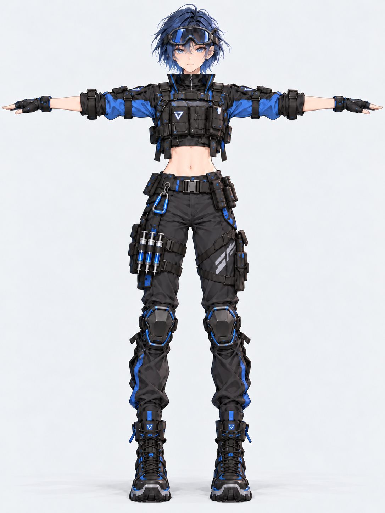 | 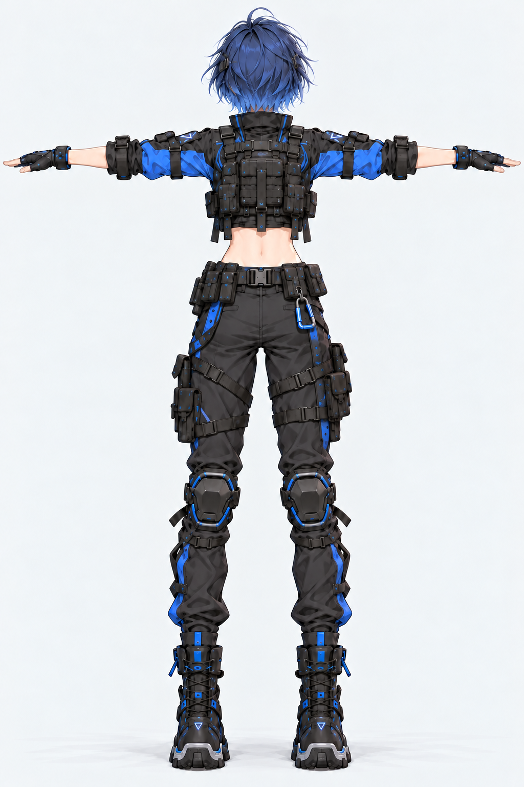 | 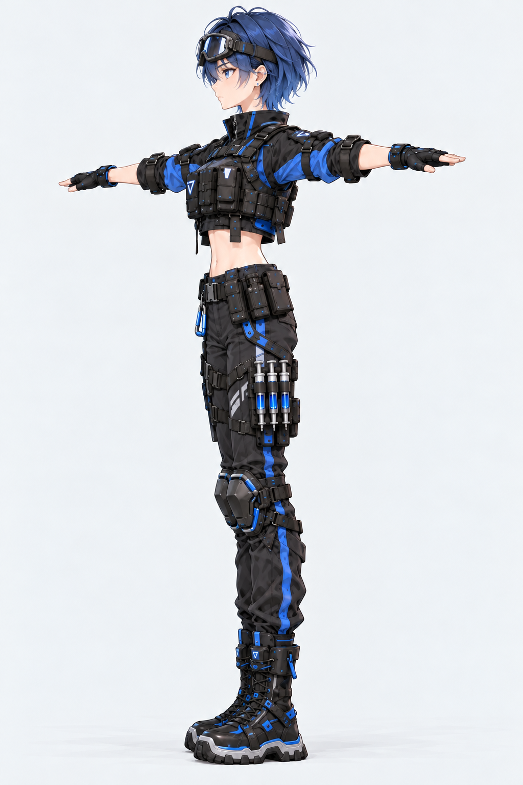 | 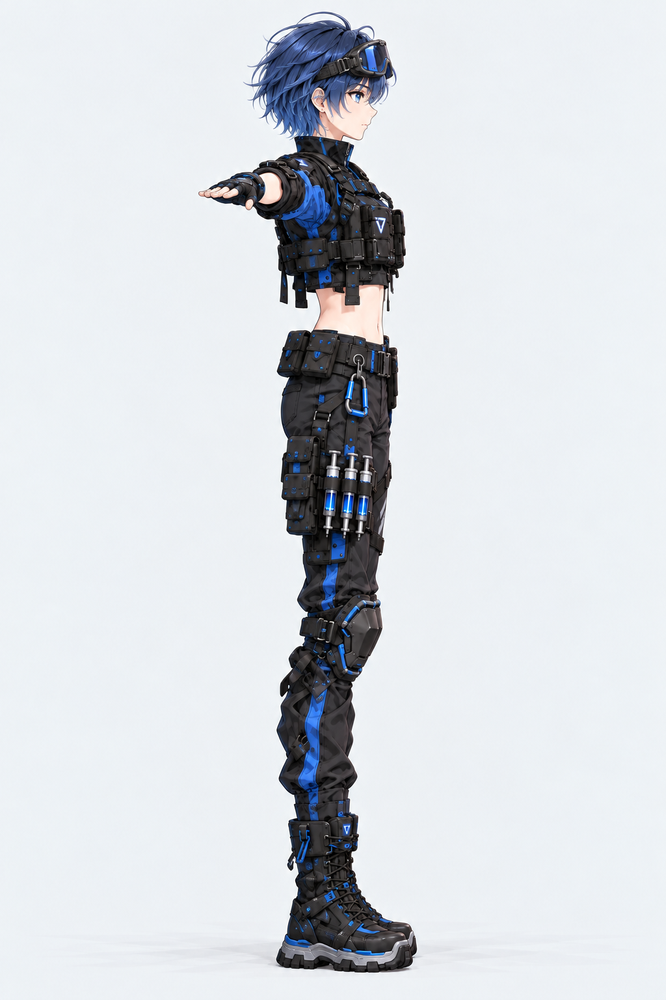 |

- **人物**：女性。青いショートヘア（毛先が軽く跳ねる）、青い瞳、額にゴーグル。クールで無表情寄り。
- **服装**：黒のテックウェア。ハイネックのクロップド丈ジャケット（袖に青いパネル）＋黒のプレートキャリア（胸に白い逆三角形のマーク）、腹部は露出。
- **下半身**：黒のカーゴパンツ（側面に青いライン、左太ももにグレーのロゴ風の模様）、黒い膝パッド（青い縁）、青いアクセントの黒い厚底コンバットブーツ。
- **装備**：腰のベルトに複数のポーチ、青いカラビナ。**右太もものホルダーに青い薬液の注射器3本**（オーバードライブの象徴。使うと1本ずつ減る見た目にしてもよい【仮】）。
- **手**：黒の指ぬきグローブ（青い差し色）。一人称視点の腕にもこのグローブと青いパネルの袖を表示する。
- **配色**：黒 #141418 を基調に、ロイヤルブルー #2f6bff、グレー #9aa0a8。
- **再現方法**：Blender でモデリングし、シルエットと配色（青い髪、クロップド丈＋露出した腹部、太ももの注射器、厚底ブーツ）を忠実に再現する。

**ソラ**

| 正面 | 背面 | 左側面 | 右側面 |
|---|---|---|---|
| 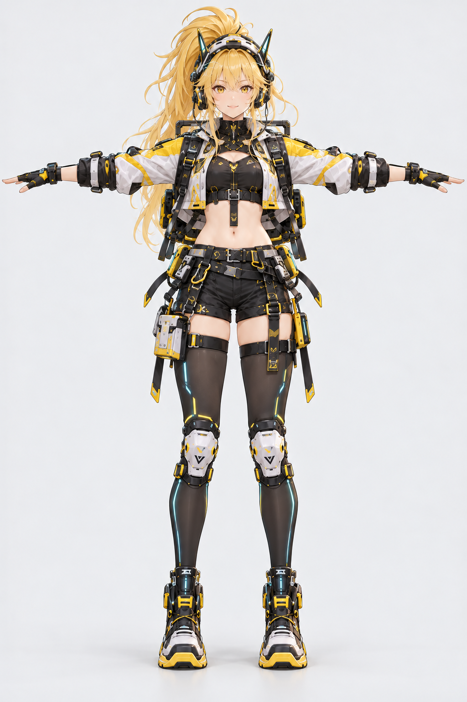 | 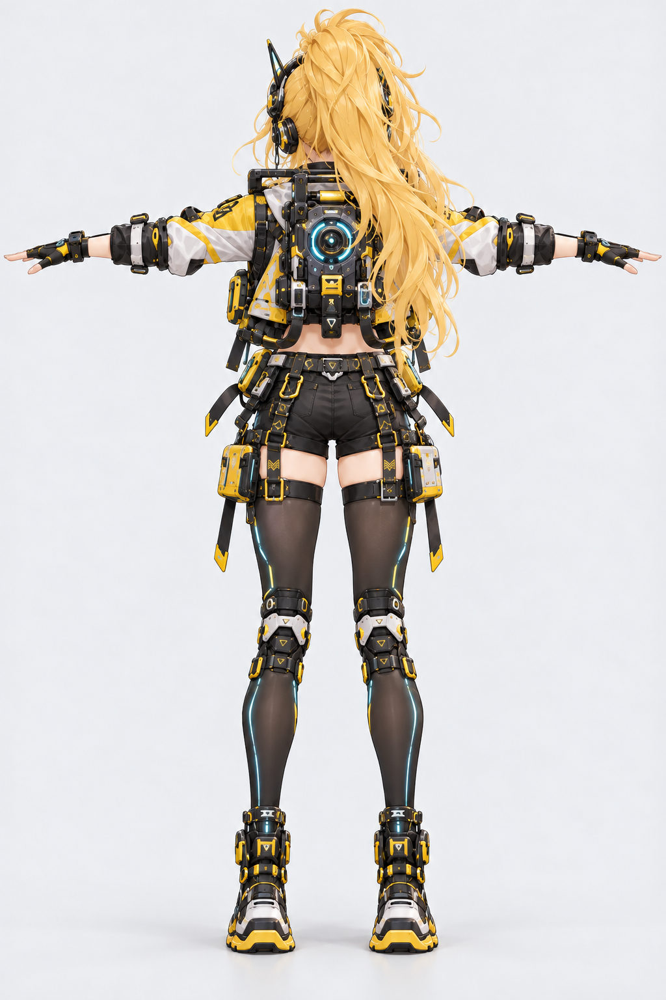 | 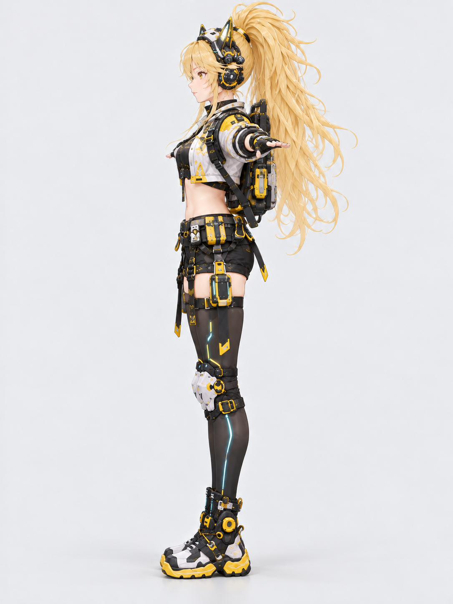 | 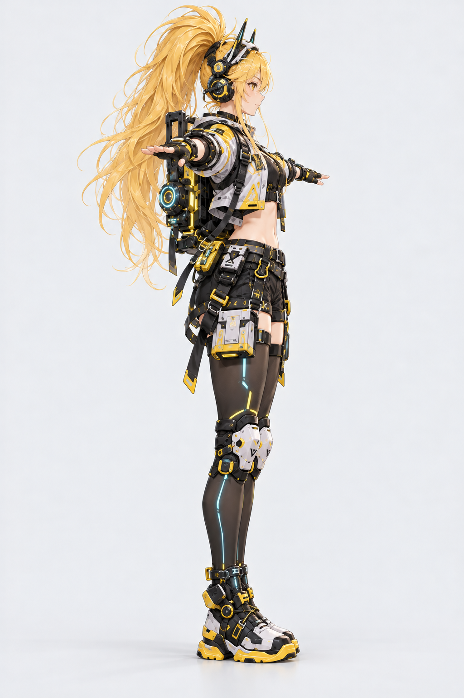 |

- **人物**：女性。金色の非常に長いハイポニーテール（腰まで届くボリュームのある髪）、金色の瞳、明るく穏やかな表情。
- **頭部**：白と黒の大型ヘッドセット。左右に獣の耳のような鋭いアンテナが立ち、内側が淡く光る（索敵役の象徴）。
- **服装**：白地に黄色と黒の模様が入ったクロップド丈ジャケット（袖口に黒と白の太いカフス）、中は黒のハイネックのクロップドトップ、腹部は露出。
- **下半身**：黒のショートパンツにハーネスと多数のストラップ（先端が黄色の矢印形）、腰と太ももに白黄色の小型ケース。黒のタイツ状のレッグスーツに**シアンに光るライン**、白い膝アーマー（逆三角形のマーク）、黄色と白の厚底ブーツ。
- **装備**：背中に黒と黄色の索敵ユニット（バックパック）。中央に**シアンに光る円形のレンズ**があり、パルスソナーはここから発信される演出にする（発動時にリングが強く光り、円形の波が広がる）。
- **手**：黒の指ぬきグローブ（黄色の差し色）。一人称視点の腕にもこのグローブと白黄色の袖を表示する。
- **配色**：白 #eceef0、黄色 #ffd21f、黒 #141418、発光部はシアン #4fe3ff。
- **再現方法**：Blender でモデリングし、シルエットと配色（長い金髪のポニーテール、アンテナ付きヘッドセット、背中の光るリング、白黄色のジャケット、光るラインの脚）を忠実に再現する。

**蘭丸**

| 正面 | 背面 | 左側面 | 右側面 |
|---|---|---|---|
| 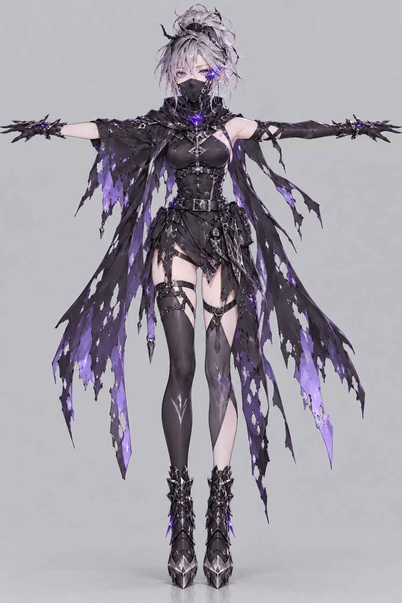 | 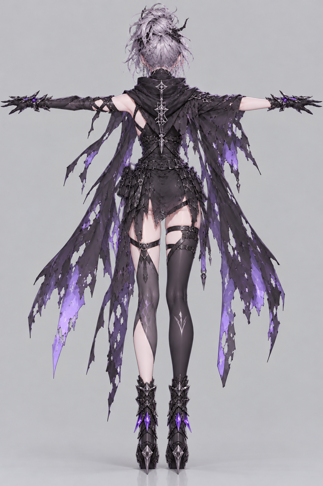 | 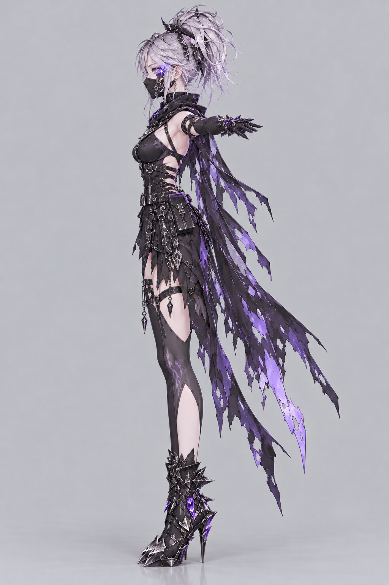 | 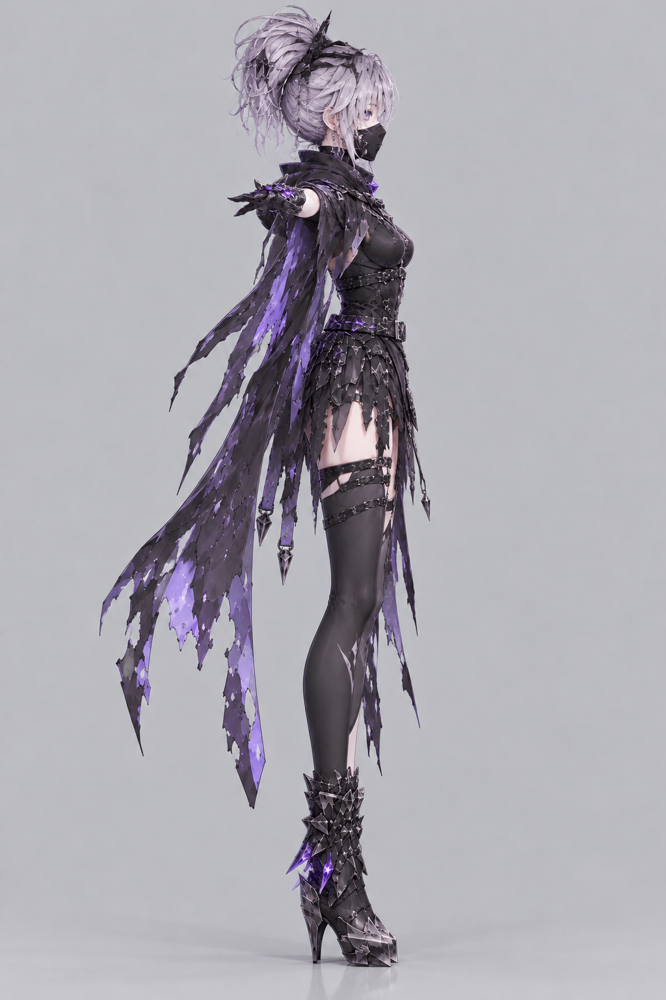 |

- **人物**：女性。銀髪を無造作に高くまとめたポニーテール（黒い装飾付きの髪留め）、紫の瞳、左目の下に紫に光る結晶状の模様。口元を黒いフェイスマスクで覆った、忍びのような雰囲気。
- **上半身**：黒のハイネックのボディスーツにベルトとストラップを交差させたハーネス、胸元に紫に光る結晶。肩から**ボロボロに裂けたフード付きの長いマント**を羽織り、マントの裂け目や裏地が紫に透けて光る（位相のずれを表す）。
- **下半身**：裂けた布を重ねた短いスカート状の腰布（金属の飾りと鎖、ひし形の飾りが垂れる）、腰にポーチ。黒のサイハイのレッグスーツ（片脚はスリット入り、銀の模様）、太ももにベルト。**とげ状の金属装甲を重ねたハイヒールブーツ**、足首に紫に光る結晶。
- **手**：黒のロンググローブ。手の甲から指先にかけて鋭い爪のような金属装甲、手首に紫の結晶。一人称視点の腕にもこのグローブを表示する。
- **配色**：黒 #141418、銀 #c8c8d0、紫 #8a5cff、発光部は明るい紫 #b48cff。
- **フェイズシフトの演出**：発動時、マントの裂け目から紫の破片が舞い、全身が紫の揺らぎに溶けるように半透明になる。終了時は破片が集まって実体に戻る。
- **再現方法**：Blender でモデリングし、シルエットと配色（銀髪のポニーテール、マスク、裂けたマント、とげ状のブーツ、紫に光る結晶）を忠実に再現する。マントは揺れるように簡単なアニメーションを付ける。

**ミランダ**

| 正面 | 背面 | 左側面 | 右側面 |
|---|---|---|---|
| 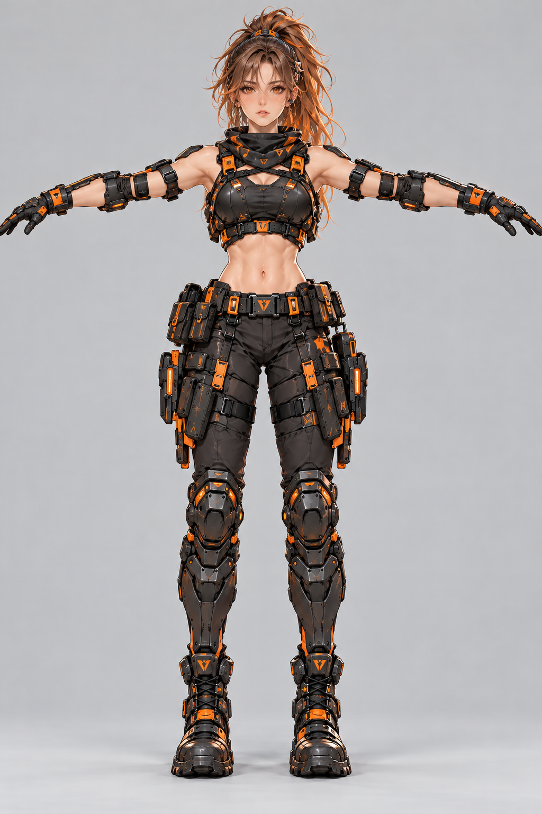 | 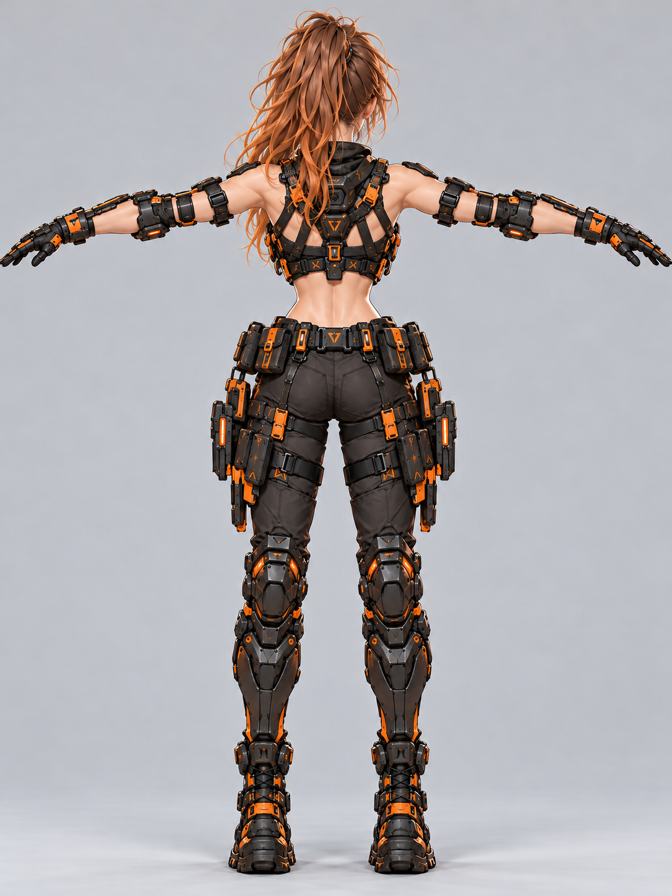 | 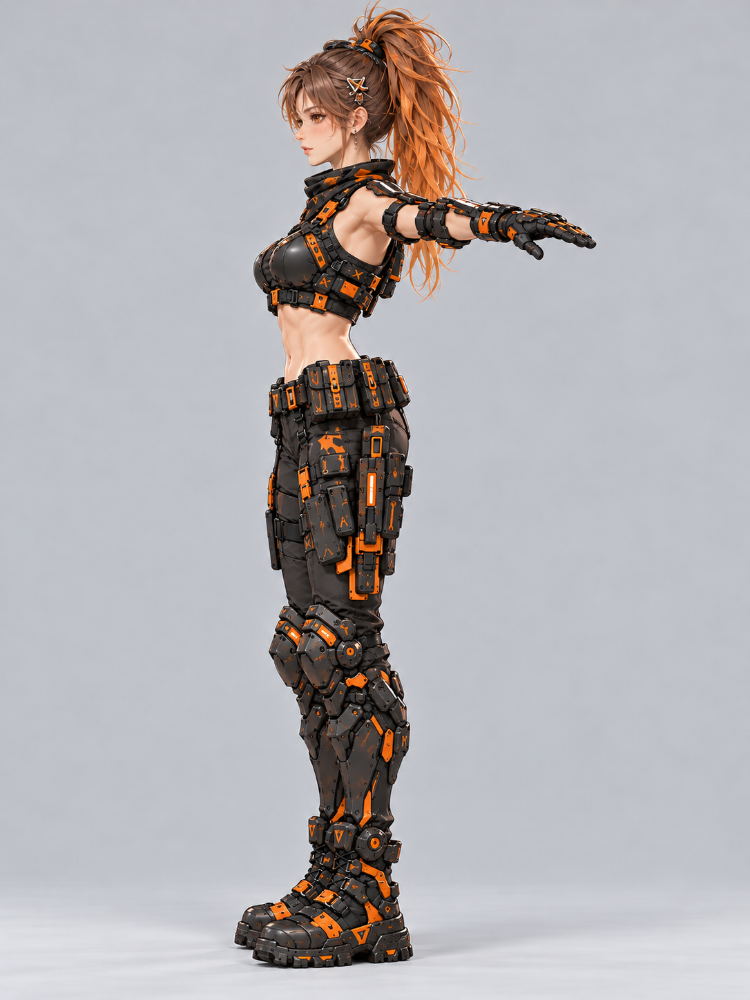 | 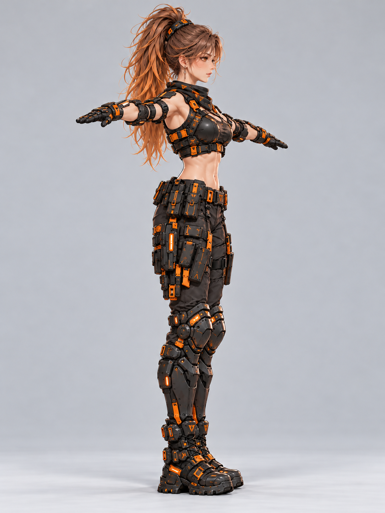 |

- **人物**：女性。茶色から毛先がオレンジに変わるロングヘアを高いポニーテールにまとめる（髪留めと星形のヘアピン）、琥珀色の瞳。引き締まった筋肉質の体つきで、落ち着いた頼れる表情。
- **上半身**：黒のスヌード（首元を覆う布）、黒のノースリーブのクロップドトップにオレンジの差し色が入ったハーネス。背中はストラップが交差するデザイン。腹部は露出。
- **腕**：二の腕・肘・前腕に分かれた黒い装甲バンド（オレンジの発光部）、黒とオレンジの装甲グローブ。
- **下半身**：腰に大量のポーチを並べたベルト、両太ももにオレンジに光るラインの入った大型ホルスター。焦げ茶のパンツの上から、**膝から足先までを覆う重厚な脚部装甲**（オレンジの差し色）、厚底のコンバットブーツ。
- **配色**：黒〜焦げ茶 #1c1714、オレンジ #ff7a1a、発光部は明るいオレンジ #ffa04a。
- **シールドウォールの演出**：両前腕の装甲を前に突き出すと、オレンジの六角形が組み合わさったエネルギーの壁が展開する。被弾した箇所が波紋のように光る。
- **再現方法**：Blender でモデリングし、シルエットと配色（茶とオレンジのポニーテール、露出した腹部、腕と脚の重厚な装甲、腰と太ももの多数のポーチ）を忠実に再現する。一人称視点の腕にも装甲バンドとグローブを表示する。

**パール**

| 正面 | 背面 | 左側面 | 右側面 |
|---|---|---|---|
| 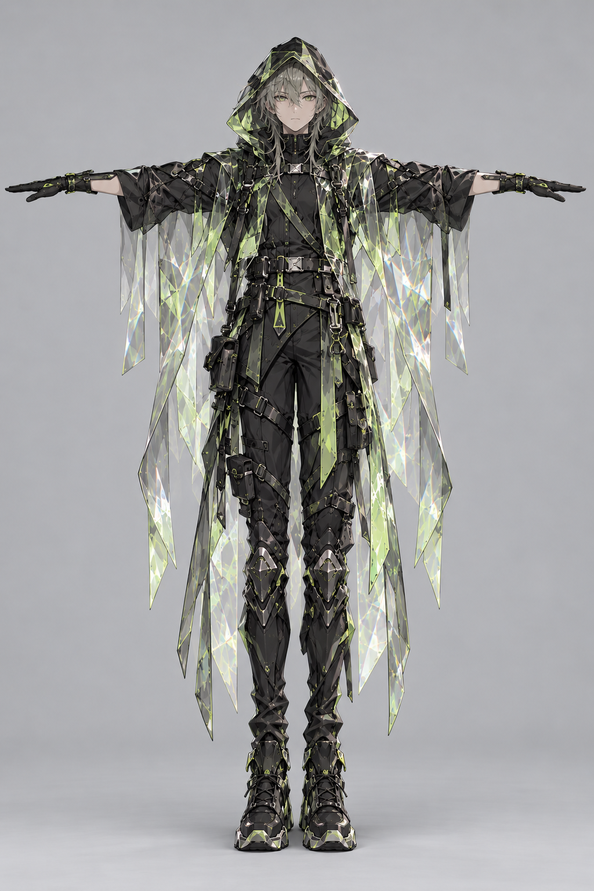 | 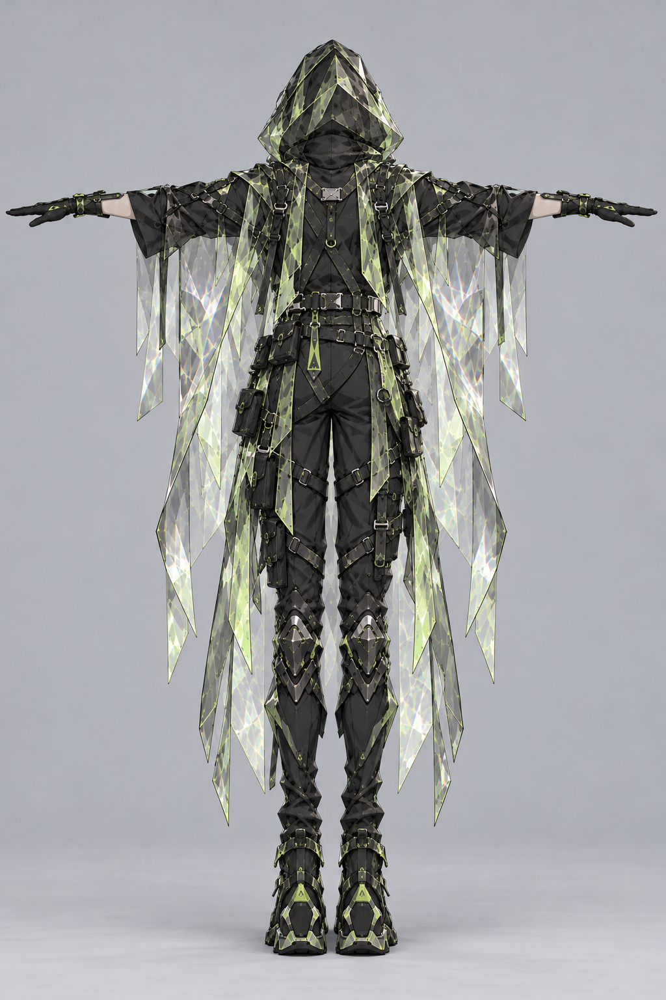 | 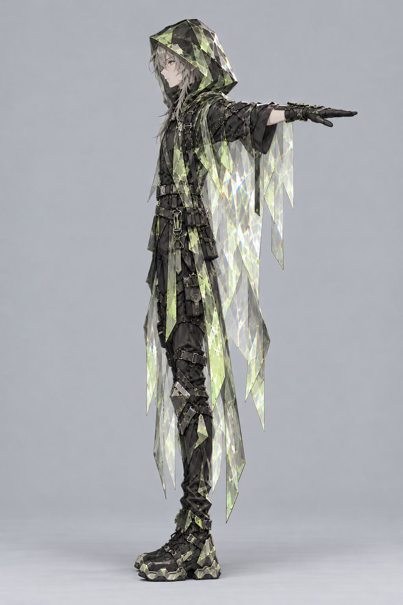 | 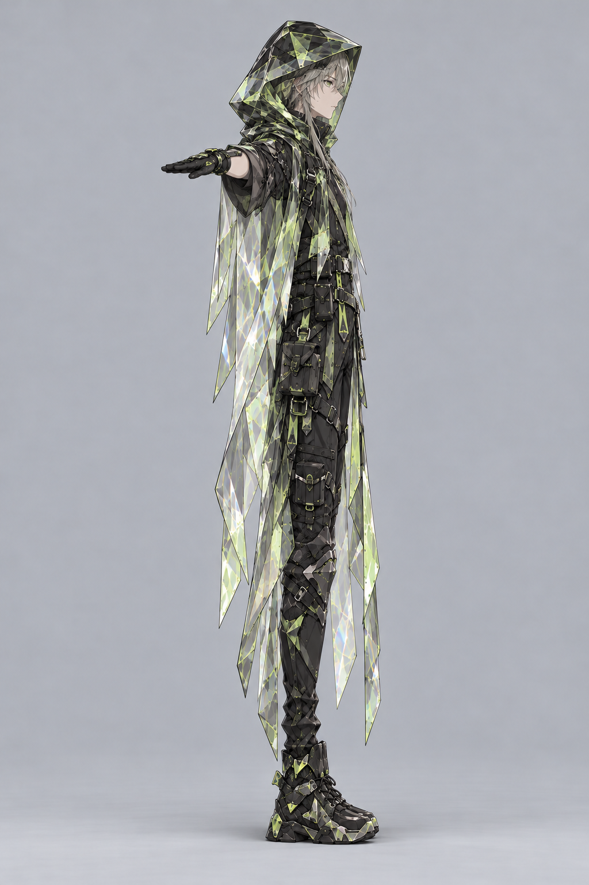 |

- **人物**：中性的な顔立ち。灰色がかった銀髪のロングヘア（前髪が目にかかる）、黄緑の瞳。無表情で物静かな雰囲気。
- **最大の特徴**：頭からすっぽり被る**透明な結晶片でできたフード付きの長いマント**。多面体のフードと、つららのように鋭く尖った半透明の破片が何枚も重なって足元近くまで垂れ下がる。破片はガラスのように透けて虹色に光を反射し、黄緑色の縁取りがある。
- **服装**：黒のハイネックの上下に、ベルトとストラップを全身に巻き付けたハーネス。胸元に銀のバックル、腰と太ももに複数の黒いポーチ、ところどころに黄緑の差し色。
- **手足**：黒の手袋（手首に黄緑のアクセント）。膝からすねにかけて菱形の銀の装甲、黒と黄緑の厚底ブーツ。
- **配色**：黒 #141418、黄緑 #b4e44a、銀 #c8c8d0、透明部分は虹色の反射。
- **光学迷彩の演出**：発動時、マントの結晶片がきらめき、その屈折が全身に広がって周囲の景色に溶け込む（背景が歪んで透けて見える）。解除時は結晶片が一瞬光って姿が戻る。
- **再現方法**：Blender でモデリングし、シルエットと配色（尖った多面体のフード、垂れ下がる半透明の結晶片のマント、黒い服と黄緑の差し色）を忠実に再現する。結晶片は半透明のマテリアルで作り、少し揺れるようにする。

**メイア**

| 正面 | 背面 | 左側面 | 右側面 |
|---|---|---|---|
| 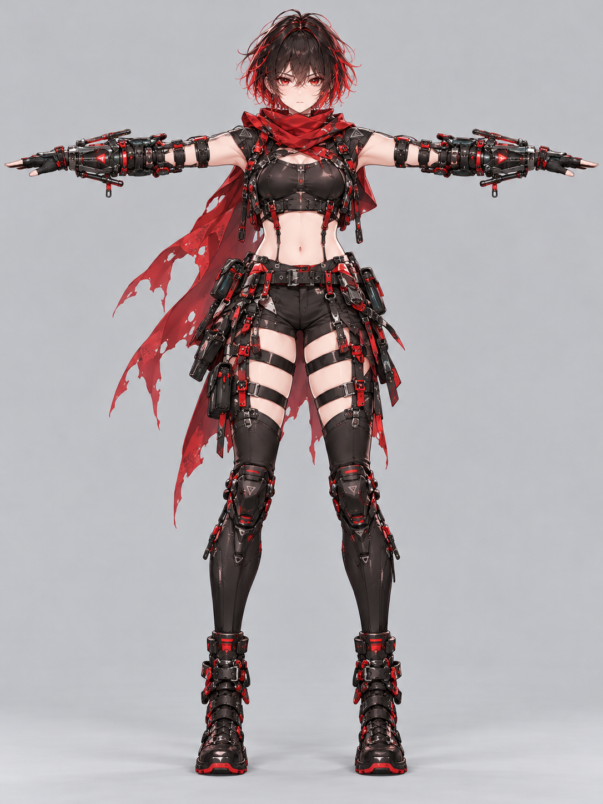 | 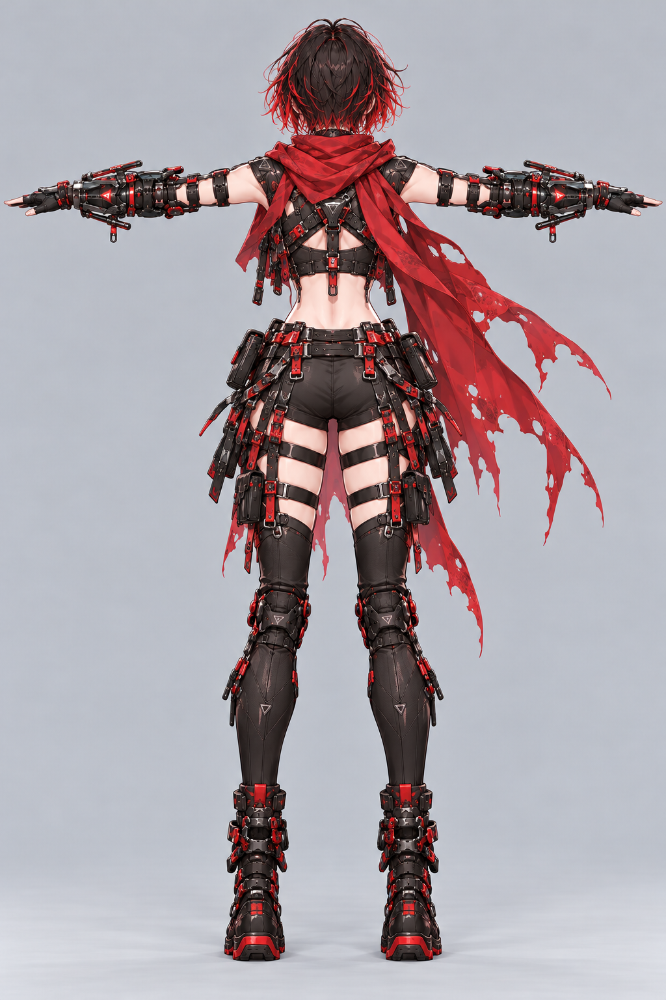 | 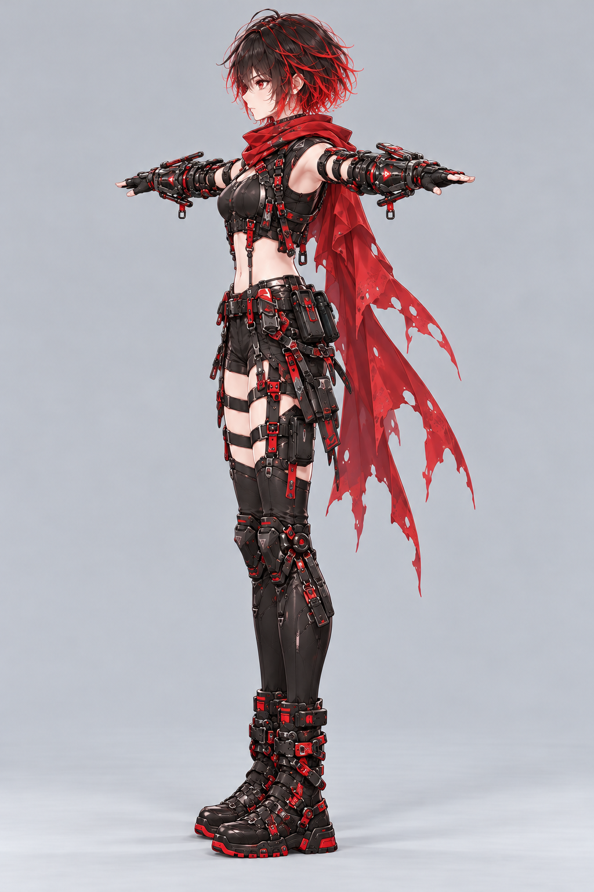 | 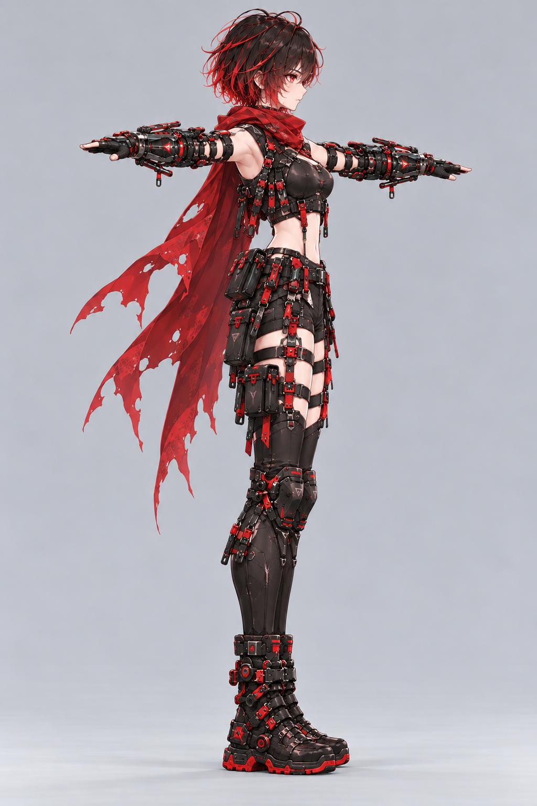 |

- **人物**：女性。黒髪のショートヘアで、毛先と内側に赤いメッシュが入る（無造作に跳ねた髪）、赤い瞳。鋭い目つきで、きりっとした表情。
- **首元**：**赤いスカーフ**を首に巻き、片側が背中へ長く流れる。スカーフの端はボロボロに裂けていて、半透明の赤い布がなびく（このキャラクターの目印）。
- **上半身**：黒のクロップドトップに赤い差し色のハーネス。背中はストラップが交差するデザイン。腹部は露出。
- **腕**：両前腕に**黒と赤の機械式ガントレット**。手首の上にシリンダーと射出口が付いており、ここからワイヤーフックを撃ち出す。黒の指ぬきグローブ。
- **下半身**：黒のショートパンツに、赤いバックルのサスペンダーと多数のポーチ。太ももにベルトを何本も巻き、黒のサイハイのレッグスーツ、膝に逆三角形マークの装甲、赤い差し色の厚底コンバットブーツ。
- **配色**：黒 #141418、赤 #e8202e、暗い赤 #8a1018、金属部はガンメタル #4a4d55。
- **ワイヤーフックの演出**：右腕のガントレットを前に突き出すと、射出口から赤く光るワイヤーが一直線に飛ぶ。刺さった先に向かって引き寄せられる間、スカーフが大きくなびく。一人称視点では、自分の右腕のガントレットとワイヤーが見えるようにする。
- **再現方法**：Blender でモデリングし、シルエットと配色（赤いメッシュの黒髪ショート、なびく赤いスカーフ、両腕のガントレット、黒と赤の装備）を忠実に再現する。スカーフは揺れるように簡単なアニメーションを付ける。

- ボットもキャラクターと能力を使う。
- 将来キャラクターを追加しやすいよう、キャラクターの定義（名前、アビリティ、パッシブ、数値、ボットの使用条件）をデータとして分離すること。

### 7.3 HUD
- 左下：体力ゲージ、キャラクターアイコン、アビリティのクールダウン表示、ブーストのゲージ（消耗戦）
- 右下：武器名、残弾／予備弾、グレネード（種類のアイコンと所持数。サッチェルを置いてあるときは「起爆」）
- 中央：照準（武器ごとに形状が変わる。ばらつきに応じて広がる）、ヒットマーカー（ヘッドショットは色が変わる）
- 上部：モード別情報
  - 消耗戦：両チームのスコア、残り時間
  - タイムアタック：経過タイム、残りターゲット数、ベスト記録との差
  - TD：ウェーブ数、コアの耐久値、残り敵数、次の侵入ルート、所持クレジット（アーマーを付けているときは「アーマー装備中」）
  - TD【フェーズ7で追加】：迫撃砲兵が据えたとき、画面の真ん中に「迫撃砲兵が陣取った（場所）」（10 秒に1度まで）。左上の侵入ルートの欄の下に「迫撃砲兵」の欄（場所・砲撃中か応戦中か・自分からの距離。近い順に3体まで、それより多ければ「ほかに N 体」）。ウェーブ中は、侵入ルートの欄の「降下ポッド」の行を出さない（欄を短くするため）
  - TD【フェーズ7で追加】：据えた迫撃砲兵の頭の上に「迫撃砲」の札（場所・距離。壁越しにも見える。砲撃中は四角が点滅）
- 右上：キルログ
- 左上：ミニマップ（消耗戦・TD）。自分を中心に、向いている方向が上になるように回る。範囲内の味方の位置（パイロットは向きの分かる矢印、歩兵は点）、銃を撃った敵の位置（撃った場所に赤い点が約2.5秒出て消える。ソナーで見えている敵は見えている間）。TD ではコア（範囲外なら縁）、タレット、設置物（小さなひし形）、大型兵器、ダウンした味方、侵入ルート、据えた迫撃砲兵（橙の四角。範囲外でも縁に出す。撃つたびに輪が広がる）も出す。M キーで広い範囲に切り替える
- 被弾方向インジケーター（赤い弧）
- TDでは味方（ボット含む）の名前・キャラクター・体力と位置を壁越しに表示。ダウンした味方は目立つアイコンと残り時間を表示

### 7.4 見た目・演出
- アートスタイル：アニメ調のキャラクター（7.2.2 の参考画像の雰囲気）と、質感重視の背景。発光マテリアルとブルーム処理でネオンを強調。
- 移動速度が上がると画面の端に流れる線（スピードライン）と FOV がわずかに広がる演出。
- 壁走り中のカメラの傾き、着地時の軽い揺れ、スライディング時の視点の低下。
- 銃口の閃光、弾の軌跡（曳光弾）、着弾の火花、敵を倒した時の消滅エフェクト。
- 敵味方の見分け：味方（パイロット・歩兵）は輪郭を少し青くハイライトし、敵は赤い縁取り。名札も味方は青、敵は赤。
- キャラクターごとにテーマカラーを持たせ、ボットや味方の見た目・アビリティのエフェクトに使う【仮】：メイア=赤、パール=黄緑、ミランダ=オレンジ、ソラ=黄色、アレックス=ロイヤルブルー、蘭丸=紫。

### 7.5 サウンド

| 場面 | 音 |
|---|---|
| 各武器の射撃音 | 種類ごとに音程・長さを変える（Web Audio API で合成） |
| 足音・壁走り・着地・スライディング | 摩擦音・低い衝撃音 |
| ヒット／キル | 短い高音の確認音 |
| アビリティ発動 | キャラクターごとに異なる電子音 |
| TD：ウェーブ開始・コア被弾警告・味方ダウン | サイレン、警告音 |
| TD：迫撃砲兵【フェーズ7で追加】 | 据える（ガシャン・カチッ）、発射（こもった低いドンと、上がっていく風の音。遠くまで届く）、落ちてくる砲弾の風切り音（着弾の 1.4 秒前、落ちる所で）、着弾の爆発音。陣取ったときの警告音 |
| BGM【仮】 | なし（将来追加） |

- 3D音響（音源の方向と距離で音量・左右が変わる）。

### 7.6 ロードアウト制

将来のオンラインマッチを見据えて、**試合の前（マッチングの前）に、使うキャラクター・装備する武器・武器のカスタマイズを決めておき、それを持ってマッチングする「ロードアウト制」**にしていく。消耗戦もタワーディフェンスも同じ仕組みにする。

- **ロードアウト**＝「キャラクター 1 人＋メイン武器＋サブ武器＋それぞれの武器のカスタマイズ＋グレネード 1 つ（「7.1.1」参照）＋ブースト 1 つ（消耗戦で使う。「5.1.1」参照）」の組み合わせ。名前（12 文字まで）を付けて、**5 枠**保存しておける。
- **設定する場所**：メインメニューの「ロードアウト」。5 つの枠が並び、押した枠が「使用中」になる。使用中の枠の名前・キャラクター・武器を変えられ、変えた内容はすぐ保存される（ブラウザに保存）。「最初の組み合わせに戻す」で、その枠を初めの状態に戻せる。
- **最初から入っている 5 つ**【仮】：1「突撃」メイア／ストラタ（ホロ・コンペンセイター・クイックストック）＋ブリーチャー（レッドドット・ガンランナー）、2「狙撃」パール／ゼニス（可変スコープ・サプレッサー・拡張マガジン）＋ワスプ（レッドドット・レーザー）、3「防衛」ミランダ／ブルワーク（2倍・拡張マガジン・コンペンセイター）＋ブリーチャー（アイアン・レーザー）、4「索敵」ソラ／ストラタ（スレット・ロングバレル）＋ワスプ（ホロ・サプレッサー・クイックリロード）、5「奇襲」蘭丸／ワスプ（レッドドット・サプレッサー・ガンランナー）＋ブリーチャー（ホロ・クイックストック・レーザー）。グレネードは順に、フラグ・スモーク・サッチェル・アーク・グラビティスター。ブーストは順に、フェイズリワインド・ホロパイロット・ハードカバー・マップハック・ティック。
- 武器を選ぶ所には、武器種ごとの見出しの下に 2 丁ずつ並べ、カードに名前・短い名前・有効距離・一言の説明（`BRIEF`）を出す。右には威力・連射・射程・装弾数などの目安と、一言の説明・詳しい説明（`config/weapons` の `RANGE`・`BRIEF`・`DESC`）を出す。メインとサブに同じ武器は選べない（もう一方と同じ武器を選ぶと、入れ替わる）。
- **武器のカスタマイズ**：武器ごとに **サイト 1 つ** と、**アタッチメントを 2 つまで** 付けられる（タイタンフォール 2 の「サイト＋アタッチメント＋MOD」、ほかの有名な FPS のアタッチメントを参考にした）。武器ごとに付けられる物が決まっている（`config/weapons.json` の SIGHTS・ATTACHMENTS）。効き目の数値は `config/attachments.json`【仮】。
  - **サイト**：アイアンサイト（照門と照星）／レッドドット（等倍）／ホロサイト（約 1.5 倍）／2倍スコープ／3倍スコープ（距離の目盛り付き）／スレットスコープ（約 1.6 倍。のぞくと、見えている敵が赤く浮かび上がる）／スナイパースコープ（狙撃銃。画面いっぱい）／可変スコープ（狙撃銃。4 倍と 8 倍をホイールで切り替え）。倍率が高いほど、のぞく時間が長く、視界はせまい
  - **アタッチメント**：拡張マガジン（装弾数 ×1.4）／クイックリロード（リロード ×0.7）／サプレッサー（敵のミニマップに映らず、聞こえる距離が 1/3。射程は少し短く）／コンペンセイター（反動 ×0.65）／クイックストック（エイム・持ち替え ×0.7）／レーザーサイト（腰だめのばらつき ×0.6）／ガンランナー（走りながらでも撃てる。撃ってもダッシュが止まらない。ハンドガンには付けられない）／ロングバレル（射程 ×1.3、エイムが少し遅い）。銃口に付ける物（サプレッサー・コンペンセイター）は 1 つまで
  - 付けた物は、一人称の武器の見た目にも付く（サイトのモデル、銃口の部品、レーザー、長い弾倉、弾倉の引き手）。光学サイトをのぞくと、照準が画面の中央（サイトのレンズの中）に出る
  - カスタマイズは武器ごとに覚えておく（メイン武器を替えて元に戻すと、前の付け方に戻る）
  - **ボット**（消耗戦の両チームのパイロット、タワーディフェンスの味方）も、付けられる物からランダムにサイトとアタッチメントを付ける（サイトは 3 割ほどが最初のまま、アタッチメントは 2 つが多い）。三人称の武器にも、付けた物がモデルで見える。歩兵・タワーディフェンスの敵は付けない
- **流れ**：メインメニュー → モードを選ぶ → ロードアウトを選ぶ（その場で編集もできる）→ マッチング（オンラインのとき）→ 試合。リザルトの「もう一度」は同じロードアウトで続ける。
- ロードアウトは、キャラクターの定義・武器の定義と同じく**データとして扱い**、試合を始めるときにゲームのロジック（`shared/`）へ渡す。オンラインでは、マッチングのときにサーバーへ送り、サーバーが正しい組み合わせか（存在するキャラクター・武器・付けられるアタッチメントか）を確かめる。
- ロードアウトのデータの形と確かめ方は `shared/loadout.ts`（`checkLoadout`：存在するキャラクター・武器か、同じ武器が 2 つでないか、名前が決まりどおりか、カスタマイズがその武器に付けられる物か・2 つまでか・銃口の部品が重なっていないか。カスタマイズの確かめ方は `shared/weaponCustom.ts`）。オンラインでは、サーバーがこれで確かめる。
- 試合中にロードアウトを変えられるか（復活するときに選び直せるか）は未定（いまは変えられない）。
- 練習モード（オフライン）では、これまでどおり一時停止画面でも自由に変えられる（使用中の枠が書き換わる）。

---

## 8. 調整用パラメータ一覧（移動）

*（数値はすべて【仮】。単位は m と秒。`config/movement` にまとめる）*

| パラメータ名 | 値 | 説明 |
|---|---|---|
| WALK_SPEED | 5.0 | 歩きの速度 m/秒 |
| SPRINT_SPEED | 8.0 | ダッシュ速度 |
| SLIDE_BOOST | 3.0 | スライディング開始時の加速量 |
| SLIDE_FRICTION | 4.0 | スライディング中の減速 |
| SLIDE_COOLDOWN | 1.0 | スライディングの再使用待ち |
| JUMP_VELOCITY | 6.0 | ジャンプ初速 |
| DOUBLE_JUMP_VELOCITY | 6.0 | 2段ジャンプ初速 |
| GRAVITY | 18.0 | 重力加速度 |
| AIR_CONTROL | 0.3 | 空中での方向転換のしやすさ（0〜1） |
| WALLRUN_MIN_SPEED | 5.0 | 壁走り開始に必要な水平速度 |
| WALLRUN_SPEED | 9.0 | 壁走り中の速度 |
| WALLRUN_MAX_TIME | 1.8 | 壁走りの最大継続時間 |
| WALLRUN_GRAVITY_SCALE | 0.15 | 壁走り中の重力倍率 |
| WALLJUMP_VELOCITY | 7.0 | 壁から跳ぶ時の速度（壁から離れる方向＋上方向） |
| CAMERA_TILT_WALLRUN | 12 | 壁走り中のカメラの傾き（度） |

---

## 9. 受け入れ条件（全体の完成チェックリスト）

- [ ] `npm install` → `npm run dev` でブラウザから遊べる
- [ ] 「3. 操作方法」の操作がすべて機能する
- [ ] 壁走り → 壁ジャンプ → 2段ジャンプ → スライディングが途切れず繋がり、勢いが維持される
- [ ] 5種類の武器が仕様の違い（連射・装弾数・距離減衰・ADS）を感じられる
- [ ] 6キャラクターの能力がすべて機能し、ボットも使う
- [ ] 蘭丸のフェイズシフト中は、あらゆるダメージを受けない
- [ ] 消耗戦がボットとの対戦で最初から最後まで遊べる
- [ ] タイムアタックでタイムが計測・保存され、ペナルティが加算される
- [ ] タワーディフェンスをプレイヤー＋味方ボット3体で最後まで遊べる（ボットがタレット設置・ルート防衛・蘇生を行う）
- [ ] 【フェーズ7で追加】迫撃砲兵が降下地点から据える所（少し高い所）へ上り、コアを砲撃する。据えた迫撃砲兵は札・欄・ミニマップでわかり、近づいて倒せる。味方のボットも倒しに行く
- [ ] 【フェーズ7で追加】マップに据え付けのジャンプパッドがない（購入メニューのジャンプパッドは使える）
- [ ] ゲームロジックが描画から分離されており、プレイヤーとボットが同じ入力コマンドで動いている
- [ ] 2つのマップが参考画像の雰囲気（配色・構造・時間帯）を再現している
- [ ] 一般的なPCで 60fps 前後を維持する
- [ ] コンソールにエラーが出ない

---

## 10. 対象外（今回は作らないもの）

- オンラインマルチプレイ全般（消耗戦の対人戦、タワーディフェンスの協力プレイ）。ただし将来対応できる設計にはする
- 巨大ロボットへの搭乗
- アカウント、オンラインランキング、課金
- スマートフォン・ゲームパッド対応
- ストーリーモード
- キャラクターのアルティメット（必殺技）アビリティ

## 11. 将来追加したい要素（メモ）

- タワーディフェンスのオンライン協力プレイ（最大4人。「5.3.4」参照）
- 消耗戦のオンライン対戦
- キャラクター・武器・マップの追加
- キャラクターのアルティメットアビリティ
- タイムアタック専用のコース（今はネオン都市の中のコース。「5.2」参照）。コースを複数にして選べるようにする
- BGM
- 武器の追加（「11.1」参照。最初の 6 つは実装した）

### 11.1 武器の追加の案（最初の 6 つは実装済み。「7.1」参照）
まずは今ある6つの武器種（アサルトライフル・サブマシンガン・ライトマシンガン・ショットガン・スナイパーライフル・ハンドガン）の中で、遊び方の違う武器を足す。数値は今の武器（例：AR は 1発25・600発/分・弾30）にそろえた仮の値。今の撃つ・弾・リロード・アタッチメントの仕組みのまま作れる（新しい動きは、3点射と回転式 LMG の「回り始め」だけ）。

| 武器種 | 案 | 数値の案【仮】 | 違い |
|---|---|---|---|
| アサルトライフル | バーストライフル | 3点射 28×3・1回ごとに0.33秒・弾24・射程 30〜70m | 3発とも当てれば強い。腕の差が出る中距離の銃 |
| アサルトライフル | バトルライフル | 34・430発/分・弾20・反動 大きめ | 1発が重いフルオート。少ない弾で倒せる |
| サブマシンガン | 高速連射SMG | 13・1300発/分・弾40・腰だめ精度が良い | 至近距離なら一番速く倒せる。少し離れると急に弱い |
| サブマシンガン | 精密SMG | 21・650発/分・弾30・射程 15〜35m・反動 小さい | SMG の中では遠くまで当たる。AR との間 |
| ライトマシンガン | 回転式LMG | 20・400発/分から、撃ち続けると1.2秒で950発/分・弾90 | 撃ち始めは弱く、回り切ると最強。待ち伏せ・TD の防衛向き |
| ライトマシンガン | 重機関銃 | 30・480発/分・弾60・エイム 0.45秒・射程 40〜90m | 遠くまで威力が落ちない。持ったときの動きは一番遅い |
| ショットガン | フルオートショットガン | 7×8・240発/分・弾10（箱型）・リロード 2.6秒 | 1発は弱いが続けて撃てる。TD の突撃兵の群れに強い |
| ショットガン | ダブルバレル | 13×10 を2連発（0.12秒あけて）・弾2・リロード 1.6秒 | 2発とも当てれば至近距離はほぼ一撃。外すと何もできない |
| スナイパーライフル | マークスマンライフル | 55（頭 1.8倍）・200発/分の半自動・弾10・最初のサイトは2倍 | 連射できる狙撃銃。体2発＋頭1発、または頭2発で倒せる |
| スナイパーライフル | 対物ライフル | 120（体でも一撃）・30発/分・弾4・持ち替えとエイムが遅い・撃つと大きく揺れる | 当てれば必ず倒せる。外したときの隙が一番大きい |
| ハンドガン | リボルバー | 65（頭 2倍）・110発/分・弾6・リロード 2.2秒 | 1発が重い。体に2発で倒せる |
| ハンドガン | 機関拳銃 | 14・1100発/分（フルオート）・弾24・リロード 1.4秒 | ハンドガンと同じく走りながら撃てる。至近距離で弾をばらまく |

- 最初は1種類につき1つ、計6つを足す案：バーストライフル・精密SMG・回転式LMG・フルオートショットガン・マークスマンライフル・リボルバー。→ **実装した**（トライデント・ニードル・サイクロン・テンペスト・ファルコン・ガベル。名前は固有のものにし、もとの 6 丁にも固有の名前を付けた。ロードアウトの武器選びは武器種ごとの見出しで並べる）
- 武器が増えるので、ロードアウトの武器選びは、まず武器種を選び、その中の武器を選ぶ形にする案。
- どの武器も Blender でモデルを作り、サイト・銃口・レーザー・弾倉を付ける所を用意する。一人称の持ち方・射撃音・付けられるサイトとアタッチメント・ボットが好む距離と装備の組み合わせ・テストも足す。
- 決まったこと：名前は独自のもの。ロードアウトの武器選びは、1 つの画面で武器種ごとの見出しの下に並べる。

その次の候補（新しい仕組みが要る、タイタンフォールらしい特徴のある武器）：

| 武器 | 枠 | 特徴 | 作るのに必要なこと |
|---|---|---|---|
| チャージライフル | メイン | 押し続けて約0.8秒ためると、ビームで90ダメージ。体を貫通し、1列に並んだ敵に当たる。TD の重装兵の盾を抜ける | ためる時間とゲージ、ビームの見た目、貫通の判定 |
| エネルギーLMG | メイン | リロードがなく、撃ち続けると熱がたまる。限界を越えると2秒ほど撃てない | 熱のゲージ、熱くなる見た目と音 |
| グレネードランチャー | メイン | 弾が放物線で飛び、当たった所で爆発（範囲 3.5m）。TD で群れに強い | グレネード・ロケットの仕組みを使う。弾の軌道の見た目 |
| スマートピストル | サブ | 照準の円の中の敵に自動で印を付けて撃つ（歩兵は1つ、パイロットは3つで必ず当たる） | 印の判定と表示、ボットの使い方 |
| 対物ライフル（弾が飛ぶ型） | メイン | 弾が飛ぶのに時間がかかり、遠いほど下に落ちる | 弾が飛んでいく仕組み、落ちる分の照準の目盛り |
| 対装甲ランチャー | サブ | ロックオンして撃つ追尾ロケット。ドローン・重装兵・大型兵器に大ダメージ。人にはロックできない | ロックオンの表示、追尾ロケット（TD のロケットを使う）。消耗戦でも持てるかは未定 |

---

## 12. 実装フェーズ

各フェーズを1回ずつ依頼し、受け入れ条件を確認してから次へ進む。

| フェーズ | 内容 | 受け入れ条件 |
|---|---|---|
| 1. 移動の土台 | プロジェクト作成、ロジック層と描画層の分離、入力コマンドの仕組み、テスト用の箱だけの部屋、一人称視点、4. の移動アクションすべて、`config` の仕組み | 壁走り・2段ジャンプ・スライディングが気持ちよく繋がる |
| 2. 射撃 | 5種類の武器（Blender でモデル作成）、ADS、リロード、射撃の的、HUD の武器表示 | 武器ごとの違いがわかる。的に当たり判定がある |
| 3. キャラクター | 6キャラクターの能力、選択画面、キャラクター定義データ、Blender での6キャラクターのモデル・アニメーション・一人称用の腕モデル | 6つの能力が機能する（テスト部屋に動く的を置いて確認） |
| 4. ネオン都市マップ | 6.1 のマップ制作（建物・小物は Blender で作成）、ライティング、ブルーム、ボット用経路データ | 参考画像の雰囲気が出ており、壁走りで建物間を移動できる |
| 5. タイムアタック | コース、ターゲット、計測、記録保存、ゴースト | 5.2 の仕様どおり最後まで遊べる |
| 6. 消耗戦 | ボットAI（パイロット・歩兵、アビリティ使用含む）、チーム、スコア、リスポーン、メニュー一式 | 5.1 の仕様どおり最後まで遊べる |
| 7. 軍事要塞マップ＋TD | 6.2 のマップ（Blender で作成）、敵・タレットのモデル、敵の種類、ウェーブ、タレット、コア、味方ボット3体（5.3.2）、ダウンと蘇生 | プレイヤー＋ボット3体で10ウェーブ遊べる |
| 8. 仕上げ | サウンド、演出、設定画面、パフォーマンス調整 | 9. の受け入れ条件をすべて満たす |

### 依頼文の例
```
添付の game-spec.md を読んで、「12. 実装フェーズ」のフェーズ1だけを実装してください。
```

---

## 13. 変更履歴（フェーズ7）

| 変更 | 内容 | 仕様の場所 |
|---|---|---|
| マップを広げ、敵を降下ポッドで降ろす | プレイできる範囲を 264m × 208m に広げ、要塞の外に前哨陣地・コンテナ置き場・崩れた壁・見張り台を置いた。地上の敵は降下ポッドで、外・防壁の上・屋上・要塞の中に降りてくる。ウェーブの敵を約 1.4 倍にした | 5.3・5.3.6・6.2 |
| 据え付けのジャンプパッド（追加 → 取りやめ） | 一度 14 か所に置いたが、ご依頼により取りやめた。マップには置かない（購入メニューのジャンプパッドはそのまま）。外の見張り台はコンテナの階段から上る | 5.3.7・6.2 |
| 迫撃砲兵を追加 | 第3ウェーブから。降りると少し高い所（前哨陣地の屋上・砲撃陣地・テラス・防壁の上など）へ上って迫撃砲を据え、コアを砲撃し続ける。近づいたパイロットには拳銃で応戦。味方のボットは倒しに行く | 5.3.3・5.3.8・5.3.2 |
| 迫撃砲兵のためのマップの変更 | 砲撃陣地を4か所作った。前哨陣地の外の階段を壁に付け、テラスへの坂を広げて縁に胸壁を付けた | 6.2 |
| 経路の決まりの見直し | 歩くつながりを細かく調べるようにし、坂の横から落ちたとき・胸壁で止まったとき・何度も失敗したときの動きを直した（味方のボットにも効く） | 5.3.9 |
| 画面・音 | 迫撃砲兵の知らせ・欄・札・ミニマップの印、落ちる所の赤い輪、発射・風切り・着弾の音 | 7.3・7.5 |
| 同じ壁での壁走り | 同じ壁でも一度離れたあとはまた壁走りできるようにした（離れて 0.3 秒たってから、離れたときの高さ以下で。張り付き直すと上向きの勢いがなく、すぐゆっくり落ち始める） | 4.3 |
| キャラクターの顔の絵 | キャラクター選択などに出す顔の絵を、新しいイラストから顔のまわりを切り抜いたものに差し替えた | 7.2.2 |
| 6人の全身のモデルを差し替え | メイア・パール・ミランダ・ソラ・アレックス・蘭丸の全身のモデルを、テクスチャ付きのモデル（Tripo で作成）に差し替えた。ゲームと同じ骨・動きを付けて書き出す（build_imported.py）。キャラクター選択・消耗戦・TD・タイムアタックのゴーストで使う | 7.2.2 |
